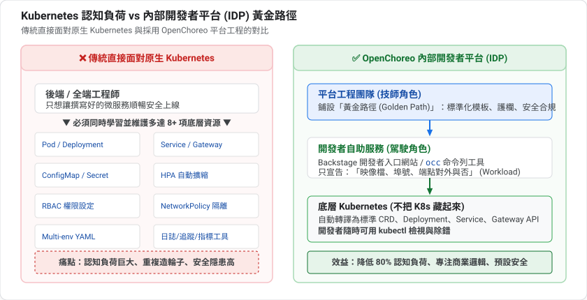
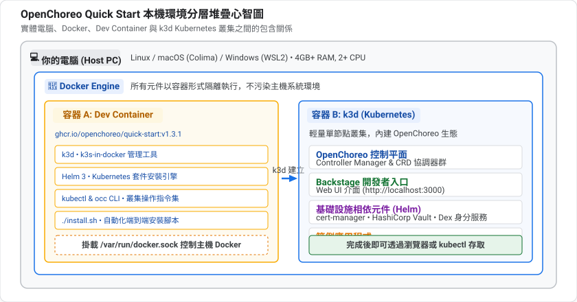
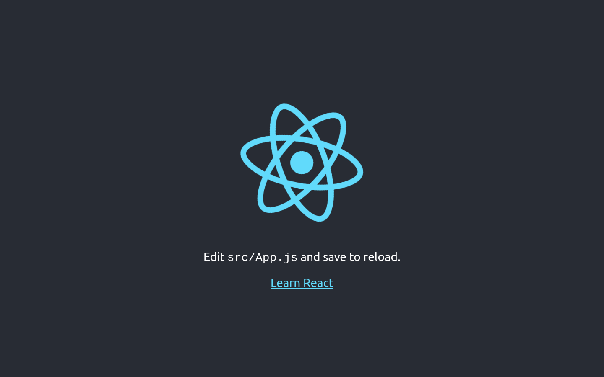
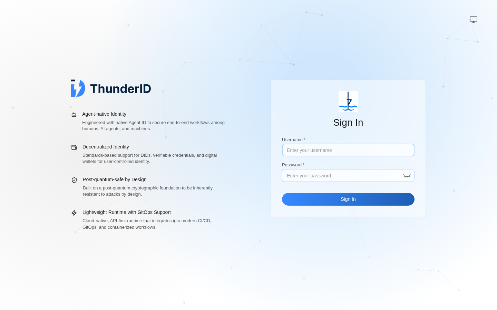
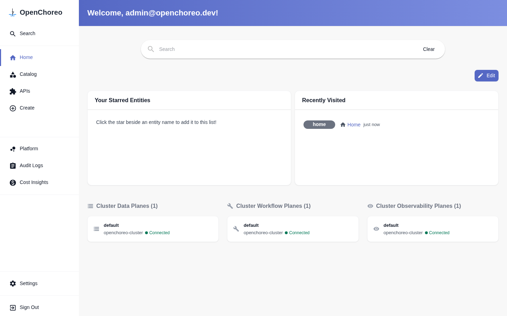

summary: 用 Docker 在本機 5 分鐘跑起 OpenChoreo,部署範例應用並登入開發者入口網站
id: openchoreo-01-quickstart
categories: openchoreo,kubernetes,platform-engineering
environments: Web
status: Published
feedback link: https://github.com/openchoreo/openchoreo/issues
author: 雷N

# OpenChoreo 實戰 01:5 分鐘跑起 OpenChoreo

## 開始之前
Duration: 3

### 什麼是 OpenChoreo?

[OpenChoreo](https://openchoreo.dev/) 是 CNCF Sandbox 的開源 **內部開發者平台(Internal Developer Platform, IDP)**,建立在 Kubernetes 之上。它在 Kubernetes 上加一層對開發者友善的抽象,但不把 Kubernetes 藏起來。內建:

* 以 Backstage 為基礎的開發者入口網站
* `occ` 命令列工具與 API
* CI/CD、GitOps、可觀測性
* RBAC 與多租戶邊界

### 本系列路線

| 課程 | 主題 |
|---|---|
| **01(本篇)** | 本機安裝與初體驗 |
| 02 | 架構與核心概念 |
| 03 | 部署你的第一個 Component |

### 你會學到

* 用官方 Quick Start 容器在本機建立 k3d 叢集並安裝 OpenChoreo
* 部署範例應用 `react-starter`
* 登入 Backstage 入口網站
* 知道如何排錯與清理環境

### 先決條件

* Docker Engine 26.0 以上(建議)
* 資源:**4 GB RAM / 2 CPU**;若之後要啟用 Workflow Plane(建置),需 **8 GB RAM / 4 CPU**
* 基本的終端機操作能力
* 本篇使用 OpenChoreo **v1.3.1**

Positive
: 這個環境全部跑在 Docker 裡,不會污染你的主機,隨時可以刪掉重來。

Negative
: 若使用 Apple Silicon Mac,官方建議用 Colima:`colima start --vm-type=vz --vz-rosetta --cpu 4 --memory 8`。

## 先備知識:為什麼需要內部開發者平台
Duration: 8

在安裝任何東西之前,先理解 OpenChoreo 想解決的問題。

### 問題:Kubernetes 很強,但門檻很高

假設你是一位後端工程師,寫好了一個服務,想讓它上線。直接用 Kubernetes 的話,你至少要懂:

| 你想做的事 | 需要學的 Kubernetes 概念 |
|---|---|
| 跑起來 | Pod、Deployment、映像、資源 requests/limits |
| 讓別人連得到 | Service、Ingress 或 Gateway、DNS |
| 設定與密碼 | ConfigMap、Secret、外部密鑰管理 |
| 多個環境 | Namespace、各環境各一份 YAML |
| 自動擴縮 | HorizontalPodAutoscaler |
| 權限與隔離 | RBAC、NetworkPolicy |
| 出事時查問題 | 日誌、指標、追蹤各自一套工具 |

每一項都不難,但**全部加起來**,就是常被稱為「認知負荷」的問題:開發者要花大量時間在基礎設施,而不是業務邏輯。更糟的是,每個團隊各寫各的 YAML,品質參差、安全設定不一致。

### 解法:平台工程與內部開發者平台

**平台工程(Platform Engineering)** 的想法是:成立一個「平台團隊」,把公司的最佳實務包成產品,讓開發者**自助(self-service)**使用。這個產品就叫 **內部開發者平台(Internal Developer Platform,IDP)**。

可以這樣類比:

| 類比 | Kubernetes | 內部開發者平台 |
|---|---|---|
| 汽車 | 引擎、變速箱、一堆零件 | 方向盤、油門、儀表板 |
| 你需要的 | 懂機械原理才能開 | 會開車就能上路 |
| 專業人員的角色 | 每個人自己修車 | 技師(平台團隊)把車調校好 |

重點不是「隱藏 Kubernetes」,而是**提供一條鋪好的路**:這條路有個名字叫 **Golden Path(黃金路徑)**,走這條路最簡單,同時自動符合安全與合規要求。



### OpenChoreo 在其中的位置

* 它是 **CNCF Sandbox** 專案(雲原生運算基金會的早期專案層級),開源
* 官網描述它是「為 Kubernetes 打造的內部開發者平台,在 Kubernetes 上加一層對開發者友善的抽象,但不把 Kubernetes 藏起來」
* 開發者介面是 **Backstage**:一個由 Spotify 開源、後來成為 CNCF 專案的開發者入口網站框架,常被用來建立 IDP 的前端
* 命令列工具叫 `occ`,後面的課程會用到

Positive
: 「不藏起來」這點很重要:OpenChoreo 的資源都是真正的 Kubernetes 自訂資源,你隨時可以用 `kubectl` 查看與除錯。這也是整個系列大量使用 `kubectl` 的原因。

### 這一課的環境是怎麼組成的?

跑 Quick Start 時,背後有好幾層東西疊在一起。先建立心智圖,看到指令時就不會迷路:




| 名詞 | 白話解釋 |
|---|---|
| **Docker** | 把程式與其執行環境打包成「容器」來執行的工具 |
| **k3d** | 在 Docker 裡面跑 k3s(輕量版 Kubernetes)的工具,適合本機實驗 |
| **Helm** | Kubernetes 的套件管理員,一個「chart」就是一包可安裝的 YAML 模板 |
| **Dev Container** | 預先裝好工具的容器,讓你不必在自己的電腦上安裝一堆東西 |

所以 `./install.sh` 大致做的事是:呼叫 k3d 建立叢集,再用 Helm 把 OpenChoreo 和它依賴的元件(例如憑證管理、密鑰管理、身分服務)一個個裝進去。

接下來,我們就開始動手。

## 檢查 Docker 資源
Duration: 2

先確認 Docker 可用的記憶體與 CPU 足夠:

```bash
docker run --rm alpine:latest sh -c "echo 'Memory:'; free -h; echo; echo 'CPU Cores:'; nproc"
```

預期至少看到 4 GB 記憶體與 2 個 CPU 核心。

## 啟動 Dev Container
Duration: 2

官方提供一個「開發容器」,裡面已經裝好 k3d、Helm、kubectl 與安裝腳本。它會透過掛載的 Docker socket 在你的主機 Docker 上建立叢集。

```bash
docker run --rm -it --name openchoreo-quick-start \
  --pull always \
  -v /var/run/docker.sock:/var/run/docker.sock \
  --network=host \
  ghcr.io/openchoreo/quick-start:v1.3.1
```

參數說明:

| 參數 | 用途 |
|---|---|
| `--rm -it` | 互動式執行,離開後自動刪除容器 |
| `-v /var/run/docker.sock...` | 讓容器內的 k3d 能操作主機的 Docker |
| `--network=host` | 使用主機網路,方便從瀏覽器存取服務 |

Negative
: 掛載 docker.sock 等同賦予容器對主機 Docker 的完整控制權。請只在自己的開發機上執行,並確認映像來源是官方的 `ghcr.io/openchoreo`。

接下來所有指令都在**這個容器的 shell 內**執行。

## 安裝 OpenChoreo
Duration: 8

在容器內執行:

```bash
./install.sh --version v1.3.1
```

這個腳本會:

1. 建立本機 k3d Kubernetes 叢集
2. 以 Helm 安裝 OpenChoreo 及其相依元件

Positive
: 腳本是 **idempotent(可重複執行)** 的,中途中斷或失敗時直接再跑一次即可。

### 若元件一直是 pending

```bash
./check-status.sh
```

### 之後可選的功能

CI/CD(建置)與可觀測性預設不啟用,日後需要時加上旗標重新執行:

```bash
./install.sh --version v1.3.1 --with-build --with-observability
```

我們會在後續課程使用它們,現在先不需要。

## 部署範例應用
Duration: 3

```bash
./deploy-react-starter.sh
```

完成後,用瀏覽器開啟:

```
http://react-starter-development-default.openchoreoapis.localhost:19080
```

你會看到一個 React 範例網站。



Positive
: 在 Dev Container 模式下,閘道(Gateway)對主機開放 **19080(HTTP)** 與 **19443(HTTPS)**。注意這個 port 與入口網站的 8080 不同。

實際的主機名稱可能帶有 `http-` 前綴與雜湊後綴(例如 `http-react-starter-development-default-xxxxxxxx.openchoreoapis.localhost`),以安裝腳本輸出或 `kubectl get httproute -A` 為準。

## 登入 Backstage 入口網站
Duration: 3

開啟:

```
http://openchoreo.localhost:8080/
```

預設帳密:

| 欄位 | 值 |
|---|---|
| Username | `admin@openchoreo.dev` |
| Password | `Admin@123` |

登入時會跳轉至 ThunderID 身分認證伺服器：



登入後進入 OpenChoreo 門戶控制台主頁，可看到底層 Data / Workflow / Observability 平面連線狀態：



登入後試著探索:

* 找到剛部署的 **react-starter** Component
* 查看它所屬的 **Project**
* 查看它在 **development** 環境的部署狀態與網址

安裝腳本結束時也會印出其他預設角色的帳密,以及 ThunderID(身分管理)console 的 `admin` 密碼,請留意終端機輸出。

Negative
: 這些是公開的預設密碼,只適用於本機實驗環境,切勿用於任何對外服務。

## 清理與重來
Duration: 2

移除範例應用:

```bash
./deploy-react-starter.sh --clean
```

暫時離開、之後再回來(叢集仍在,但 Dev Container 要重新啟動):

```bash
exit
```

完整移除整個 OpenChoreo 環境:

```bash
./uninstall.sh
exit
```

## 自我檢核
Duration: 4

試著不看上文回答下面的問題;答不出來的,回頭看對應的章節。

1. OpenChoreo 為什麼說自己「不把 Kubernetes 藏起來」?這對你使用 kubectl 有什麼意義?

2. Quick Start 的環境由哪幾層組成?Kubernetes 叢集是跑在哪裡的?

3. `install.sh` 執行到一半中斷了,該怎麼辦?

4. 為什麼預設密碼 `Admin@123` 不能用在正式環境?

### 參考答案

1. 它的資源(Project、Component 等)都是真正的 Kubernetes 自訂資源,所以可以隨時用 `kubectl` 查看與除錯,而不是只能透過它自己的介面。

2. 你的電腦 → Docker → Dev Container 與 k3d 建立的叢集(叢集本身也是 Docker 容器),OpenChoreo 用 Helm 裝在叢集裡。

3. 直接再執行一次,腳本是 idempotent(可重複執行)的;若元件一直 pending,用 `./check-status.sh` 檢查。

4. 它是公開的預設值,任何人都知道,只適合本機實驗。

## 恭喜與下一步
Duration: 1

你已經:

* ✅ 在本機建立了 OpenChoreo 環境
* ✅ 部署並存取了範例應用
* ✅ 登入了開發者入口網站

### 延伸閱讀

* [Quick Start Guide](https://openchoreo.dev/docs/getting-started/quick-start-guide/)
* [OpenChoreo 文件](https://openchoreo.dev/docs/)

### 下一課

**02:架構與核心概念** — 理解剛剛背後到底發生了什麼事。
