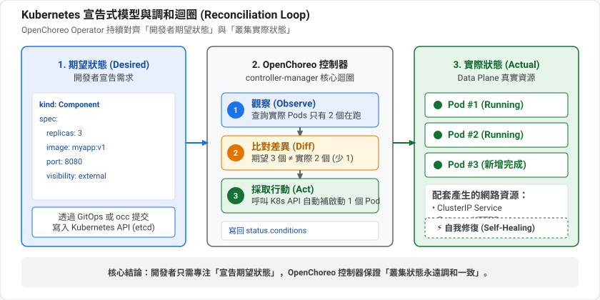
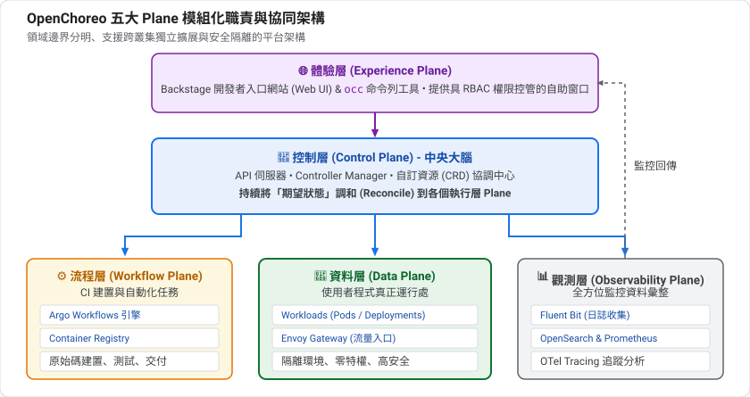
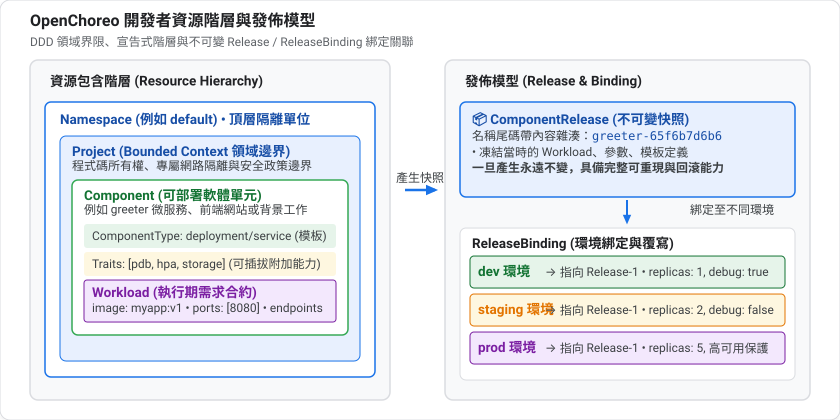
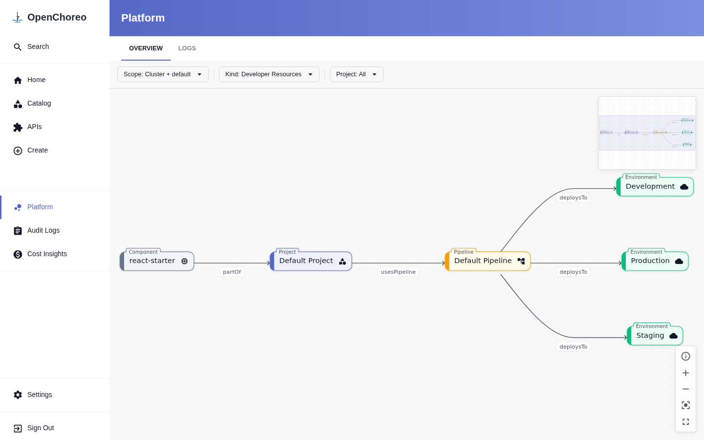

summary: 理解 OpenChoreo 的五大 Plane 與 Project、Component、Workload、Environment 等核心資源,並用 kubectl 實際觀察
id: openchoreo-02-architecture-concepts
categories: openchoreo,kubernetes,architecture
environments: Web
status: Published
feedback link: https://github.com/openchoreo/openchoreo/issues
author: 雷N

# OpenChoreo 實戰 02:架構與核心概念

## 概覽
Duration: 2

### 先決條件

* 已完成 **01:5 分鐘跑起 OpenChoreo**,叢集仍在運行
* 本機已安裝 `kubectl`,且能連到 k3d 叢集(或在 Dev Container 內操作)

### 你會學到

* OpenChoreo 的五種 Plane 各自負責什麼
* 開發者資源與平台資源的分工
* 用 `kubectl` 把概念對應到真實的資源

## 先備知識:Kubernetes 的「期望狀態」模型
Duration: 8

要看懂 OpenChoreo 的架構,必須先理解 Kubernetes 一個最核心的設計。

### 命令式 vs 宣告式

| | 命令式(Imperative) | 宣告式(Declarative) |
|---|---|---|
| 你說什麼 | 「啟動 3 個副本」 | 「我要有 3 個副本」 |
| 重複執行 | 可能多啟動一次 | 結果相同,安全 |
| 出狀況 | 你必須自己發現並處理 | 系統自己補回來 |

Kubernetes 是宣告式的:你描述**期望狀態(desired state)**,系統負責讓**實際狀態(actual state)**追上它。

### 調和迴圈(Reconciliation Loop)

負責「讓實際追上期望」的程式叫 **控制器(Controller)**,它永遠在跑一個迴圈:



例子:你宣告 `replicas: 3`,但有一個 Pod 當機了。控制器發現「實際 2 個、期望 3 個」,就補啟動一個。你完全不用介入。

### CRD:擴充 Kubernetes 的詞彙

Kubernetes 內建的資源種類(Pod、Deployment…)是固定的。**CRD(CustomResourceDefinition)** 讓你新增自己的資源種類,例如 `Component`。

只有 CRD 還不夠,還需要一個懂得處理它的控制器。這個「CRD + 控制器」的組合就是 **Operator 模式**。

**OpenChoreo 本質上就是一組 CRD 加上一群控制器。** 第 1 課你在叢集裡看到的 `controller-manager`,就是這些控制器所在的地方。你寫 `Component`,控制器負責把它變成真正的 Deployment、Service 等資源。

Positive
: 這解釋了為什麼 OpenChoreo 和 GitOps 工具天生合得來(第 6 課):兩者都建立在「宣告期望狀態、持續調和」的同一個模型上。

### 為什麼要拆成多個 Plane?

「Plane」可以理解成「平面」或「層」。OpenChoreo 把不同職責放在不同的 Plane,理由和大型組織的分工很像:

| 類比 | 對應 |
|---|---|
| 公司總部:制定規則、管理所有分店 | Control Plane |
| 分店:真正服務客人的地方 | Data Plane |
| 中央廚房:大量準備共用的東西 | Workflow Plane(建置) |
| 品管與監視中心 | Observability Plane |
| 櫃檯與服務窗口 | Experience Plane(CLI 與入口網站) |

拆開的好處:

* **安全隔離**:跑使用者程式的 Data Plane,不需要有建置或管理的高權限
* **獨立擴展與故障隔離**:建置很吃資源,不該拖垮正在服務的應用
* **多叢集**:一個 Control Plane 可以管理分佈在不同區域、不同雲的多個 Data Plane

在本機實驗時,所有 Plane 擠在同一個叢集;正式環境可以拆開。概念不變。

### 領域驅動設計(DDD)的「界限上下文」

下面會提到 **Project 是一個 bounded context**。這是領域驅動設計的詞彙:把「彼此關係緊密、共同完成一個商業能力」的東西圈成一個邊界。例如「訂單」和「付款」可能各自是一個 Project。邊界內可以自由溝通,跨邊界則要透過明確的介面。這也是為什麼 Project 同時是安全與網路的邊界。

準備好了,看看實際的架構。

## 五大 Plane
Duration: 8

OpenChoreo 採模組化多 Plane 架構,各 Plane 職責清晰、彼此解耦,可以跑在同一個叢集,也可以跨多個雲端與實體叢集分散部署。

### 1. 深度拆解:各 Plane 內部具體跑什麼?

| Plane | 白話定位 | 底層核心技術與元件 | 具體職責與運作內容 |
|---|---|---|---|
| **Experience Plane**<br>(體驗平面) | **「統一門戶」**<br>開發者的一站式前台 | • **Backstage** (Web Portal)<br>• **`occ`** CLI 工具<br>• IDE 插件與 AI Agent (MCP) | 消除 Kubernetes 的認知負載,提供不需要碰千行 YAML 的自服務介面。讓工程師自助瀏覽專案拓撲、點擊發布、檢視即時日誌與端點。 |
| **Control Plane**<br>(控制平面) | **「平台大腦」**<br>規則制定與狀態調和中樞 | • **openchoreo-api** (REST API)<br>• **controller-manager** (CRD 控制器)<br>• **ThunderID** (OIDC 認證)<br>• **OpenBao** (Vault 密鑰管理) | **全系統的狀態管理中心**。持有核心 CRD(Component、Release、Pipeline),將開發者的宣告意圖結合平台工程師制定的防護規範(CEL 驗證、Golden Path),調和並生成發布快照。 |
| **Workflow Plane**<br>(工作流平面) | **「打包工廠」**<br>專跑高風險與重算力 CI 任務 | • **Argo Workflows**<br>• **Podman / Kaniko** (容器編譯)<br>• 內建/外部 Container Registry<br>• `cluster-agent-workflowplane` | **專門執行會動用外部或未受信任程式碼的任務**。拉取 Git 原始碼、跑單元測試、依 Dockerfile 建置映像、推送到倉庫,最後產出不可變發布製品(Release)。 |
| **Data Plane**<br>(資料平面) | **「線上門市」**<br>真正承載業務流量與容器的地方 | • 使用者業務 Pods (微服務、網站)<br>• **Envoy / KGateway** (API 閘道)<br>• NetworkPolicy (網路微隔離)<br>• `cluster-agent-dataplane` | **真正服務終端使用者的執行期**。負責 Pod 高可用調度、服務間 mTLS 加密、零停機滾動發布、Gateway 路由轉發與水平自動擴展(HPA)。 |
| **Observability Plane**<br>(可觀測性平面) | **「品管與安監中樞」**<br>遙測數據收集與審計大腦 | • **OpenTelemetry Collector**<br>• **Prometheus** (Metrics 指標)<br>• **OpenSearch** (Logs 日誌/審計)<br>• **Fluent-bit** (節點日誌收集) | 跨所有平面收集日誌、分散式追蹤(Tracing)、性能指標與操作審計,並將遙測數據反哺給 Experience Plane,讓工程師在 Web 介面開箱即用。 |



#### 核心觀念釐清：為什麼叫「Data Plane」？它不是「資料庫（Database）」！

初學者常望文生義,以為 Data Plane 是「存放資料庫(MySQL/Postgres)或大數據」的地方。但在電腦網路(SDN)與雲原生分散式系統的經典術語中:

* **Control Plane (控制平面)**: 負責「大腦決策與下達規則」,只傳送控制訊號(Control Signaling),**絕不經手使用者的任何業務資料封包**。
* **Data Plane (資料平面 / 轉發平面)**: 又稱為 **Forwarding Plane(轉發面)** 或 **User Plane(用戶面)**。這裡的「Data」指的是使用者傳輸的**業務數據載荷(Payload Data / HTTP 請求與封包)**！

因此,Data Plane 在 OpenChoreo 中同時涵蓋了兩大關鍵能力:

1. **入口引流與智慧轉發 (Gateway / API 閘道)**: 由 Envoy Proxy 監聽外部請求(如 `19080` 埠),依據 Gateway API 的 `HTTPRoute` 規則,知道該將路徑路由至後端哪一個微服務。
2. **業務算力與容器執行期 (Workload Pods)**: 你的業務容器(如 Go Greeter、React 前端、Python 服務)真正執行的地方。它消耗 CPU/記憶體、執行商業邏輯、存取資料,並將處理結果回傳給用戶。

簡而言之:**Control Plane 負責「指揮調度」,Workflow Plane 負責「編譯打包」,而 Data Plane 則是「接待終端流量、運行微服務算力」的實體戰場！**

### 2. 彼此的協同關係:一個發布的生命週期閉環

五大 Plane 絕非各自獨立的孤島,而是形成緊密相扣的端到端閉環:

1. **意圖發起** (`Experience Plane`): 開發者在 Backstage 介面點擊「Build Latest」或透過 Git Push 觸發建置。
2. **調度與指派** (`Control Plane`): 控制平面驗證權限與參數 schema,建立 `WorkflowRun` 資源,並指派任務至工作流平面。
3. **隔離建置** (`Workflow Plane`): Argo Workflows 啟動獨立 Pod 執行 Checkout ➔ Build ➔ Publish,完成後產出不可變的 `ComponentRelease` 並回報控制平面。
4. **渲染與發布** (`Data Plane`): 控制平面根據環境配置(如 Development)渲染出具體的 Workload 資源,下發至資料平面。Data Plane 啟動應用 Pod,並由 Envoy 閘道配置對外路由。
5. **遙測與反哺** (`Observability Plane`): 應用執行產生的日誌與指標由 Fluent-bit 與 OTel 收集彙整,並即時傳回 Experience Plane 供開發者除錯。

#### 零信任安全通道:ClusterAgent 反向連線

在實體生產環境中,Data Plane 與 Workflow Plane 往往分散在不同的實體 Kubernetes 叢集(例如正式生產與測試環境實體隔離):

* 每個遠端 Plane 內部只運行一個輕量的 **`cluster-agent`**,**主動以 gRPC + mTLS 向 Control Plane 建立安全出站連線**。
* **安全優勢**:Control Plane 不需要持有各叢集的管理員 Kubeconfig,遠端叢集也不需要對公網開放任何 API 埠號,徹底落實零信任(Zero Trust)架構。

### 3. 團隊職能對照:哪種角色在關注哪個 Plane?

根據現代軟體組織的「團隊拓撲」(Team Topologies),不同角色關注的層次截然不同:

| 團隊角色 (Persona) | 主要關注的 Plane | 他們最關心的核心價值與日常操作 |
|---|---|---|
| **業務應用開發者**<br>(App Developers) | **Experience Plane**<br>+ Data Plane(端點) | • 「我的程式碼跑成功沒?建置有沒有噴錯?」(看 BUILD)<br>• 「我的 API 外部呼叫網址是什麼?」(看 DEPLOY)<br>• 「拋出 Exception 時,最新日誌在哪?」(看 LOGS)<br>• **專注於業務邏輯,完全不必理會底層 K8s 的 YAML 與網路細節**。 |
| **平台工程師**<br>(Platform Engineers) | **Control Plane**<br>+ Experience Plane(治理) | • **打造黃金路徑(Golden Path)**:定義標準的 `ClusterComponentType` 與 `ClusterWorkflow` 模板。<br>• **設計護欄(Guardrails)**:用 CEL 規則限制 CPU/記憶體規格,防止開發者寫出有資安隱患的宣告。<br>• **維護多環境管線**:設定 Dev ➔ Staging ➔ Prod 的發布策略與審批條件。 |
| **資安與架構工程師**<br>(SecOps / Architects) | **Workflow Plane**<br>+ Control Plane(IAM/密鑰) | • **高風險建置隔離**:CI 會執行外部不可信的指令(`RUN npm install`),將 Workflow Plane 實體隔離,防止建置惡意程式橫向滲透線上生產服務。<br>• **憑證與密鑰集中管理**:確保 Git Token 與鏡像庫密碼存於 OpenBao/ThunderID,杜絕金鑰明文洩漏。 |
| **SRE 與維運團隊**<br>(Site Reliability Engineers) | **Data Plane**<br>+ Observability Plane | • **高可用與穩定性**:關注 Data Plane 節點容量、Envoy 閘道流量、零停機滾動發布。<br>• **SLO/SLA 監控告警**:配置 Prometheus 告警規則、維護 OpenSearch 90 天稽核日誌留存、利用分散式 Tracing 快速定位跨服務效能瓶頸。 |

### 4. 兩種 API 兩種角色

* **Platform API**:平台工程師宣告平台設定(環境、元件類型、流程等)
* **Developer API**:開發者宣告自己的資源(Project、Component、Workload 等)

這個分工是 OpenChoreo 的核心想法:平台工程師定義**護欄與模板**,開發者在護欄內**自助**。

Positive
: 在第 1 課的本機安裝裡,這些 Plane 全部壓在同一個 k3d 叢集上;正式環境可以拆開。Workflow 與 Observability Plane 就是 `--with-build`、`--with-observability` 所啟用的部分。

## 開發者資源
Duration: 7

資源階層與發佈關聯：



在入口網站的 Platform 視圖中，也能直觀看到 Component、Project、Pipeline 與 Environments 的動態相依拓撲：



### Project

一個 **bounded context**(領域驅動設計 DDD 的概念),把同一個商業能力的 Components 分組,是程式碼擁有權、部署與營運的邊界。Project 對應到隔離的命名空間、網路邊界與安全政策;同一 Project 內的 Components 可以自由互相通訊。

#### `Project` 宣告實例

```yaml
apiVersion: openchoreo.dev/v1alpha1
kind: Project
metadata:
  name: ecommerce
  namespace: default
spec:
  deploymentPipelineRef:
    kind: DeploymentPipeline
    name: default
```

* **`spec.deploymentPipelineRef`**: 明確指定此專案遵循哪一條環境晉升流水線(如 Dev ➔ Staging ➔ Prod),確保專案下的所有元件共用相同的發布流程。

### Component

一個**可部署的軟體單元**:微服務、網站或背景工作。開發者透過 `Component` CRD 宣告元件的靜態歸屬與治理特性:

#### `Component.spec` 核心欄位詳解

| 欄位 | 型別 / 必要性 | 說明與底層機制 |
|---|---|---|
| `owner.projectName` | 字串 / **必填** | 指定該元件屬於哪個 `Project`,決定領域邊界、網路微隔離與權限範圍。 |
| `componentType` | 物件 / **必填** | 模板參照。需指定 `kind` (通常是 `ClusterComponentType`) 與 `name` (如 `deployment/service`、`deployment/web-application`)。 |
| `autoDeploy` | 布林值 / 選填 | 建立或更新後,是否自動部署到流水線的第一個環境(如 `development`),預設為 `false`。 |
| `autoBuild` | 布林值 / 選填 | 原始碼推送到 Git 倉庫時是否透過 Webhook 自動觸發建置,預設為 `false`。 |
| `parameters` | 物件 / 選填 | 傳遞給 ComponentType 的自訂參數,跨環境一致(如特定業務標籤或旗標)。 |
| `traits` | 物件陣列 / 選填 | 為該元件附加的可重用能力(如存儲掛載、自動擴縮、安全標籤),可多次實例化。 |
| `workflow` | 物件 / 選填 | 從原始碼建置時的工作流參照與參數(指定 Git 倉庫 URL、分支、建置參數,詳見第 4 課)。 |

### Workload

Component 的**執行期合約**:描述「應用在執行時需要什麼環境」,而不是「平台底層怎麼實作」。

#### `Workload.spec` 核心欄位詳解

| 欄位 | 型別 / 必要性 | 說明與底層機制 |
|---|---|---|
| `owner` | 物件 / **必填** | 綁定所屬關係,包含 `componentName` 與 `projectName`。 |
| `container` | 物件 / **必填** | 容器規格:包含 `image` (鏡像位址)、`command`、`args`、`env` (環境變數清單) 與資源限制。 |
| `endpoints` | 字典映射 / 選填 | 網路端點宣告(鍵名為端點名稱,如 `http` 或 `api`):<br>• `type`: 協定類型,支援 `HTTP`、`gRPC`、`GraphQL`、`Websocket`、`TCP`、`UDP`<br>• `port`: 服務暴露埠號<br>• `targetPort`: 容器內部監聽埠號(若未填則預設同 `port`)<br>• `visibility`: 存取範圍陣列,包含 `[external]` (經 Envoy 閘道對外公網) 與預設隱含的 `[project]` (同專案微服務互通) |
| `dependencies` | 物件 / 選填 | 微服務與受管資源相依性宣告:<br>• `endpoints`: 宣告依賴同專案其他 Component 的端點,透過 `envBindings` 自動注入其 URL/位址<br>• `resources`: 宣告依賴的受管資料庫或快取(如 Redis),並將連線字串注入為環境變數(詳見第 9 課) |

#### 開發者 YAML 實例：`Component` + `Workload` 協同宣告

以下是一個生產級微服務的完整開發者宣告範例：

```yaml
# 1. Component: 宣告我是誰、屬於哪個專案、採用什麼平台模板
apiVersion: openchoreo.dev/v1alpha1
kind: Component
metadata:
  name: order-service
  namespace: default
spec:
  owner:
    projectName: ecommerce
  autoDeploy: true
  componentType:
    kind: ClusterComponentType
    name: deployment/service
---
# 2. Workload: 宣告執行期需要的容器映像、對外埠號與跨微服務呼叫依賴
apiVersion: openchoreo.dev/v1alpha1
kind: Workload
metadata:
  name: order-service-workload
  namespace: default
spec:
  owner:
    componentName: order-service
    projectName: ecommerce
  endpoints:
    http:
      type: HTTP
      port: 8080
      visibility: [external]
  dependencies:
    endpoints:
      - component: payment-service
        name: http
        visibility: project
        envBindings:
          url: PAYMENT_SERVICE_URL    # 平台自動將依賴服務的 URL 注入此環境變數
  container:
    image: "ghcr.io/openchoreo/samples/order-service:v1.0"
    env:
      - key: LOG_LEVEL
        value: "info"
```

Positive
: 你隨時可以在終端機透過 `kubectl explain component.spec` 或 `kubectl explain workload.spec` 查詢最權威的叢集即時欄位手冊！

### Resource 與 WorkflowRun

* **Resource**: Project 內的受管基礎設施宣告(資料庫、佇列、快取)。開發者不必自行建立 StatefulSet 或申請雲端 RDS,只需在 YAML 宣告需要快取或資料庫,平台會自動開通並把連線字串注入給 Workload。
* **WorkflowRun**: Workflow 的一次執行實例,記錄 Git commit 雜湊、建置狀態、Pod 日誌與產出的 ComponentRelease 製品。

#### `Resource` 宣告實例

```yaml
apiVersion: openchoreo.dev/v1alpha1
kind: Resource
metadata:
  name: redis-cache
  namespace: default
spec:
  owner:
    projectName: ecommerce
  type:
    kind: ClusterResourceType
    name: valkey
```

## 平台資源：平台工程師的治理中樞
Duration: 8

平台資源是**平台工程師 (Platform Engineers)** 的核心戰場。開發者之所以能只寫 40 行極簡 YAML 就上線服務,是因為平台工程師預先定義了**護欄 (Guardrails)、部署模板 (Golden Path) 與環境拓撲**。

### 1. `ClusterComponentType`：元件架構黃金模板

`ClusterComponentType` 是平台的靈魂。它將開發者的業務參數代入模板,自動生成 Deployment、Service、HTTPRoute、NetworkPolicy 等原生 Kubernetes 資源。

#### `ClusterComponentType` 規格範例 (以內建的 `deployment/service` 為例)

```yaml
apiVersion: openchoreo.dev/v1alpha1
kind: ClusterComponentType
metadata:
  name: service
spec:
  workloadType: deployment
  allowedTraits:
  - kind: ClusterTrait
    name: horizontal-pod-autoscaler
  - kind: ClusterTrait
    name: health-probes
  allowedWorkflows:
  - kind: ClusterWorkflow
    name: dockerfile-builder
  environmentConfigs:
    openAPIV3Schema:
      properties:
        cpu:
          type: string
          default: "100m"
        memory:
          type: string
          default: "256Mi"
        replicas:
          type: integer
          default: 1
```

| 核心區塊 | 作用與平台工程意涵 |
|---|---|
| `spec.workloadType` | 指定基礎負載類型,目前支援 `deployment` 與 `cronjob`。 |
| `spec.allowedTraits` | **能力護欄**。白名單限制該元件類型允許掛載哪些附加能力(如只允許 HPA 與探針,防止隨意掛載非核准套件)。 |
| `spec.allowedWorkflows` | **建置護欄**。限制該元件允許使用哪些工作流從原始碼建置。 |
| `spec.environmentConfigs` | **跨環境規格 Schema**。定義在不同環境中允許覆寫的參數(如每個環境的 CPU、記憶體與複本數)。 |

### 2. `ClusterTrait`：可重用附加能力

實踐「組合優於繼承」原則。當元件需要水平自動擴縮(HPA)或儲存卷時,不需重寫 ComponentType,而是以 Trait 附加能力。

#### `ClusterTrait` 規格範例 (以 HPA 為例)

```yaml
apiVersion: openchoreo.dev/v1alpha1
kind: ClusterTrait
metadata:
  name: horizontal-pod-autoscaler
spec:
  parameters:
    openAPIV3Schema:
      properties:
        minReplicas:
          type: integer
          default: 2
        maxReplicas:
          type: integer
          default: 10
        targetCPUUtilization:
          type: integer
          default: 80
```

### 3. `Environment`：部署階段與實體算力平面錨點

`Environment` 是控制平面的邏輯抽象,透過 `spec.dataPlaneRef` 將邏輯環境釘選到實體承載流量的 Kubernetes 叢集(`ClusterDataPlane`)。

#### `Environment` 規格範例

```yaml
apiVersion: openchoreo.dev/v1alpha1
kind: Environment
metadata:
  name: development
  namespace: default
spec:
  dataPlaneRef:
    kind: ClusterDataPlane
    name: default
  isProduction: false
```

* **`spec.dataPlaneRef`**: 指定此環境的 Workload 該派發到哪一個 `ClusterDataPlane` 實體叢集。
* **`spec.isProduction`**: 標記是否為生產環境。若為 true,平台會強制套用更嚴格的防護規範與審批條件。

### 4. `DeploymentPipeline`：環境晉升有向圖

`DeploymentPipeline` 規定了微服務在各環境間「可以怎麼晉升」,本質上是一張**有向無環圖 (DAG)**。

#### `DeploymentPipeline` 規格範例

```yaml
apiVersion: openchoreo.dev/v1alpha1
kind: DeploymentPipeline
metadata:
  name: default
  namespace: default
spec:
  promotionPaths:
  - sourceEnvironmentRef:
      kind: Environment
      name: development
    targetEnvironmentRefs:
    - kind: Environment
      name: staging
  - sourceEnvironmentRef:
      kind: Environment
      name: staging
    targetEnvironmentRefs:
    - kind: Environment
      name: production
```

* **強制交付路徑**：規定 Production 只能由 Staging 晉升而來，嚴禁從 Development 未經完整測試直接晉升至 Production。

### 5. `ClusterDataPlane`：實體運算平面合約

宣告承載業務負載的 Kubernetes 叢集規格,包含外部 Envoy 閘道監聽埠、mTLS 客戶端連線憑證與可觀測性關聯。

#### `ClusterDataPlane` 規格範例

```yaml
apiVersion: openchoreo.dev/v1alpha1
kind: ClusterDataPlane
metadata:
  name: default
spec:
  planeID: default
  gateway:
    ingress:
      external:
        http:
          host: openchoreoapis.localhost
          listenerName: http
          port: 19080
        name: gateway-default
        namespace: openchoreo-data-plane
  clusterAgent:
    clientCA:
      value: "-----BEGIN CERTIFICATE-----\n..."
  observabilityPlaneRef:
    kind: ClusterObservabilityPlane
    name: default
```

* **`spec.gateway.ingress.external`**: 規範微服務對外開放的 Envoy 閘道網址後綴與負載平衡連接埠(19080)。
* **`spec.clusterAgent.clientCA`**: 遠端叢集 Agent 建立反向 mTLS 零信任連線時驗證所需的憑證。

### 6. `ReleaseBinding`：不可變快照釘選與環境覆寫

實踐 Twelve-Factor App 的「程式碼與環境設定分離」原則。將不可變的快照(`ComponentRelease`)釘選在特定環境,並注入環境專屬設定。

#### `ReleaseBinding` 規格範例

```yaml
apiVersion: openchoreo.dev/v1alpha1
kind: ReleaseBinding
metadata:
  name: order-service-development
  namespace: default
spec:
  environment: development
  owner:
    componentName: order-service
    projectName: ecommerce
  releaseName: order-service-94d009af    # 釘選特定內容雜湊的不可變快照
  state: Deploy
  environmentConfigs:                   # 環境專屬覆寫
    replicas: 1
```

| 欄位 | 說明與底層機制 |
|---|---|
| `spec.environment` | 綁定至哪一個環境(如 `development` 或 `production`)。 |
| `spec.releaseName` | **不可變製品名稱**。帶有內容雜湊,代表此環境目前運行哪一個版本。**版本晉升(Promotion)與回滾本質上只是修改這個字串**。 |
| `spec.state` | 部署狀態,可設為 `Deploy` 或 `Undeploy`(一鍵安全下線)。 |
| `spec.environmentConfigs` | **環境覆寫**。例如 development 環境複本數設為 1,production 環境設為 5,不動底層程式碼。 |

Positive
: 帶有 **Cluster** 前綴的類型(如 `ClusterComponentType`、`ClusterDataPlane`)是叢集範圍的共用版本,可跨 namespace 使用;沒有前綴的是 namespace 範圍。

### 發佈模型閉環機制

OpenChoreo 用**不可變的 Release** 管理全系統變更,形成嚴謹的四步發布閉環:

```
[開發者變更 Component] ──▶ 控制器自動生成不可變快照: [ComponentRelease]
                                                        │
[平台工程師設定 Pipeline] ──▶ 釘選版本與環境專屬覆寫:  [ReleaseBinding]
                                                        │
                      控制器自動編譯並渲染完整 K8s 清單: [RenderedRelease]
                                                        │
                cluster-agent 透過 mTLS 下發至資料平面: [Data Plane (dp-*)]
```

1. **快照生成**: Component 任何程式碼或規格變更,控制器自動產出帶有唯一雜湊的不可變 **`ComponentRelease`**。
2. **環境釘選**: 每個環境存在一個 **`ReleaseBinding`**,將特定 Release「釘」在該環境中。
3. **契約編譯**: 控制器將 ComponentRelease 與環境專屬覆寫融合成 **`RenderedRelease`**。
4. **極速晉升**: **Promotion(晉升)** 不需重新打包映像檔,只要將 target 環境的 ReleaseBinding 改指向較新的 Release,即可秒級安全發布！

## 動手觀察
Duration: 7

把概念對應到真實叢集。先看你有哪些 OpenChoreo 的 CRD:

```bash
kubectl api-resources --api-group=openchoreo.dev
```

查看已有的 Project、Environment、Component:

```bash
kubectl get project,environment,component -A
```

查看已連線的 Data Plane 及其狀態:

```bash
kubectl get clusterdataplane -o wide
```

用 `occ` 看同樣的事(需先安裝並登入,見第 3 課):

```bash
occ namespace list
occ project list -n default
occ component list -n default
```

### 找出資料層真正的 Kubernetes 資源與交付契約

Control Plane 裡的 Component 只是「宣告」,實際的 Deployment、Service 等在 Data Plane 的獨立 namespace:

```bash
# 1. 檢視跨平面的交付契約 (RenderedRelease)
kubectl get renderedrelease -A

# 2. 檢視 Data Plane 平台中樞組件 (Envoy 閘道與通訊代理)
kubectl get pods,svc -n openchoreo-data-plane

# 3. 檢視 Data Plane 的業務隔離命名空間與實體負載
kubectl get ns | grep dp-
kubectl get deployment,svc -A -l openchoreo.dev/component=react-starter
```

Negative
: 如果最後一個指令沒有輸出,可能是 label 或 Component 名稱和你的環境不同。先用 `kubectl get component -A` 確認名稱。這些 label 與 namespace 命名是依官方文件整理,請以你叢集的實際輸出為準。

### 思考題

1. `react-starter` 在 Control Plane 與 Data Plane 各留下了哪些資源?
2. 為什麼開發者不直接寫 Deployment,而是寫 Component + Workload?

## 自我檢核
Duration: 4

試著不看上文回答下面的問題;答不出來的,回頭看對應的章節。

1. 宣告式與命令式差在哪?請用 `replicas: 3` 舉例。

2. OpenChoreo 本質上是由什麼組成的?

3. 為什麼要把 Control Plane 和 Data Plane 分開?至少說出兩個理由。

4. Project 為什麼同時是「領域邊界」和「安全邊界」?

### 參考答案

1. 宣告式描述「我要 3 個副本」,系統持續調和;即使有 Pod 當機也會補回來。命令式是「啟動 3 個」,重複執行可能多啟動。

2. 一組 CRD 加上處理它們的控制器(Operator 模式)。

3. 安全隔離(跑使用者程式的地方不需要管理高權限)、故障與資源隔離、一個控制平面可管理多個資料平面或多叢集。

4. 它對應 DDD 的 bounded context:同一能力的元件圈在一起,並對應到獨立 namespace、網路與安全政策,邊界內自由溝通。

## 小結
Duration: 1

| 概念 | 一句話 |
|---|---|
| Plane | 五種職責分離的執行層 |
| Project | 領域邊界,Component 的分組 |
| Component | 可部署單元 = 類型 + 參數 + Trait + Workflow |
| Workload | 執行期合約:容器、端點、依賴 |
| Environment | 綁定 DataPlane 的部署階段 |
| Release / ReleaseBinding | 不可變版本與其在各環境的釘選 |

### 延伸閱讀

* [Architecture](https://openchoreo.dev/docs/overview/architecture)
* [Developer Abstractions](https://openchoreo.dev/docs/concepts/developer-abstractions/)
* [Deployment Topology](https://openchoreo.dev/docs/platform-engineer-guide/deployment-topology/)

### 下一課

**03:部署你的第一個 Component** — 自己寫 YAML,用 `occ` 與 `kubectl` 部署。
