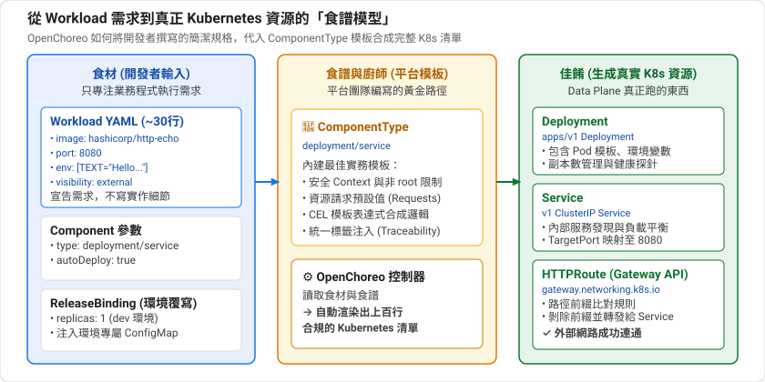
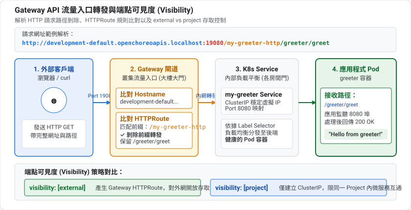
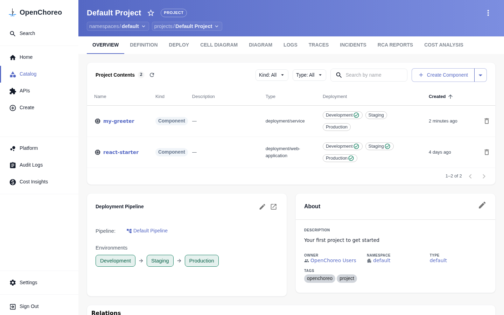
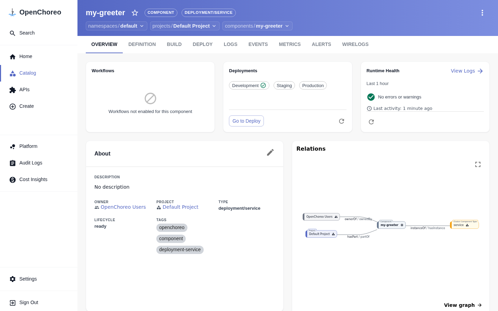
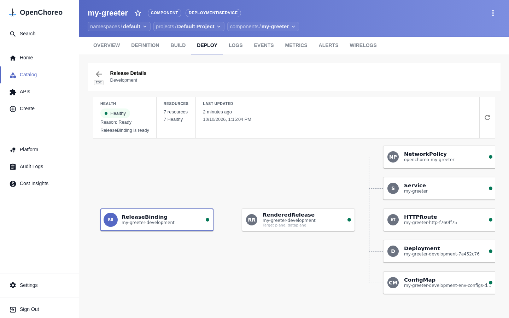
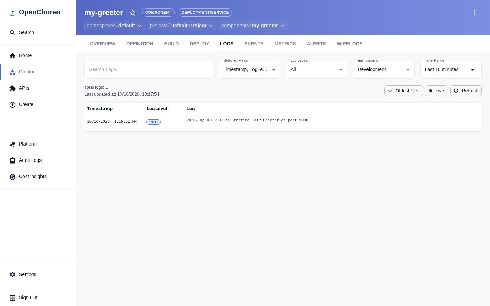
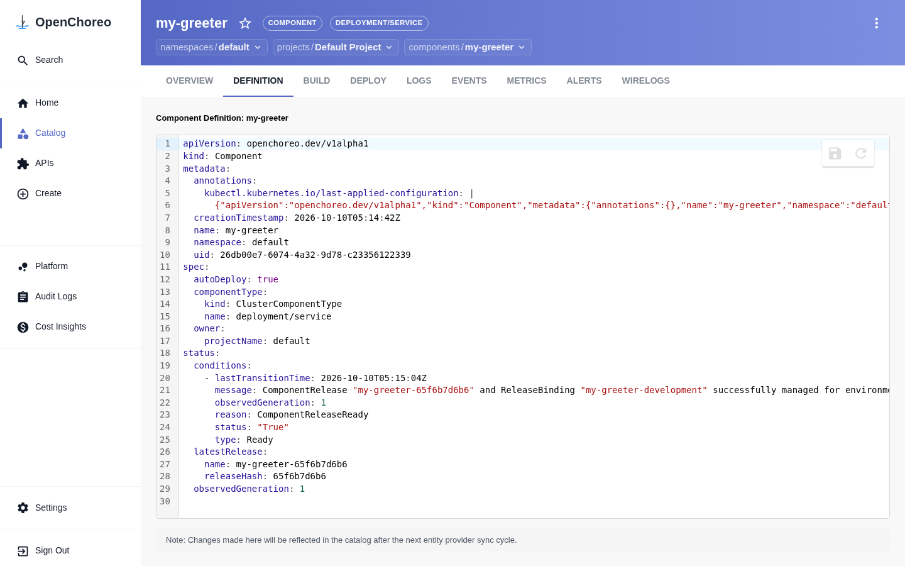
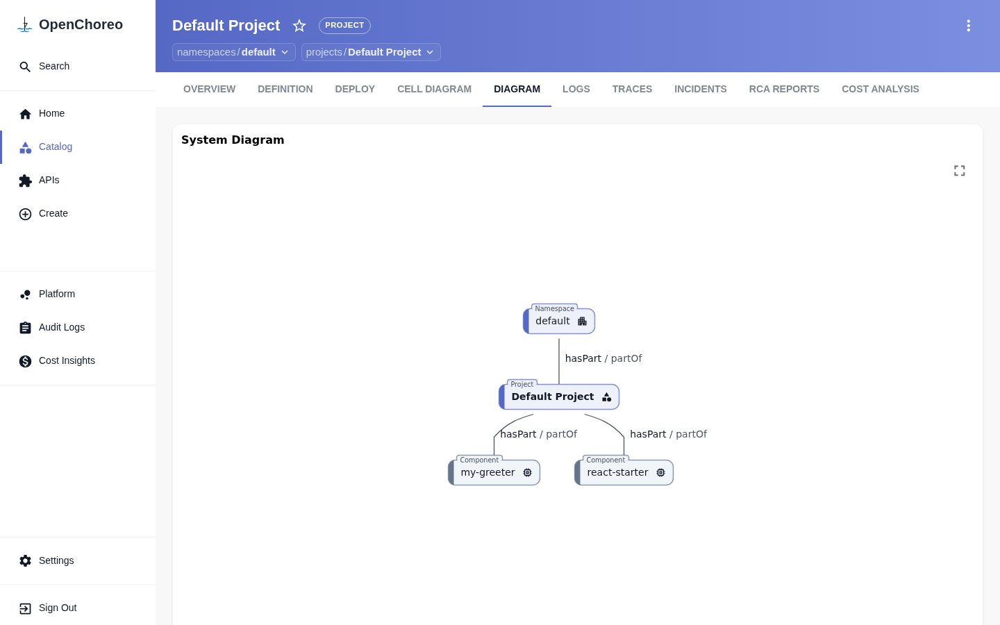
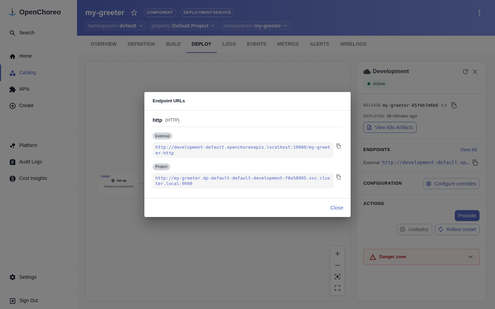
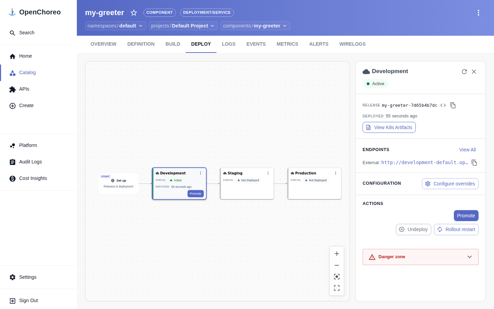

summary: 安裝 occ CLI,撰寫 Component 與 Workload YAML,部署預建映像並追蹤 Release、ReleaseBinding 與路由
id: openchoreo-03-first-component
categories: openchoreo,kubernetes,deployment
environments: Web
status: Published
feedback link: https://github.com/openchoreo/openchoreo/issues
author: 雷N

# OpenChoreo 實戰 03:部署你的第一個 Component

## 概覽
Duration: 2

### 先決條件

* 已完成第 1、2 課,OpenChoreo 運行中
* `kubectl` 能連到叢集
* 本機有 `curl`

### 你會學到

* 安裝並登入 `occ` CLI
* 撰寫 Component 與 Workload 的 YAML
* 部署一個預建映像(不需要建置)
* 沿著 Component → ComponentRelease → ReleaseBinding → Kubernetes 資源追蹤部署
* 透過閘道呼叫服務

## 先備知識:從 Workload 到 Kubernetes 資源
Duration: 8

寫 YAML 之前,先搞清楚「我寫的東西」和「叢集裡真正跑的東西」是什麼關係。

### YAML 的基本結構

所有 Kubernetes 風格的資源,都有相同的四個頂層欄位:

```yaml
apiVersion: openchoreo.dev/v1alpha1   # 這個資源屬於哪個 API 與版本
kind: Component                       # 資源的種類
metadata:                             # 名稱、namespace、標籤等識別資訊
  name: my-greeter
spec:                                 # 你「期望」的內容
  ...
```

`status` 欄位則是控制器寫回來的**實際狀態**(你不用寫)。看到 `.status.conditions` 就是在讀它。

### 為什麼把 Component 和 Workload 分開?

這是 OpenChoreo 的核心設計之一:

| 資源 | 回答的問題 | 誰關心 |
|---|---|---|
| **Component** | 「這是什麼類型的東西?要怎麼被平台管理?」(what / how) | 平台與開發者共同 |
| **Workload** | 「我的程式需要什麼才能跑?」(要什麼映像、開哪個埠、依賴誰) | 開發者 |

Workload 只描述**需求**,不描述 Kubernetes 怎麼滿足。同一份 Workload,平台可以用不同的 ComponentType(模板)翻譯成不同的 Kubernetes 資源。

### 平台怎麼把它變成真正的資源



**ComponentType 像是一個「食譜」**:你提供食材(映像、埠、參數),食譜決定怎麼烹調(產生哪些資源、用什麼預設值)。所以你寫 30 行,平台能產生上百行的 Kubernetes 設定。這就是第 8 課要自己動手寫的東西。

### 流量怎麼進來:Gateway API

要讓外部連到服務,Kubernetes 需要「路由」。`Ingress` 是舊的標準,**Gateway API** 是新一代標準,OpenChoreo 用的是它。你會看到:

| 資源 | 角色 |
|---|---|
| **Gateway** | 流量入口(像大樓大門),由平台管理 |
| **HTTPRoute** | 路由規則:「某個主機名稱與路徑,轉到哪個 Service」 |



所以呼叫網址 `http://development-default.openchoreoapis.localhost:19080/my-greeter-http/greeter/greet` 可以拆成:

| 片段 | 意義 |
|---|---|
| `development-default` | 環境名稱 + namespace(用來區分主機名) |
| `.openchoreoapis.localhost` | 閘道的網域 |
| `:19080` | 本機閘道對外的 port |
| `/my-greeter-http` | 路徑前綴:元件名 + 端點名,HTTPRoute 依此比對 |
| `/greeter/greet` | 真正送給你應用程式的路徑(前綴會被剝掉) |

### 端點的可見度(visibility)

Workload 的每個端點都要宣告誰看得到它:

| 值 | 意義 |
|---|---|
| `external` | 經閘道對叢集外開放 |
| `project`(第 9 課實測) | 只有同一個 Project 內的元件能連 |

**預設不對外**是比較安全的設計,你必須明確寫出 `external` 才會產生對外路由。


### `autoDeploy` 的意思

`autoDeploy: true` 表示:Component 一建立或變更,平台就自動產生 Release 並部署到管線的**第一個環境**。第 5 課會說明 Release 是什麼。

### kubectl 與 occ 的分工

| 工具 | 定位 |
|---|---|
| `kubectl` | 通用:所有 Kubernetes 資源都能操作,本系列主要用它,因為最透明 |
| `occ` | OpenChoreo 專用:語意更高階(例如 `component deploy --to staging`),需要登入 |

下面開始動手。

## 安裝 occ CLI
Duration: 4

Linux x64(其他平台請見[官方頁面](https://openchoreo.dev/docs/getting-started/cli-installation/)):

```bash
curl -L https://github.com/openchoreo/openchoreo/releases/download/v1.3.1/occ_v1.3.1_linux_amd64.tar.gz | tar -xz && sudo mv occ /usr/local/bin/
occ version
```

### 設定 Control Plane 位址

本機 k3d 的位址是 `http://api.openchoreo.localhost:8080`:

```bash
occ config controlplane update default --url http://api.openchoreo.localhost:8080
```

在 `/etc/hosts` 加入(若主機尚未解析 `*.localhost`):

```
127.0.0.1       api.openchoreo.localhost
127.0.0.1       thunder.openchoreo.localhost
127.0.0.1       observer.openchoreo.localhost
```

### 登入

```bash
occ login
```

會開啟瀏覽器,使用 `admin@openchoreo.dev` / `Admin@123`。成功後試試:

```bash
occ namespace list
occ project list -n default
occ component list -n default
```

Negative
: 若你的叢集用自簽 TLS 憑證(非本機 k3d 預設),需先信任 CA,步驟見官方 CLI 安裝頁。

## 撰寫 YAML
Duration: 6

建立 `my-greeter.yaml`,內含 Component 與 Workload 兩個文件:

```yaml
apiVersion: openchoreo.dev/v1alpha1
kind: Component
metadata:
  name: my-greeter
  namespace: default
spec:
  owner:
    projectName: default
  autoDeploy: true
  componentType:
    kind: ClusterComponentType
    name: deployment/service
---
apiVersion: openchoreo.dev/v1alpha1
kind: Workload
metadata:
  name: my-greeter-workload
  namespace: default
spec:
  owner:
    componentName: my-greeter
    projectName: default
  endpoints:
    http:
      type: HTTP
      port: 9090
      visibility: [external]
  container:
    image: "ghcr.io/openchoreo/samples/greeter-service:latest"
    command:
      - ./go-greeter
    args:
      - --port
      - "9090"
    env:
      - key: LOG_LEVEL
        value: "info"
```

### 逐欄解讀

| 欄位 | 意義 |
|---|---|
| `spec.owner.projectName` | Component 屬於哪個 Project |
| `autoDeploy: true` | 建立後自動部署到第一個環境 |
| `componentType` | 用平台提供的 `deployment/service` 模板;`kind` 預設是 `ComponentType`,內建類型要明確寫 `ClusterComponentType` |
| `Workload.spec.owner` | 這個 Workload 屬於哪個 Component |
| `endpoints.http` | 宣告一個 HTTP 端點,port 9090,`visibility: [external]` 代表經閘道對外 |
| `container` | 映像、指令、參數與環境變數 |

Positive
: 官方範例 `greeter-service.yaml` 另外包含一個 `SecretReference`,用來注入 `GITHUB_TOKEN`。本課為了不依賴外部密鑰庫,刻意拿掉它。若服務啟動失敗,請先對照官方範例。

## 部署並追蹤
Duration: 8

### 套用

```bash
kubectl apply -f my-greeter.yaml
kubectl wait --for=condition=Ready component/my-greeter -n default --timeout=120s
```

也可以用 `occ` 確認:

```bash
occ component list --namespace default --project default
occ component get my-greeter --namespace default
```

### 追蹤 Release

Component 的變更會產生不可變的 ComponentRelease:

```bash
kubectl get component my-greeter -n default -o jsonpath='{.status.latestRelease.name}'
kubectl get componentrelease -n default
```

名稱尾碼是 Release spec 的雜湊值,你的結果會不同。

### 查看 development 環境的 ReleaseBinding

```bash
kubectl get releasebinding my-greeter-development -n default
```

這就是第 2 課說的「把 Release 釘在某個環境」。

### 查看 Data Plane 上真正的資源

```bash
kubectl get deployment,svc,httproute -A -l openchoreo.dev/component=my-greeter
```

這些資源位於類似 `dp-default-default-development-*` 的 namespace,而不是 `default`。

### 深度解析:Data Plane 的底層架構與運作機制

常有人疑惑：「Data Plane 是儲存資料的資料庫嗎？」答案是：**不是！**
在網路與 Kubernetes 語境中,「Data」指的是「使用者的業務數據封包(Payload Data)」。Data Plane 實質上是**「API 智慧引流閘道 + 業務容器執行期」**的集合體。它透過 Envoy 閘道知道如何將外部請求路徑精準路由至對應服務,並真正承載所有微服務 Pod 的運算執行。

在底層架構上,OpenChoreo 採用了**雙層命名空間(Two-Tier Namespaces)**與**反向代理閘道**架構:

#### 1. 平台中樞命名空間: `openchoreo-data-plane`

查看 Data Plane 基礎設施元件:

```bash
kubectl get pods,svc -n openchoreo-data-plane
```

你會看到三大關鍵守護組件:

| 元件名稱 | 類型 | 角色與底層機制 |
|---|---|---|
| **`gateway-default`** | Envoy Proxy (LoadBalancer) | **外部流量總閘門**。監聽外部 `19080` (HTTP) 與 `19443` (HTTPS) 埠號,根據 Gateway API 的 `HTTPRoute` 規則將外部請求轉發給後端微服務。 |
| **`cluster-agent-dataplane`** | 叢集通訊代理 (Agent) | **跨平面通訊橋樑**。透過 gRPC + mTLS 主動向 Control Plane 保持長連線,接收已渲染的部署指令,並向控制平面回報容器健康狀態。 |
| **`openchoreo-remote-agent-router`** | 路由中繼 (Router) | 在多叢集環境中負責遠端資料平面的指令路由與安全通道轉發。 |

#### 2. 業務執行隔離命名空間: `dp-<namespace>-<project>-<environment>-<hash>`

開發者在 Control Plane 的 `default` 命名空間宣告 Component,但**真正的業務 Pod 絕不會跑在 Control Plane**。平台會自動開闢隔離命名空間:

```bash
kubectl get all,httproute,networkpolicy -n dp-default-default-development-f8e58905
```

當一個 Component 部署完成,Data Plane 會自動生成五大協同工件:

1. **`Deployment` / `Pod`**: 運行使用者的業務容器(如 Go Greeter)。
2. **`Service`**: 提供叢集內部穩定的虛擬 IP 與 CoreDNS 名稱(如 `my-greeter.dp-...svc.cluster.local:9090`)。
3. **`HTTPRoute` (Gateway API)**: 宣告將 Envoy 閘道網址(`development-default.openchoreoapis.localhost:19080/my-greeter-http`)綁定至該 Service。
4. **`NetworkPolicy` (零信任隔離)**: 預設 Default Deny,僅允許 Envoy 閘道與同專案宣告依賴的微服務進入,防止惡意橫向攻擊。
5. **`ConfigMap` / `Secret`**: 注入由平台解析的環境變數與安全憑證。

#### Data Plane 流量轉發與控制架構

```
[外部使用者 / 瀏覽器] ─▶ (HTTP: 19080)
        │
        ▼
[🚪 gateway-default (Envoy Proxy)]  ◀── (配置 HTTPRoute) ── [cluster-agent-dataplane]
        │                                                               ▲
        │ (轉發路徑: /my-greeter-http)                                  │ (mTLS 接收指令)
        ▼                                                               │
┌─ Data Plane 隔離命名空間 (dp-default-default-development-*) ───────────┴──────────┐
│                                                                                  │
│   🛡️ NetworkPolicy (核心層過濾非授權流量)                                          │
│         │                                                                        │
│         ▼                                                                        │
│   [Service: my-greeter (ClusterIP: 9090)]                                        │
│         │                                                                        │
│         ▼                                                                        │
│   [Pod: my-greeter (Go Container)] ─▶ Fluent-bit 抓取日誌送 Observability Plane   │
│                                                                                  │
└──────────────────────────────────────────────────────────────────────────────────┘
```

#### 3. Data Plane 的宣告式合約心臟：`RenderedRelease`

Control Plane 是如何將抽象的 Component 與 ReleaseBinding 變成 Data Plane 上的真實 Pod 與 Service？關鍵在於 **`RenderedRelease`**（渲染後的發布合約）：

```bash
kubectl get renderedrelease -n default
```

你會看到例如 `greeting-service-development` 或 `react-starter-development`。用 `describe` 或 `yaml` 觀察它：

```bash
kubectl get renderedrelease greeting-service-development -n default -o yaml
```

這個 CRD 揭示了跨平面的三大底層機制：

1. **`spec.targetPlane: dataplane`**：明確指示此資源集合由 Data Plane 負責承載。
2. **`spec.resources[]`**：控制器編譯後的完整 Kubernetes 原生清單（包含目標命名空間 `dp-default-default-development-*`、Envoy 閘道父參照 `gateway-default`、以及容器鏡像位址與連接埠）。
3. **`status.resources[]` 與健康回報**：遠端的 `cluster-agent-dataplane` 套用工件後，會主動探測資源狀態（如 Deployment 的 `readyReplicas`、HTTPRoute 的 `Accepted` 條件），並將 `healthStatus: Healthy` 即時回報寫入此 CRD。

Positive
: 在 Backstage 介面點擊「View K8s Artifacts」所看到的五大工件樹狀圖，底層就是 Experience Plane 直接讀取並可視化這個 RenderedRelease 物件！

### 在 OpenChoreo 門戶中探索剛部署的服務

在 Backstage 入口網站中，我們可以直接看到剛部署的 `my-greeter` 呈現於專案與元件管理中：

**1. Project 專案總覽**：已同時列出 `my-greeter` 與 `react-starter`，Development 環境顯示綠色打勾表示健康運作：



**2. Component 元件概況**：點進 `my-greeter`，可檢視 Runtime Health（綠色 Healthy）、類型（`deployment/service`）與右下角實體關係圖：



**3. DEPLOY 部署流水線**：展示 `my-greeter` 剛完成 Development 部署，右側側邊欄提供版本雜湊、對外端點與 Promote 晉升按鈕：


**4. 檢視生成的 Kubernetes 工件（View K8s Artifacts）**：點擊右側的「View K8s Artifacts」按鈕，可直接看見平台如何把 ReleaseBinding 自動渲染成 5 大 Kubernetes 原生資源（NetworkPolicy、Service、HTTPRoute、Deployment、ConfigMap）：



**5. 容器即時日誌（LOGS）**：切換至 LOGS 分頁，能看到 Fluent-bit 聚合抓取的服務啟動紀錄（`Starting HTTP Greeter on port 9090`）：



**6. 原生 CRD 宣告式定義（DEFINITION）**：在 DEFINITION 分頁中，可直接檢視與複製 Kubernetes Component CRD YAML：



**7. 專案架構相依圖（DIAGRAM）**：回到專案切換至 DIAGRAM 分頁，可一覽整個命名空間與所有微服務元件的拓撲圖：



Positive
: 你只寫了約 30 行 YAML,平台根據 `deployment/service` 這個 ComponentType 幫你生出 Deployment、Service 與 HTTPRoute。

## 呼叫服務
Duration: 3

閘道網址格式:

```
http://{environment}-{namespace}.{gateway-host}/{endpoint-name}/{path}
```

### 從 OpenChoreo 網頁端取得端點網址

在元件的 DEPLOY 分頁右側面板中，點擊 ENDPOINTS 下方的 **View All**，門戶會彈出端點對話框，提供對外閘道網址（External）與叢集內部 DNS 服務網址（Project），並附有一鍵複製按鈕：



### 透過瀏覽器或 curl 呼叫

複製 External 端點網址後加上 `/greeter/greet`，本機 Dev Container 的閘道在 19080:

```bash
curl http://development-default.openchoreoapis.localhost:19080/my-greeter-http/greeter/greet
curl "http://development-default.openchoreoapis.localhost:19080/my-greeter-http/greeter/greet?name=OpenChoreo"
```

你也可以直接在瀏覽器網址列貼上 `http://development-default.openchoreoapis.localhost:19080/my-greeter-http/greeter/greet?name=OpenChoreo`，瀏覽器會直接收到服務回應：


預期輸出:

```
Hello, Stranger!
Hello, OpenChoreo!
```

Positive
: 端點路徑前綴是 `/{component}-{endpoint 名稱}`,所以這裡是 `/my-greeter-http`。可用 `kubectl get httproute -A -l openchoreo.dev/component=my-greeter -o yaml` 確認。

### 排錯清單

| 症狀 | 檢查 |
|---|---|
| Component 一直不 Ready | `kubectl describe component my-greeter -n default` 看 conditions |
| Pod 起不來 | 在 `dp-*` namespace 用 `kubectl describe pod` |
| 404 | 檢查 HTTPRoute 的 path 與主機名 |
| 連不上 | 確認閘道 port 是 19080(Dev Container) |

## 修改並觀察新 Release
Duration: 4

把 `LOG_LEVEL` 改成 `debug`,重新套用:

```bash
sed -i 's/value: "info"/value: "debug"/' my-greeter.yaml
kubectl apply -f my-greeter.yaml
kubectl get componentrelease -n default
kubectl get releasebinding my-greeter-development -n default -o yaml
```

觀察:

1. 是否多出一個新的 ComponentRelease?
2. ReleaseBinding 指向的 Release 是否更新(因為 `autoDeploy: true`)?

### 從網頁端觀察新 Release 的即時更新

重新整理 OpenChoreo 門戶，你可以直接在網頁上觀察到不可變製品的自動更新：

**1. DEPLOY 分頁中的 Release 雜湊自動推進**：Release 欄位自動跳至新版本（例如 `my-greeter-7d65b4b7dc`），DEPLOYED 時間重設為剛剛，右側 Promote 按鈕維持可用：



**2. DEFINITION 分頁中的 CRD 狀態同步**：Component 的狀態區塊（`.status.latestRelease`）同步更新為新的 releaseHash，證明平台控制器在 Kubernetes 背景完成調和：


## 清理
Duration: 2

除了使用 `kubectl` 指令之外，OpenChoreo 的網頁介面也提供了兩種不同層級的清理方式：

### 方式 1：環境下線（Undeploy，不刪除元件）

如果你只是想暫時釋放資源，但未來還需要該元件，可以在元件的 **DEPLOY** 分頁選取該環境（如 Development），點擊右側面板 ACTIONS 中的 **`Undeploy`** 按鈕：


* **效果**：OpenChoreo 會將 `ReleaseBinding` 的狀態轉為 `Undeployed`，並將 Data Plane 中的 Pod 副本縮減至 0、釋放 CPU/Memory 資源，但保留元件定義與歷史版本。未來點擊 **`Redeploy`** 即可隨時恢復。

### 方式 2：完整刪除元件（Delete Component）

若要徹底移除元件及其所有相關資源，可在 **Project 總覽（OVERVIEW）** 頁面的 Project Contents 列表中，點擊該元件右側的 **垃圾桶圖示 🗑️**：


* **效果**：點擊紅色 **`Delete`** 後，OpenChoreo 控制器會執行級聯刪除（Cascade Delete），自動將 Kubernetes 內的 Component、Workload、所有 ComponentRelease、ReleaseBinding，以及工作節點上的 Deployment、Service、HTTPRoute 與 ConfigMap 一併徹底清除。

### 方式 3：使用命令列刪除

```bash
kubectl delete -f my-greeter.yaml
```

## 自我檢核
Duration: 4

試著不看上文回答下面的問題;答不出來的,回頭看對應的章節。

1. Component 和 Workload 各回答什麼問題?

2. 網址 `http://development-default.openchoreoapis.localhost:19080/my-greeter-http/greeter/greet` 的 `/my-greeter-http` 是什麼?

3. 如果想讓服務只在叢集內使用,不產生外部路由,該怎麼設定端點?

4. 修改 `LOG_LEVEL` 後再 apply,發生了什麼事?

### 參考答案

1. Component 回答「這是什麼類型、怎麼被平台管理」;Workload 回答「我的程式需要什麼才能跑」(映像、埠、依賴)。

2. HTTPRoute 比對用的路徑前綴,格式是 `/{元件名}-{端點名}`,轉給應用時會被剝掉。

3. 不要把 `visibility` 寫成 `external`(例如寫 `project`),只有 `external` 才會產生對外路由。

4. 產生新的 ComponentRelease,因為 `autoDeploy: true`,development 的 ReleaseBinding 指向新 Release。

## 恭喜與下一步
Duration: 1

你已經:

* ✅ 安裝並登入 `occ`
* ✅ 手寫 Component + Workload 並部署
* ✅ 沿著 Release → ReleaseBinding → 實際資源追蹤了整個過程
* ✅ 透過閘道呼叫服務

### 延伸閱讀

* [Deploy and Explore](https://openchoreo.dev/docs/getting-started/deploy-and-explore/)
* [Projects and Components](https://openchoreo.dev/docs/developer-guide/projects-and-components/overview/)
* [Creating a Component](https://openchoreo.dev/docs/developer-guide/projects-and-components/creating-a-component/)

### 下一課

**04:從原始碼建置** — 啟用 Workflow Plane,從 Git 原始碼自動建置映像並部署。
