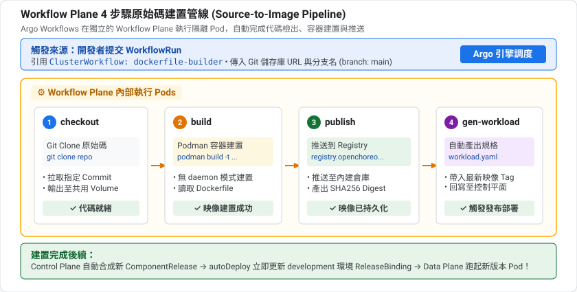
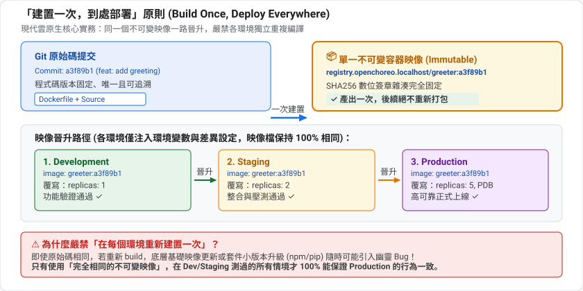
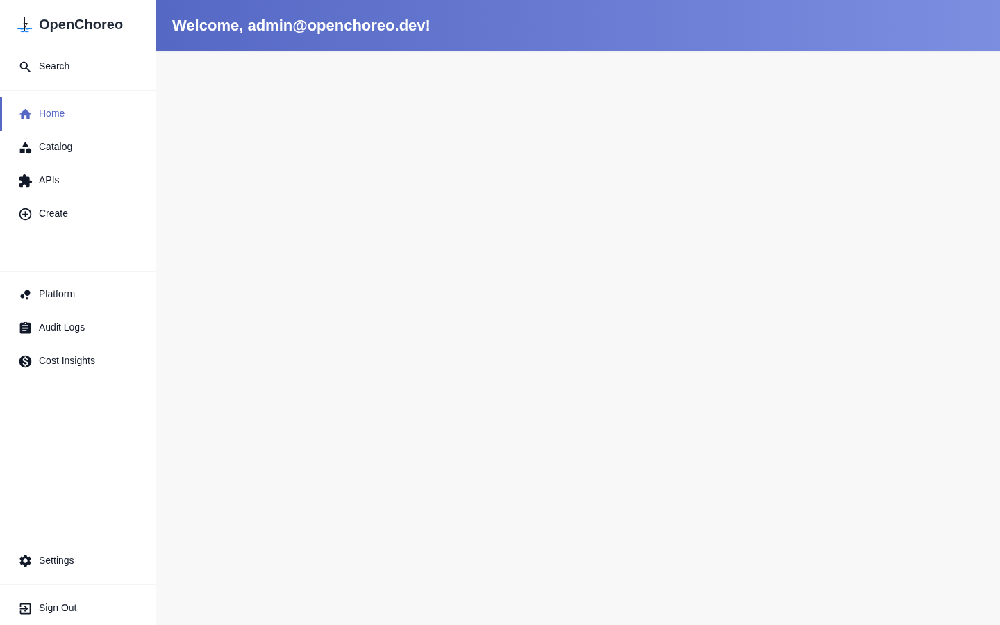
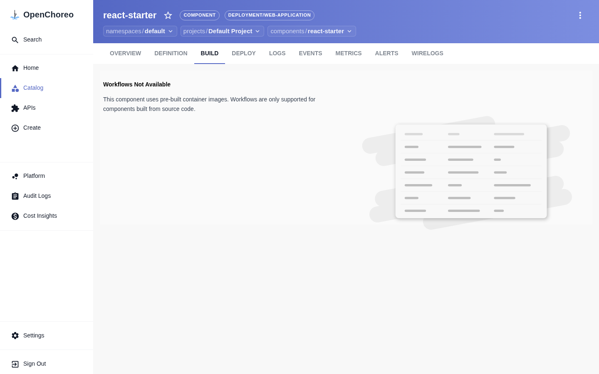
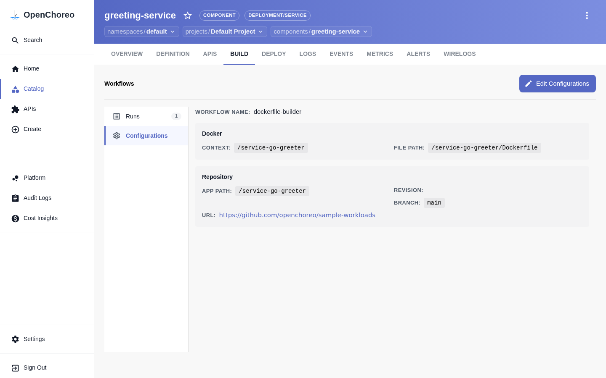
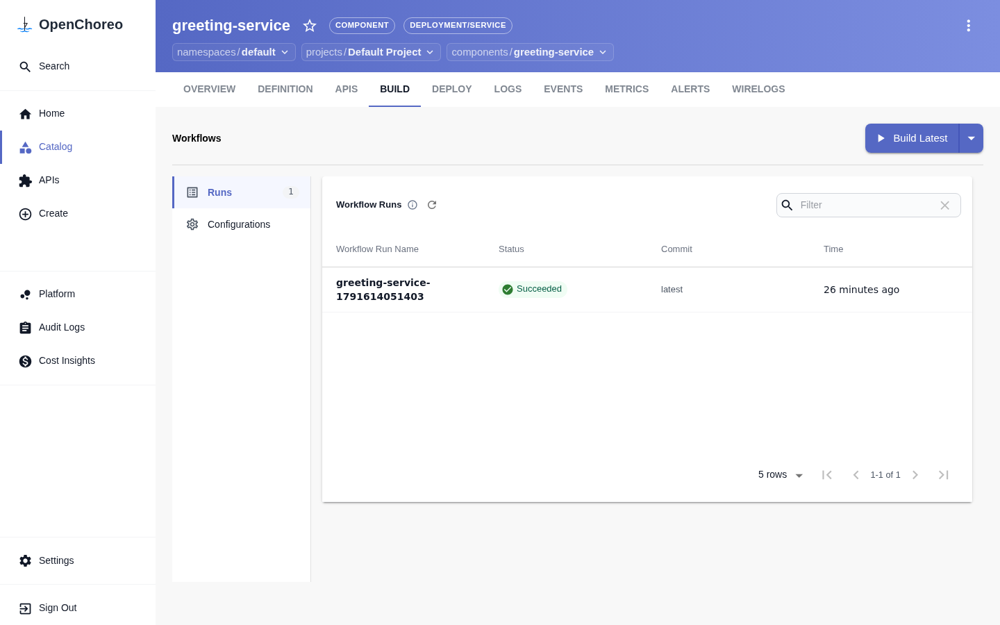
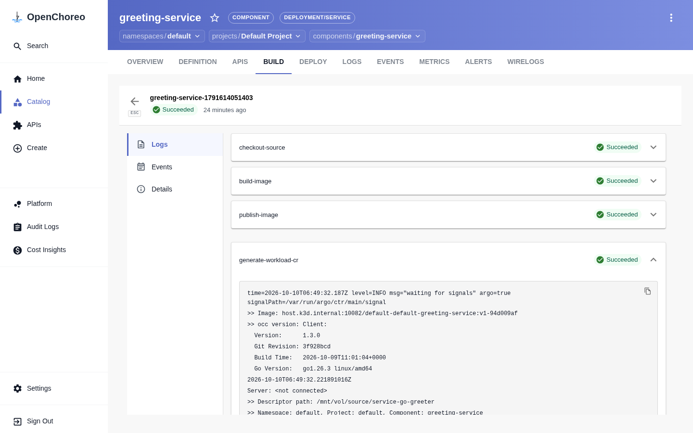
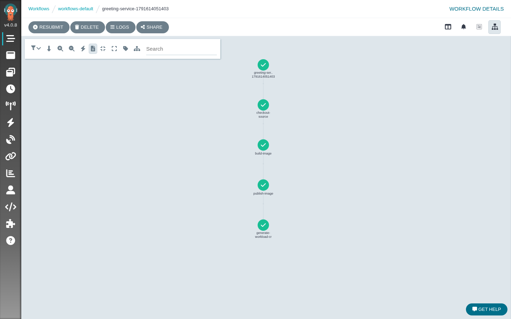
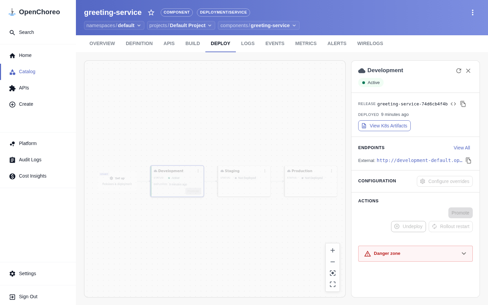
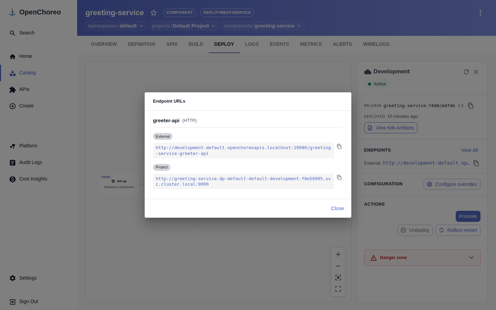

summary: 啟用 Workflow Plane,讓 OpenChoreo 從 Git 原始碼用 Dockerfile 建置映像、推到內建 registry 並自動部署
id: openchoreo-04-build-from-source
categories: openchoreo,kubernetes,ci-cd
environments: Web
status: Published
feedback link: https://github.com/openchoreo/openchoreo/issues
author: 雷N

# OpenChoreo 實戰 04:從原始碼建置

## 概覽
Duration: 2

第 3 課部署的是**預建映像**。這一課要讓 OpenChoreo 自己從 Git 原始碼把映像建出來,這就是內建 CI/CD 的核心。

### 先決條件

* 已完成第 1 到 3 課
* **8 GB RAM / 4 CPU**(啟用 Workflow Plane 的建議值)
* 主機磁碟至少有 **10 GB** 空間(建置映像與 registry 會佔用)
* 能連到 GitHub 與 `ghcr.io`

### 你會學到

* Workflow Plane 是什麼,以及如何安裝
* Component 的 `workflow` 欄位與 `WorkflowRun` 的關係
* 建置管線的四個步驟
* 用 `kubectl` 與 Argo Workflows UI 觀察建置
* 建置完成後自動產生 Workload 並部署

## 先備知識:CI/CD 與容器映像
Duration: 8

### CI 與 CD 各是什麼?

| 縮寫 | 全名 | 做什麼 |
|---|---|---|
| **CI** | Continuous Integration(持續整合) | 程式碼一變動就自動:拉程式碼、編譯、測試、**建置成映像** |
| **CD** | Continuous Delivery/Deployment(持續交付/部署) | 把建好的成品自動(或半自動)送到各環境 |

本課是 CI 的部分:從 Git 原始碼產出可部署的映像。第 5 課和第 6 課是 CD 的部分。

### 映像、Dockerfile、Registry

| 名詞 | 說明 |
|---|---|
| **容器映像(image)** | 一個打包好的唯讀檔案系統加啟動設定,是「可執行的成品」 |
| **Dockerfile** | 一份食譜:從哪個基底映像開始、複製哪些檔案、執行哪些指令、啟動時跑什麼 |
| **建置脈絡(build context)** | 建置時可以讀取的檔案範圍(本課的 `docker.context`) |
| **Registry** | 存放映像的倉庫,Kubernetes 從這裡拉取映像來跑 |

流程是:`原始碼 + Dockerfile` →(建置)→ `映像` →(推送)→ `Registry` →(拉取)→ `Pod`。

### 為什麼要在叢集裡建置?

你當然也可以在自己的電腦或外部 CI 服務建置。讓平台內建的好處是:

* 開發者不用自己維護 CI 設定,填「Git 網址、分支」即可
* 建置紀錄與元件綁在一起,平台知道「這個映像從哪個 commit 來」
* 平台工程師可以統一規範用什麼工具建置、推到哪裡

### 為什麼需要獨立的 Workflow Plane?

建置要執行**別人寫的程式碼與指令**(Dockerfile 裡的 `RUN`),這比跑一個已經建好的服務風險更高,而且很吃 CPU、記憶體和磁碟。獨立出來有三個好處:

1. **安全隔離**:建置的高風險行為不會碰到正式服務所在的環境
2. **資源隔離**:建置高峰不會拖慢線上服務
3. **獨立擴展**:可以只擴充建置的容量

### Argo Workflows 與 Podman

| 工具 | 角色 |
|---|---|
| **Argo Workflows** | 在 Kubernetes 上執行「有順序的多步驟任務」的引擎。每個步驟是一個 Pod,步驟之間可傳遞輸出 |
| **Podman** | 不需要常駐背景程式(daemon)的容器工具,適合在 Pod 裡建置映像 |

本課你會看到的四個步驟(checkout、build、publish、generate-workload),就是 Argo 的四個步驟,每一步一個 Pod。



### 模板與執行:Workflow 與 WorkflowRun

如果熟悉程式設計,可以這樣理解:

| OpenChoreo | 類比 |
|---|---|
| **ClusterWorkflow** | 類別(class)或函式定義:規定參數 schema 與流程 |
| **WorkflowRun** | 實例(instance)或一次函式呼叫:帶入實際參數執行一次 |

一個 Workflow 可以被不同元件、不同次數重複執行。

### Dockerfile 建置 vs Buildpacks

叢集預設提供多種建置器:

| 建置器 | 適用情境 |
|---|---|
| `dockerfile-builder`(本課) | 專案已有 Dockerfile,想完全掌控 |
| Buildpacks 系列(paketo、gcp、ballerina) | 沒有 Dockerfile,由工具偵測語言並自動產生映像 |

### 「建置一次,到處部署」

最重要的原則:**同一個映像**應該一路從 development 走到 production,而不是每個環境重建一次。因為重建可能得到不同的結果。這個原則是第 5 課的基礎。




準備好了就開始安裝 Workflow Plane。

## 認識 Workflow Plane
Duration: 6

Workflow Plane 是 OpenChoreo 專門跑「流程」的地方,負責 CI 建置、測試與平台定義的任務。它底層使用 **Argo Workflows**,並搭配一個本機用的 **container registry**。

### 1. 核心 CRD 與五層調和模型

在架構上,Workflow Plane 貫穿了從基礎設施註冊到不可變製品產出的五個抽象層次:

| 層次 | 核心 CRD / 組件 | 所在平面 | 職責與運作內容 |
|---|---|---|---|
| **1. 基礎設施層** | **`ClusterWorkflowPlane`** | Control Plane | 向控制平面宣告工作流叢集、建立 `cluster-agent` mTLS 安全連線與綁定 SecretStore。 |
| **2. 流程模板層** | **`ClusterWorkflow`** | Control Plane | 平台工程師定義的 CI 食譜,宣告參數 schema(Git URL、分支、Dockerfile 路徑)與轉譯邏輯。 |
| **3. 實例執行層** | **`WorkflowRun`** | Control Plane | 開發者發起的一次建置執行,綁定特定 Component 與 Project 標籤,帶入實際參數。 |
| **4. 任務執行層** | **`Argo Workflow`** + **`ClusterWorkflowTemplate`** | Workflow Plane | 底層工作流引擎將任務解構為 4 個獨立的 Kubernetes Pod 依序執行(每步一個 Pod)。 |
| **5. 製品倉庫層** | **`Container Registry`** | Workflow Plane | 儲存建置完成的容器映像,並由控制器封裝為不可變的 `ComponentRelease`。 |

#### 註冊中樞:ClusterWorkflowPlane

工作流平面透過 `ClusterWorkflowPlane` 向控制平面報到:

```yaml
apiVersion: openchoreo.dev/v1alpha1
kind: ClusterWorkflowPlane
metadata:
  name: default
spec:
  planeID: default
  clusterAgent:
    clientCA:
      value: "-----BEGIN CERTIFICATE-----\n...\n-----END CERTIFICATE-----"
  secretStoreRef:
    name: default
```

當工作流平面就緒後,在 OpenChoreo 控制台首頁可以直觀看到 **Cluster Workflow Planes** 點亮為綠色的 Connected 狀態:



### 2. 為什麼建置必須獨立在 Workflow Plane?

在企業生產環境中,絕不能將 CI 建置與 Data Plane(正式線上服務)混在同一個節點,理由包含三大防禦維度:

* **安全隔離(防禦 Untrusted Code)**: 建置過程會執行外部開發者寫的 Dockerfile 指令(`RUN npm install`、`RUN curl | bash`),具有潛在安全威脅。獨立在 Workflow Plane 可避免惡意指令橫向攻擊線上正式資料庫或業務 Pod。
* **資源隔離(防爆量 CPU/IO)**: 編譯程式碼(如 Go 編譯、Maven 打包、Docker 層建立)會瞬間將 CPU、記憶體與磁碟 I/O 衝到 100%。獨立平面能徹底避免線上交易服務產生延遲甚至引發 OOM 當機。
* **彈性算力成本優化**: Workflow Plane 節點可配置為雲端 Spot Instances(競價搶佔式實例),有建置任務才開機,建置完即銷毀,大幅降低企業 CI 成本。

### 3. 內建的 ClusterWorkflow 建置器

你的叢集在安裝時就已經預載了多種建置器,查看它們:

```bash
kubectl get clusterworkflow
```

預期看到 `dockerfile-builder`、`paketo-buildpacks-builder`、`gcp-buildpacks-builder`、`ballerina-buildpack-builder`。本課使用 `dockerfile-builder`,也就是用專案內的 Dockerfile 建置。

Positive
: 開發者只需要填「Git 網址、分支、Dockerfile 路徑」這些參數,不用寫 CI 設定檔。要用什麼工具建置,是平台工程師透過 ClusterWorkflow 決定的。

## 安裝 Workflow Plane
Duration: 10

Negative
: 如果你是用第 1 課的 Quick Start 容器,只要在容器內執行 `./install.sh --version v1.3.1 --with-build` 就完成了,可以直接跳到下一節。以下是在既有 k3d 叢集手動安裝的步驟,對應官方文件的 Step 6。

### 1. 建立 namespace 並複製 CA

```bash
kubectl create namespace openchoreo-workflow-plane --dry-run=client -o yaml | kubectl apply -f -
CA_CRT=$(kubectl get secret cluster-gateway-ca \
  -n openchoreo-control-plane -o jsonpath='{.data.ca\.crt}' | base64 -d)
kubectl create configmap cluster-gateway-ca \
  --from-literal=ca.crt="$CA_CRT" \
  -n openchoreo-workflow-plane --dry-run=client -o yaml | kubectl apply -f -
```

### 2. 安裝 container registry

```bash
helm repo add twuni https://twuni.github.io/docker-registry.helm && helm repo update
helm upgrade --install registry twuni/docker-registry \
  --namespace openchoreo-workflow-plane \
  --create-namespace \
  --values https://raw.githubusercontent.com/openchoreo/openchoreo/release-v1.3/install/k3d/single-cluster/values-registry.yaml
```

### 3. 安裝 Workflow Plane

```bash
helm upgrade --install openchoreo-workflow-plane oci://ghcr.io/openchoreo/helm-charts/openchoreo-workflow-plane \
  --version 1.3.1 \
  --namespace openchoreo-workflow-plane \
  --values https://raw.githubusercontent.com/openchoreo/openchoreo/release-v1.3/install/k3d/single-cluster/values-wp.yaml
```

### 4. 安裝建置步驟模板

這些是 Argo 的 ClusterWorkflowTemplate,定義每個建置步驟。在 k3d 上,發佈步驟會推到本機 registry `host.k3d.internal:10082`:

```bash
R=https://raw.githubusercontent.com/openchoreo/openchoreo/release-v1.3/samples/getting-started
kubectl apply \
  -f $R/workflow-templates/checkout-source.yaml \
  -f $R/workflow-templates.yaml \
  -f $R/workflow-templates/publish-image-k3d.yaml \
  -f $R/workflow-templates/generate-workload-k3d.yaml
```

### 5. 向控制平面註冊

等待 agent 憑證就緒,再建立 `ClusterWorkflowPlane`:

```bash
kubectl wait -n openchoreo-workflow-plane \
  --for=condition=Ready certificate/cluster-agent-workflowplane-tls --timeout=120s
AGENT_CA=$(kubectl get secret cluster-agent-tls \
  -n openchoreo-workflow-plane -o jsonpath='{.data.ca\.crt}' | base64 -d)
kubectl apply -f - <<EOF
apiVersion: openchoreo.dev/v1alpha1
kind: ClusterWorkflowPlane
metadata:
  name: default
spec:
  planeID: default
  clusterAgent:
    clientCA:
      value: |
$(echo "$AGENT_CA" | sed 's/^/        /')
  secretStoreRef:
    name: default
EOF
```

### 驗證

```bash
kubectl get pods -n openchoreo-workflow-plane
kubectl get clusterworkflowplane
```

應該看到 `argo-server`、`argo-workflow-controller`、`cluster-agent-workflowplane`、`registry` 四個 Pod 都是 Running。

## 撰寫 Component 與 WorkflowRun
Duration: 6

建立 `greeting-service.yaml`(取自官方 `samples/from-source/services/go-docker-greeter`):

```yaml
apiVersion: openchoreo.dev/v1alpha1
kind: Component
metadata:
  name: greeting-service
  namespace: default
spec:
  owner:
    projectName: default
  componentType:
    kind: ClusterComponentType
    name: deployment/service
  autoDeploy: true
  workflow:
    kind: ClusterWorkflow
    name: dockerfile-builder
    parameters:
      repository:
        url: "https://github.com/openchoreo/sample-workloads"
        revision:
          branch: "main"
        appPath: "/service-go-greeter"
      docker:
        context: "/service-go-greeter"
        filePath: "/service-go-greeter/Dockerfile"
---
apiVersion: openchoreo.dev/v1alpha1
kind: WorkflowRun
metadata:
  name: greeting-service-build-01
  labels:
    openchoreo.dev/project: "default"
    openchoreo.dev/component: "greeting-service"
spec:
  workflow:
    kind: ClusterWorkflow
    name: dockerfile-builder
    parameters:
      repository:
        url: "https://github.com/openchoreo/sample-workloads"
        revision:
          branch: "main"
        appPath: "/service-go-greeter"
      docker:
        context: "/service-go-greeter"
        filePath: "/service-go-greeter/Dockerfile"
```

### 與第 3 課的差異

| 第 3 課(預建映像) | 第 4 課(從原始碼) |
|---|---|
| 手寫 Workload,指定 `image` | **不寫 Workload**,建置完成後自動產生 |
| 沒有 `workflow` | Component 帶 `spec.workflow` 指定建置器與參數 |
| 沒有 WorkflowRun | 用 WorkflowRun 觸發一次建置 |

這個差異在 OpenChoreo Web 介面上有非常鮮明的體現：

#### 預建映像元件的 BUILD 分頁：未啟用

在第 3 課中，由於 `react-starter` 與 `my-greeter` 都採用外部 Docker Registry 的既有映像，在控制台切換至 **BUILD** 分頁時，平台會直接提示 `Workflows Not Available`（如下圖），因為該元件不需要內部 CI 建置。



#### 原始碼元件的 BUILD 分頁：啟用 Configurations 面板

一旦元件 YAML 宣告了 `spec.workflow`（如本課的 `greeting-service`），OpenChoreo 的 **BUILD** 分頁就會被立即激活！點擊左側的 **Configurations**，平台會自動解析出 Git 來源網址、分支 (`main`)、Dockerfile 相對路徑以及建置脈絡，右上角亦提供 **Edit Configurations** 按鈕供隨時在介面上調整。



Positive
: `WorkflowRun` 的 labels(`openchoreo.dev/project`、`openchoreo.dev/component`)把這次建置歸屬到某個 Component。建置成功後,平台據此把新映像接回該 Component。

## 觸發並觀察建置
Duration: 12

```bash
kubectl apply -f greeting-service.yaml
```

### 看 WorkflowRun (命令列與 Web 介面)

你可以在命令列查詢 CR 狀態：

```bash
kubectl get workflowrun -n default
```

也可以直接切換到 OpenChoreo 控制台 `greeting-service` ➔ **BUILD** 分頁。平台會列出完整的 **Workflow Runs** 歷史清單：



* **右上角「Build Latest」按鈕**：除了打 `kubectl apply` 外，開發者隨時可以在網頁上一鍵觸發最新分支的建置。
* **建置狀態與版本審計**：表格清晰列出 Run 名稱、狀態徽章（如綠色 `Succeeded` 或藍色 `Running`）、關聯 commit 與建置耗時。

### 原生管線步驟與即時日誌視圖

點選表格中的任一筆 Run 紀錄，OpenChoreo 會進入專屬的管線執行詳情頁面 (`/workflows/run/<run-id>`)：



開發者可以展開任一步驟的卡片（如 `checkout-source`、`build-image`、`publish-image`、`generate-workload-cr`），直接在瀏覽器即時閱讀終端日誌（包括 Podman 編譯輸出或平台產生 Workload CR 的過程），完全不需要下指令 `kubectl logs`。

### 看底層的 Argo Workflow

```bash
kubectl get workflow -n workflows-default --watch
kubectl get pods -n workflows-default
```

### 或用 Argo Workflows UI

開啟 <http://localhost:10081>（預設帳號密碼可略過或關閉歡迎提示），點選 `workflows-default` 命名空間下的工作流，可以看到圖形化渲染的完整有向無環圖 (DAG)：



### 建置管線的四個步驟

| 步驟 | 作用 |
|---|---|
| `checkout-source` | 用 `alpine/git` 把原始碼 clone 下來 |
| `build-image` | 用 `podman-runner` 依 Dockerfile 建置映像 |
| `publish-image` | 把映像推到本機 registry |
| `generate-workload-cr` | 產生 Workload,把新映像接到 Component |

Negative
: **第一次建置會比較久**。`build-image` 需要拉取約數百 MB 的 `podman-runner` 映像,網路慢時 Pod 會停在 `PodInitializing`(實測在慢速網路下約 30 分鐘,在快速網路下通常幾分鐘)。可以用 `kubectl describe pod -n workflows-default <pod>` 看 `Pulling image` 事件確認是不是在下載。

## 部署與呼叫
Duration: 5

等部署就緒:

```bash
kubectl wait --for=condition=available deployment \
  -l openchoreo.dev/component=greeting-service -A --timeout=300s
```

查看 Release 與自動產生的 Workload:

```bash
kubectl get workload -n default
kubectl get componentrelease,releasebinding -n default | grep greeting
```

#### 在 OpenChoreo DEPLOY 分頁觀察自動部署

建置成功後，平台自動生成帶有唯讀映像 Hash 的 `ComponentRelease`（如 `greeting-service-74d6cb4f4b`），並根據 `autoDeploy: true` 自動發布到 Development 環境：



#### 呼叫服務

從 HTTPRoute 取出主機名稱與路徑前綴：

```bash
HOSTNAME=$(kubectl get httproute -A -l openchoreo.dev/component=greeting-service \
  -o jsonpath='{.items[0].spec.hostnames[0]}')
PATH_PREFIX=$(kubectl get httproute -A -l openchoreo.dev/component=greeting-service \
  -o jsonpath='{.items[0].spec.rules[0].matches[0].path.value}')
curl "http://${HOSTNAME}:19080${PATH_PREFIX}/greeter/greet"
```

預期輸出 `Hello, Stranger!`。

#### 在 Web UI 檢視端點並以瀏覽器調用

你也可以在 DEPLOY 介面點擊 Development 環境卡片上的 **View Endpoints**（或 **View All**），平台會彈出端點資訊視窗，清楚呈現自動配置的路由前綴：



複製其中的 External 網址，在瀏覽器中直接造訪：

```text
http://development-default.openchoreoapis.localhost:19080/greeting-service-greeter-api/greeter/greet
```


瀏覽器順利呈現 `Hello, Stranger!`，驗證了從 Git 原始碼、平台自動建置、推送到 Registry、自動產生 Workload 到網關流量轉發的完整端到端自動化！

Positive
: 這個範例的端點名稱是 `greeter-api`,所以路徑前綴是 `/greeting-service-greeter-api`,和第 3 課的 `/my-greeter-http` 不同。路徑前綴由 Workload 的端點名稱決定,因此腳本直接從 HTTPRoute 讀取最保險。

## 排錯:建置成功但 Pod 是 ImagePullBackOff
Duration: 3

建置步驟全部 Completed,但 `kubectl describe pod` 出現:

```
failed to resolve reference "host.k3d.internal:10082/...": lookup host.k3d.internal: no such host
```

原因:建置 Pod 透過 CoreDNS 能解析 `host.k3d.internal`,所以推送成功;但**節點本身的 containerd** 讀的是節點的 `/etc/hosts`,若節點容器重啟過,k3d 注入的這一行可能消失。

檢查並補回(把 IP 換成你的 docker network 閘道):

```bash
NODE=k3d-openchoreo-server-0
docker exec $NODE cat /etc/hosts | grep host.k3d.internal
GW=$(docker network inspect k3d-openchoreo --format '{{(index .IPAM.Config 0).Gateway}}')
docker exec $NODE sh -c "grep -q host.k3d.internal /etc/hosts || echo '$GW host.k3d.internal' >> /etc/hosts"
kubectl delete pod -n dp-default-default-development-f8e58905 -l openchoreo.dev/component=greeting-service
```

Negative
: 這個修正在節點容器再次重啟後會消失。用第 1 課的 Quick Start 容器安裝的環境通常不會遇到。

## 清理
Duration: 1

```bash
kubectl delete -f greeting-service.yaml
```

Workflow Plane 可以保留,後面的課程還會用到。

## 自我檢核
Duration: 4

試著不看上文回答下面的問題;答不出來的,回頭看對應的章節。

1. CI 與 CD 的差別?本課屬於哪一個?

2. 為什麼建置要放在獨立的 Workflow Plane?

3. ClusterWorkflow 與 WorkflowRun 的關係?

4. 建置成功但 Pod 是 ImagePullBackOff 且訊息是 `lookup host.k3d.internal: no such host`,原因與修法?

### 參考答案

1. CI 負責整合與建置(原始碼 → 映像),CD 負責把成品送到各環境。本課是 CI。

2. 建置會執行他人撰寫的指令,風險高且吃資源;獨立後可安全隔離、不拖慢線上服務,也能單獨擴展。

3. ClusterWorkflow 像類別或函式定義(模板與參數 schema),WorkflowRun 像一次實際呼叫(帶入參數執行一次)。

4. 節點的 `/etc/hosts` 缺少 `host.k3d.internal`,建置 Pod 走 CoreDNS 能解析所以推送成功,但節點 containerd 解析不到。把閘道 IP 補回節點 `/etc/hosts` 後重建 Pod。

## 恭喜與下一步
Duration: 1

你已經:

* ✅ 安裝並註冊了 Workflow Plane
* ✅ 用 Component + WorkflowRun 從原始碼建置映像
* ✅ 理解 checkout → build → publish → generate-workload 的管線
* ✅ 部署並呼叫了剛建好的服務

### 延伸閱讀

* [Run Locally on K3d(Step 6)](https://openchoreo.dev/docs/getting-started/try-it-out/on-k3d-locally/)
* [Projects and Components](https://openchoreo.dev/docs/developer-guide/projects-and-components/overview/)

### 下一課

**05:多環境與 Promotion** — 把同一個 Release 從 development 晉升到 staging、production。
