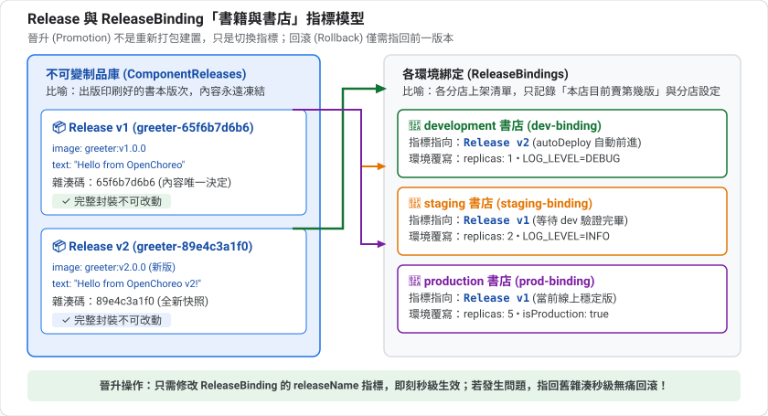
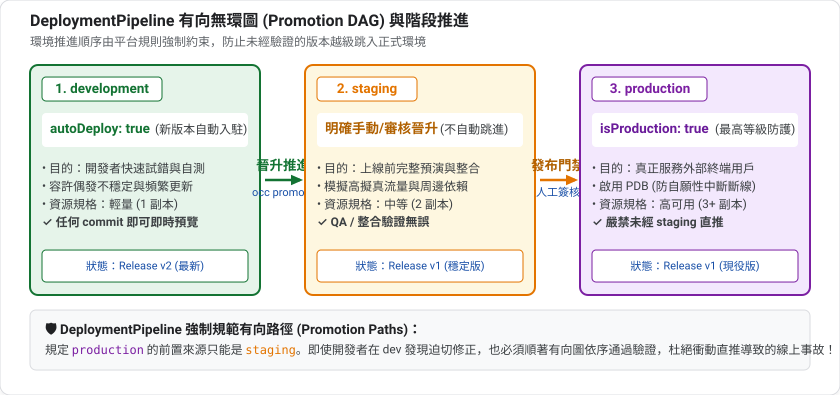
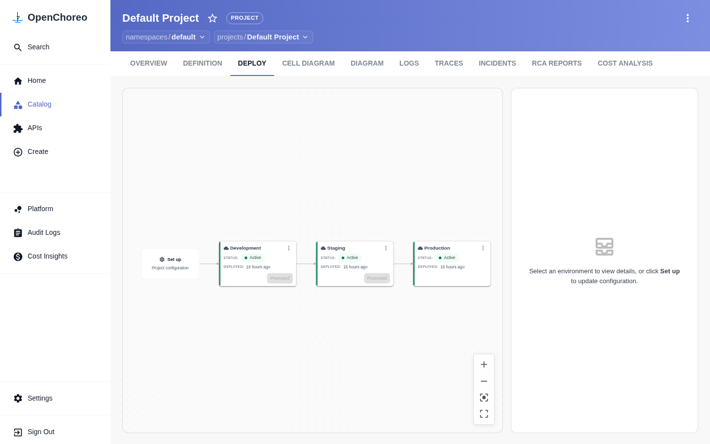
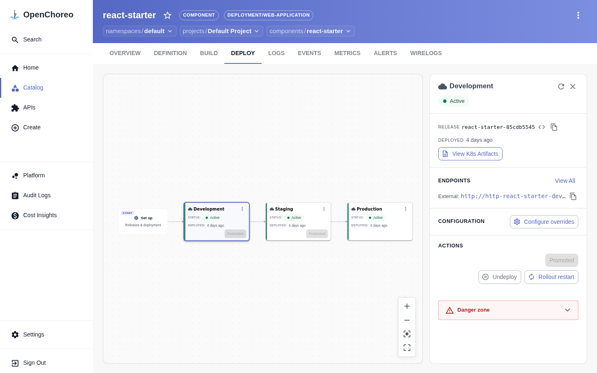

summary: 理解 Environment、DeploymentPipeline 與 ReleaseBinding,為每個環境設定不同的副本數與環境變數,並把同一個 Release 從 development 晉升到 staging、production
id: openchoreo-05-environments-promotion
categories: openchoreo,kubernetes,ci-cd
environments: Web
status: Published
feedback link: https://github.com/openchoreo/openchoreo/issues
author: 雷N

# OpenChoreo 實戰 05:多環境與 Promotion

## 概覽
Duration: 2

「建置一次,到處部署」是交付的基本原則。OpenChoreo 用**不可變的 Release** 加上**每個環境一個 ReleaseBinding** 實現它:同一份產物在各環境以相同方式執行,只有環境專屬設定不同。

### 先決條件

* 已完成第 1 到 3 課(第 4 課不是必要)
* 叢集有 `development`、`staging`、`production` 三個環境(Quick Start 預設就有)

### 你會學到

* Environment、DeploymentPipeline 與 Project 的關係
* ReleaseBinding 的結構:釘選 Release、環境覆寫
* 為 staging、production 手動建立 ReleaseBinding
* 觀察「dev 自動更新、其他環境維持釘選」
* 晉升(promotion)與回滾,本質上只是修改 `releaseName`

## 先備知識:環境、不可變制品與晉升
Duration: 8

### 為什麼需要多個環境?

| 環境 | 目的 | 典型特徵 |
|---|---|---|
| development | 開發者快速試錯 | 資源少、容許不穩定 |
| staging | 上線前的完整演練 | 盡量和 production 相似 |
| production | 真正服務使用者 | 高可用、嚴格管控 |

變更先在較低風險的環境驗證,再往前推,這個過程叫**晉升(promotion)**。

### 設定與程式碼分離

業界著名的 **Twelve-Factor App** 方法論有一條原則:**把設定放在環境裡,不要寫死在程式碼中**。理由是同一份程式碼會在不同環境執行,只有「資料庫位址、日誌等級、副本數」這類設定不同。

OpenChoreo 把這個原則做成制度:

| 內容 | 放哪裡 | 為什麼 |
|---|---|---|
| 跨環境一致的(映像、埠、元件類型) | Component / Workload | 每個環境都一樣,才有可比性 |
| 每個環境不同的(副本數、環境變數) | ReleaseBinding | 只改這裡,不動程式碼 |

### 不可變(Immutable)制品

**不可變**的意思是:一旦產生,內容就永遠不變。想改,就產生一個**新的**。

好處:

* **可重現**:「production 跑的 Release A」就是一個確定的東西
* **可回滾**:舊版本還在,切回去就好
* **可審計**:可以回答「那天到底部署了什麼」

OpenChoreo 的 ComponentRelease 就是這樣的不可變快照,它的名稱尾碼是內容雜湊,內容一變雜湊就變。

### Release 與 ReleaseBinding 的比喻

可以想像成**書與書店**:

| OpenChoreo | 比喻 |
|---|---|
| ComponentRelease | 一本書的某個「版次」(第一版、第二版),印出來就不改 |
| Environment | 不同的書店(實體店、網路書店、直營店) |
| ReleaseBinding | 「這家書店目前上架第幾版」的紀錄 |
| 晉升 | 把某家書店的上架版次,改成較新的一版 |
| 回滾 | 改回舊版次 |



這樣你就能理解:**晉升不是重新建置、重新打包,只是改變指標**。所以非常快、非常安全。

### DeploymentPipeline:有向圖

DeploymentPipeline 規定了「環境之間可以怎麼走」,本質上是一張**有向圖**:



它的價值是**強制流程**:例如規定 production 只能從 staging 來,不能從 development 直接跳過去。Project 透過 `deploymentPipelineRef` 選擇使用哪一條管線,所以同一個 Project 的所有元件遵守同一套流程。

### 兩種「自動」

* `autoDeploy`:新 Release 自動套用到**第一個環境**
* 之後的環境:需要**明確的晉升動作**(人或自動化流程決定)

這個設計讓「快速迭代」與「謹慎上線」並存。


Positive
: 接下來你會親手驗證這些概念:建立三個環境的綁定、讓 development 前進而其他環境不動、再做晉升與回滾。

## 環境與部署管線
Duration: 5

### 看看你的環境

```bash
kubectl get environment -n default
kubectl get deploymentpipeline -n default default -o yaml
```

預設會有三個 Environment,其中 `production` 標記為 `isProduction: true`。DeploymentPipeline 的重點是 `promotionPaths`:

```yaml
spec:
  promotionPaths:
  - sourceEnvironmentRef:
      kind: Environment
      name: development
    targetEnvironmentRefs:
    - kind: Environment
      name: staging
  - sourceEnvironmentRef:
      kind: Environment
      name: staging
    targetEnvironmentRefs:
    - kind: Environment
      name: production
```

這就是一張「有向圖」:development → staging → production。

### Project 如何選擇管線

```bash
kubectl get project default -n default -o jsonpath='{.spec}'
```

你會看到 `deploymentPipelineRef: {kind: DeploymentPipeline, name: default}`。**同一個 Project 內的所有 Component 共用同一條管線**。

| 資源 | 誰維護 | 作用 |
|---|---|---|
| Environment | 平台工程師 | 一個部署階段,綁定一個 DataPlane |
| DeploymentPipeline | 平台工程師 | 定義環境間可以怎麼晉升 |
| ReleaseBinding | 開發者/自動化 | 把某個 Release 釘在某個環境,並帶環境覆寫 |

### Control Plane 與 Data Plane 的橋樑:Environment 與 ClusterDataPlane

在架構上,`Environment` 屬於 **Control Plane** 的邏輯抽象,它如何落實到具體承載流量的 K8s 叢集?關鍵在於其 `spec.dataPlaneRef` 欄位:

```bash
kubectl get environment development -n default -o yaml
```

你會看到它精確指向一個 `ClusterDataPlane`:

```yaml
apiVersion: openchoreo.dev/v1alpha1
kind: Environment
metadata:
  name: development
spec:
  dataPlaneRef:
    kind: ClusterDataPlane
    name: default
  isProduction: false
```

#### 多叢集實體隔離機制

* **單一控制台,多個資料叢集**: 在多叢集企業環境中,`development` 可以指向測試叢集,而 `production` 指向實體隔離的生產專用 EKS/GKE 叢集(`ClusterDataPlane`)。
* **命名空間自動微隔離**: 當 ReleaseBinding 生效時,OpenChoreo 控制器會透過 `cluster-agent` 在對應的 Data Plane 上自動開闢專屬命名空間:`dp-<namespace>-<project>-<environment>-<hash>`(例如本課實測的 `dp-default-default-development-f8e58905`),確保不同環境的 Pod 具備嚴格的網路與資源邊界。
* **閘道與觀測平面自動綁定**: 查看 `kubectl get clusterdataplane default -o yaml`,你會發現 Data Plane 不僅配置了 Envoy Proxy 監聽埠(`19080`),還宣告了 `observabilityPlaneRef`,自動將該資料平面的日誌與指標接入中樞。

#### 實戰拆解：`ClusterDataPlane` 核心規格與心跳機制

現在，讓我們用 `kubectl` 親自檢視這個定義整個 Data Plane 的核心 CRD：

```bash
kubectl get clusterdataplane default -o yaml
```

你會看到類似以下的核心欄位：

```yaml
apiVersion: openchoreo.dev/v1alpha1
kind: ClusterDataPlane
metadata:
  name: default
spec:
  planeID: default
  clusterAgent:
    clientCA:
      value: "-----BEGIN CERTIFICATE-----\n..."
  gateway:
    ingress:
      external:
        http:
          host: openchoreoapis.localhost
          listenerName: http
          port: 19080
        name: gateway-default
        namespace: openchoreo-data-plane
  observabilityPlaneRef:
    kind: ClusterObservabilityPlane
    name: default
status:
  agentConnection:
    connected: true
    connectedAgents: 1
    lastHeartbeatTime: "2026-10-10T07:36:30Z"
    message: 1 agent connected
  conditions:
  - status: "True"
    type: Created
```

| 核心區塊 | 作用與底層機制 |
|---|---|
| `spec.clusterAgent.clientCA` | **mTLS 零信任連線依據**。Data Plane 內運行的 Agent 憑藉此 CA 簽發的客戶端憑證，向 Control Plane 建立反向 gRPC 長連線。 |
| `spec.gateway.ingress.external` | **Envoy 閘道拓撲規範**。宣告外部請求的主機後綴（`openchoreoapis.localhost`）、負載平衡監聽埠（`19080`）以及 Envoy Proxy 所在的平台命名空間（`openchoreo-data-plane`）。 |
| `spec.observabilityPlaneRef` | **關聯可觀測性**。指名此資料平面由哪個 `ClusterObservabilityPlane` 負責抓取日誌與指標。 |
| `status.agentConnection` | **連線健康度與即時心跳**。顯示當前是否有 Agent 連線（`connected: true`）以及最新的心跳同步時間（`lastHeartbeatTime`）。 |

#### Data Plane 實戰排錯指南 (Troubleshooting Runbook)

當開發者反映「服務已顯示 Healthy，但在 Data Plane 透過網址連不上或噴 503」時，SRE 與維運工程師可依照以下標準四部曲進行 Data Plane 故障排查：

1. **第一關：確認跨平面通訊通道存活**
   ```bash
   kubectl get clusterdataplane default -o jsonpath='{.status.agentConnection}'
   kubectl logs -n openchoreo-data-plane -l app.kubernetes.io/name=cluster-agent-dataplane --tail=50
   ```
   若 `connected` 為 `false`，代表 Control Plane 無法向 Data Plane 下發指令，需檢查網路連線或 mTLS 憑證。

2. **第二關：確認宣告式合約渲染成功**
   ```bash
   kubectl get renderedrelease -n default
   kubectl describe renderedrelease <component>-<environment> -n default
   ```
   檢查 `status.conditions` 是否包含 `ResourcesApplied=True`。若為 False，代表 Kubernetes 原生工件在 Data Plane 套用失敗（例如映像拉取失敗或名稱衝突）。

3. **第三關：確認 Envoy Gateway 與 HTTPRoute 生效**
   ```bash
   kubectl get httproute -A
   kubectl describe httproute <route-name> -n dp-...
   ```
   檢查 `status.parents[0].conditions` 中的 `Accepted` 與 `ResolvedRefs` 是否皆為 `True`。若為 False，代表路徑衝突或後端 Service 找不到。

4. **第四關：確認零信任 NetworkPolicy 未意外封鎖流量**
   ```bash
   kubectl get networkpolicy -n dp-... -o yaml
   ```
   OpenChoreo 預設配置嚴格的白名單。確認 Ingress 規則是否放行了來源（Envoy 閘道或同專案依賴元件）。

## 部署到 development
Duration: 4

沿用第 3 課的映像,建立 `promo-demo.yaml`:

```yaml
apiVersion: openchoreo.dev/v1alpha1
kind: Component
metadata:
  name: promo-demo
  namespace: default
spec:
  owner:
    projectName: default
  autoDeploy: true
  componentType:
    kind: ClusterComponentType
    name: deployment/service
---
apiVersion: openchoreo.dev/v1alpha1
kind: Workload
metadata:
  name: promo-demo-workload
  namespace: default
spec:
  owner:
    componentName: promo-demo
    projectName: default
  endpoints:
    http:
      type: HTTP
      port: 9090
      visibility: [external]
  container:
    image: "ghcr.io/openchoreo/samples/greeter-service:latest"
    command:
      - ./go-greeter
    args:
      - --port
      - "9090"
    env:
      - key: LOG_LEVEL
        value: "info"
```

```bash
kubectl apply -f promo-demo.yaml
kubectl wait --for=condition=Ready component/promo-demo -n default --timeout=60s
kubectl get releasebinding -n default | grep promo
```

只有 `promo-demo-development` 被自動建立。因為 `autoDeploy: true` 只會部署到管線的**第一個環境**。

記下目前的 Release 名稱:

```bash
kubectl get component promo-demo -n default -o jsonpath='{.status.latestRelease.name}{"\n"}'
```

下面以 `RELEASE1` 代表它。

## 認識 ReleaseBinding
Duration: 4

看看 development 自動產生的 ReleaseBinding:

```bash
kubectl get releasebinding promo-demo-development -n default -o yaml
```

重要欄位:

| 欄位 | 意義 |
|---|---|
| `spec.environment` | 綁定的環境 |
| `spec.owner` | 屬於哪個 Component |
| `spec.releaseName` | **釘選**的 ComponentRelease |
| `spec.state` | `Active` 表示部署中 |
| `spec.componentTypeEnvironmentConfigs` | 覆寫 ComponentType 的環境參數(例如 `replicas`) |
| `spec.workloadOverrides.container.env` | 覆寫容器環境變數 |

Positive
: 第 2 課說過:跨環境一致的值放 Component 的 Parameters,**環境專屬的值放 ReleaseBinding**。這就是為什麼同一個 Release 可以在 staging 跑 2 個副本、在 production 跑 1 個,卻不用改 Component。

## 建立 staging 與 production
Duration: 6

建立 `promo-staging.yaml`,把 `RELEASE1` 換成你的 Release 名稱:

```yaml
apiVersion: openchoreo.dev/v1alpha1
kind: ReleaseBinding
metadata:
  name: promo-demo-staging
  namespace: default
spec:
  environment: staging
  owner:
    componentName: promo-demo
    projectName: default
  releaseName: RELEASE1
  state: Active
  componentTypeEnvironmentConfigs:
    replicas: 2
  workloadOverrides:
    container:
      env:
        - key: LOG_LEVEL
          value: warn
```

再建立 `promo-prod.yaml`,環境改成 `production`,名稱改成 `promo-demo-production`,`replicas: 1`,`LOG_LEVEL` 設為 `error`。然後套用:

```bash
kubectl apply -f promo-staging.yaml -f promo-prod.yaml
kubectl wait --for=condition=Available deploy -A -l openchoreo.dev/component=promo-demo --timeout=200s
```

### 驗證三個環境

```bash
kubectl get deploy -A | grep promo
```

預期 staging 是 `2/2`,development 與 production 是 `1/1`。

環境變數被放進各環境的 ConfigMap:

```bash
for ns in development staging production; do
  kubectl get cm -A -o jsonpath='{range .items[*]}{.metadata.namespace}{" "}{.metadata.name}{" "}{.data}{"\n"}{end}' \
    | grep "promo-demo-$ns-env-configs"
done
```

預期分別看到 `{"LOG_LEVEL":"debug"}`(若尚未改動則是 `info`)、`warn`、`error`。

呼叫三個環境(主機名稱格式 `{環境}-default.openchoreoapis.localhost`):

```bash
for e in development staging production; do
  curl -s http://$e-default.openchoreoapis.localhost:19080/promo-demo-http/greeter/greet; echo " <- $e"
done
```

在入口網站的 DEPLOY 分頁中，可視覺化檢視三個環境的 Promotion 流水線：



點擊特定環境卡片，可在右側側邊欄檢視目前釘選的 Release 雜湊、端點網址與 **View K8s Artifacts** 按鈕：



Negative
: 本課是手寫 ReleaseBinding,為了讓你看清楚結構,所以 `kubectl apply` 不會檢查是否符合 DeploymentPipeline 的晉升路徑。實務上建議用 `occ component deploy --to` 或 GitOps 流程,讓管線規則發揮作用(見最後一節)。

## 新版本:dev 前進,其他環境不動
Duration: 5

修改程式的設定,產生新的 Release:

```bash
sed -i 's/value: "info"/value: "debug"/' promo-demo.yaml
kubectl apply -f promo-demo.yaml
sleep 10
kubectl get component promo-demo -n default -o jsonpath='{.status.latestRelease.name}{"\n"}'
kubectl get releasebinding -n default \
  -o custom-columns=NAME:.metadata.name,ENV:.spec.environment,RELEASE:.spec.releaseName | grep -E 'NAME|promo'
```

預期結果:

| ReleaseBinding | Release |
|---|---|
| promo-demo-development | **新的** `RELEASE2` |
| promo-demo-staging | 仍是 `RELEASE1` |
| promo-demo-production | 仍是 `RELEASE1` |

Positive
: 這就是「釘選」的價值:你可以在 development 反覆迭代,staging 與 production 不受影響,直到你明確決定晉升。

## 晉升與回滾
Duration: 5

**晉升 = 把下一個環境的 `releaseName` 指向新的 Release。** 把 `RELEASE2` 換成上一節看到的新名稱:

```bash
kubectl patch releasebinding promo-demo-staging -n default \
  --type merge -p '{"spec":{"releaseName":"RELEASE2"}}'
sleep 15
kubectl get releasebinding -n default \
  -o custom-columns=NAME:.metadata.name,RELEASE:.spec.releaseName | grep -E 'NAME|promo'
```

staging 現在跟 development 同版本,但**環境覆寫沒有消失**:staging 仍然是 2 個副本、`LOG_LEVEL=warn`。

### 回滾

回滾只是把釘選改回去:

```bash
kubectl patch releasebinding promo-demo-staging -n default \
  --type merge -p '{"spec":{"releaseName":"RELEASE1"}}'
kubectl get releasebinding promo-demo-staging -n default \
  -o jsonpath='{.status.conditions[?(@.type=="Ready")].message}{"\n"}'
```

預期看到 `ReleaseBinding is ready`。因為 Release 不可變,回滾得到的和當初部署的**完全一樣**。

### 用 occ 晉升

`occ` 也提供晉升指令(依 `occ component deploy --help`):

```bash
# 部署最新 Release 到管線的第一個環境
occ component deploy promo-demo --namespace default --project default

# 晉升到下一個環境
occ component deploy promo-demo --namespace default --project default --to staging
```

Negative
: `occ` 需要先 `occ login`(會開瀏覽器)。本課的 `occ` 指令是依 `--help` 說明整理,沒有實際執行。還有 `occ releasebinding generate` 可以產生 ReleaseBinding 的 YAML,適合搭配 GitOps(第 6 課)。

## 清理
Duration: 1

```bash
kubectl delete releasebinding promo-demo-staging promo-demo-production -n default
kubectl delete -f promo-demo.yaml --ignore-not-found
```

## 自我檢核
Duration: 4

試著不看上文回答下面的問題;答不出來的,回頭看對應的章節。

1. 為什麼說「晉升不是重新建置」?

2. `autoDeploy` 會把新 Release 部署到哪些環境?

3. 跨環境一致的內容與每環境不同的內容,各放在哪?

4. production 出問題,想回到上一版怎麼做?

### 參考答案

1. Release 是不可變快照,晉升只是把下一個環境的 `releaseName` 指向它,所以快速、可重現、可回滾。

2. 只會部署到管線的第一個環境;之後的環境需要明確的晉升。

3. 一致的放 Component / Workload;每環境不同的(副本數、環境變數)放 ReleaseBinding。

4. 把 production 的 ReleaseBinding 的 `releaseName` 改回舊的 Release 名稱。

## 恭喜與下一步
Duration: 1

你已經:

* ✅ 看懂 Environment → DeploymentPipeline → Project 的關係
* ✅ 為每個環境手寫 ReleaseBinding 並設定不同的副本數與環境變數
* ✅ 驗證了 Release 釘選:dev 前進,其他環境不動
* ✅ 完成晉升與回滾

### 重點整理

| 概念 | 一句話 |
|---|---|
| Release | 不可變的版本,建置一次 |
| ReleaseBinding | 把 Release 釘在環境,並帶環境覆寫 |
| 晉升 | 修改下一個環境的 `releaseName` |
| 回滾 | 把 `releaseName` 改回舊值 |

### 下一課

**06:GitOps** — 不再手動 `kubectl patch`,把 ReleaseBinding 放進 Git,由 Argo CD 同步。
