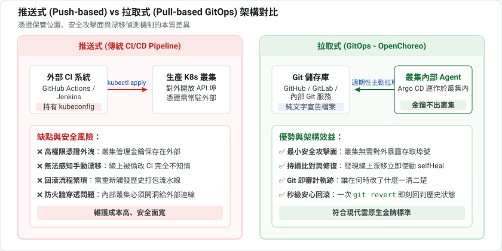
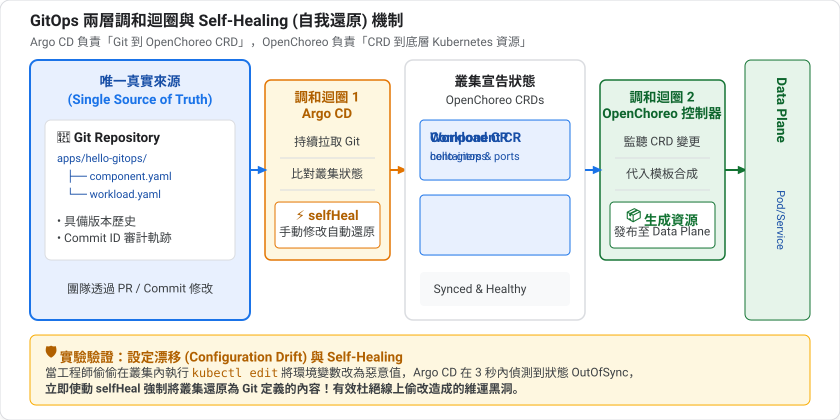
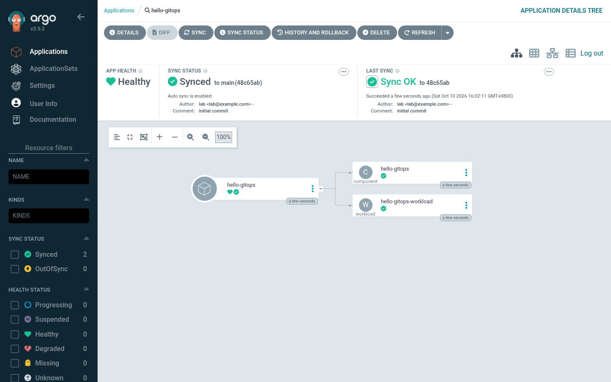
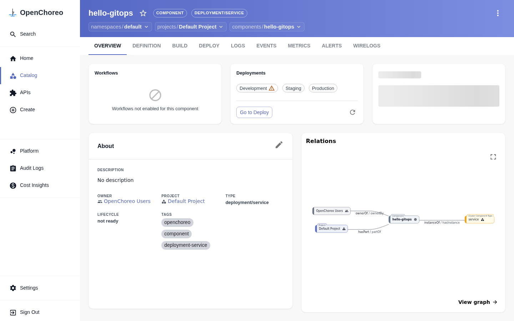
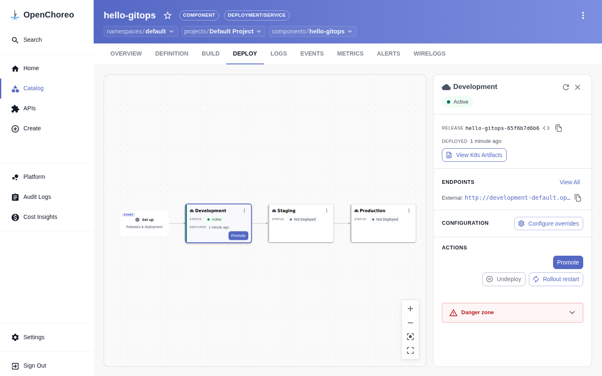

summary: 把 OpenChoreo 的 Component 與 Workload 放進 Git,由 Argo CD 自動同步,體驗修改即部署與漂移自動還原
id: openchoreo-06-gitops
categories: openchoreo,kubernetes,gitops
environments: Web
status: Published
feedback link: https://github.com/openchoreo/openchoreo/issues
author: 雷N

# OpenChoreo 實戰 06:GitOps

## 概覽
Duration: 2

前幾課我們都用 `kubectl apply` 手動部署。這一課把「期望狀態」放進 Git,讓 Argo CD 持續把叢集調和成 Git 的樣子。

### 為什麼 OpenChoreo 很適合 GitOps?

OpenChoreo 的所有資源(Project、Component、Workload…)都是 Kubernetes CRD,所以任何 GitOps 工具都能直接同步它們,不需要特別的整合。

### 先決條件

* 已完成第 1 到 3 課
* 叢集已安裝 Argo CD(`argocd` namespace)。第 1 課的 k3d 環境若沒有,請參考 [Argo CD 安裝文件](https://argo-cd.readthedocs.io/en/stable/getting_started/)
* 本機有 `git`

### 你會學到

* 在叢集內架一個簡易 Git 伺服器
* 建立 Argo CD Application 指向 Git repo
* 修改 Git → 自動部署
* 手動改叢集 → 被 selfHeal 還原

## 先備知識:GitOps 是什麼?
Duration: 8

### 從「手動部署」說起

到目前為止,我們都是自己在終端機執行 `kubectl apply`。這在實驗時很方便,但在團隊裡會遇到問題:

* 誰在什麼時候改了什麼?不知道
* 有人偷偷 `kubectl edit` 了線上環境,和文件不一致(**設定漂移**,configuration drift)
* 壞掉了想回到昨天的狀態?要靠記憶
* 部署權限要發給每一個人的電腦

### GitOps 的四個原則

GitOps(OpenGitOps 社群定義的原則)主張:

| 原則 | 意思 |
|---|---|
| **宣告式** | 系統的期望狀態用宣告方式描述 |
| **版本化且不可變** | 期望狀態存在 Git,有完整歷史,不能偷改 |
| **自動拉取** | 軟體代理人自動從 Git 取得最新期望狀態 |
| **持續調和** | 代理人持續比對實際與期望,發現差異就修正 |

一句話:**Git 是唯一的真實來源(single source of truth)**,叢集只是 Git 的反映。

### 推送式 vs 拉取式部署

| | 推送式(傳統 CI/CD) | 拉取式(GitOps) |
|---|---|---|
| 誰動手 | CI 系統執行 `kubectl apply` | 叢集內的代理人自己去 Git 拉 |
| 叢集憑證 | 必須交給 CI 系統 | 留在叢集內,不外流 |
| 發現漂移 | 通常不會 | 持續比對,自動發現 |
| 回滾 | 重跑舊的流水線 | `git revert`,代理人自動套用 |



### Argo CD 的核心名詞

| 名詞 | 說明 |
|---|---|
| **Application** | 一個「Git 的某個目錄 → 叢集的某個 namespace」的對應關係 |
| **Sync(同步)** | 把叢集調整成 Git 的樣子 |
| **Synced / OutOfSync** | 叢集和 Git 一致 / 不一致 |
| **Health** | 資源本身是否健康(例如 Deployment 是否就緒) |
| **selfHeal** | 叢集被手動改了,自動還原 |
| **prune** | Git 裡刪掉的檔案,叢集裡的資源也刪掉 |

注意 **Sync 與 Health 是兩件事**:Synced 只代表「和 Git 一致」,不代表應用正常運作。

### 兩層調和迴圈

這一課很有趣,因為有**兩個**調和迴圈疊在一起:



* Argo CD 負責「Git → OpenChoreo 資源」
* OpenChoreo 控制器負責「OpenChoreo 資源 → Kubernetes 資源」

兩者都是第 2 課說的「宣告期望狀態、持續調和」,所以能無縫銜接。

### Argo CD 與 OpenChoreo 的職責分工：以後到底在哪裡維護？

很多企業已經導入了 Argo CD 做 GitOps。引入 OpenChoreo 後，團隊常常會問：**「兩者有何差別？以後我們到底要在哪裡維護部署這整件事？」**

#### 傳統 GitOps vs OpenChoreo GitOps

| 維度 | 傳統 Argo CD GitOps | OpenChoreo + Argo CD 雙層 GitOps |
|---|---|---|
| **Git 裡維護什麼** | 上千行原生 K8s YAML（Deployment、Service、Ingress、HPA、NetworkPolicy…）或龐大的 Helm/Kustomize | **極簡的高階業務契約**（僅 30~50 行 `Component` 與 `Workload`） |
| **誰寫這些 YAML** | 業務開發者必須被迫學習 K8s 網路、探針、安全標籤語法 | 業務開發者只填寫業務參數（映像檔、環境變數、對外埠） |
| **規範與安全護欄** | 仰賴人工 Code Review 或外掛 OPA/Kyverno 策略檢查 | 平台工程師在 `ComponentType` 定義 Golden Path，自動生成合規架構 |
| **開發者除錯視圖** | 只能在 Argo CD 看到龐大複雜的 Pod 樹狀圖，缺少日誌與相依圖 | 開發者在 **OpenChoreo Portal** 享有專案拓撲、日誌串流與端點一覽 |

#### 企業落地分工：不同角色在哪裡維護？

1. **業務開發團隊 (App Developers)**
   * **日常維護地點**：**應用的 Git 倉庫**。
   * **操作方式**：只維護 `apps/<app>/component.yaml` 與 `workload.yaml`。若要改映像檔或環境變數，直接開 PR 提交 Git。
   * **狀態與除錯**：日常回到 **OpenChoreo Portal (Backstage)** 介面。查看元件健康度、查日誌、抓端點網址，完全不需要進 Kubernetes 或操作 Argo CD！
2. **平台工程師 (Platform Engineers)**
   * **日常維護地點**：**平台基礎設施 Git 倉庫**。
   * **操作方式**：維護標準的 `ComponentType`（如 `deployment/service`）、`Trait`（監控與儲存附加能力）與 `DeploymentPipeline`（晉升規則）。
   * **效益**：只要更新一次平台範本，全公司數百個微服務自動套用最新架構，無需逐一修改各應用的 Helm Chart。
3. **維運與 SRE 團隊 (Operations / SRE)**
   * **日常維護地點**：**Argo CD 控制台 + OpenChoreo Observability**。
   * **操作方式**：在 **Argo CD UI** 監看 Git 同步健康度（Sync Status / OutOfSync）與防漂移自我修復（Self-Healing）；在 OpenSearch / Prometheus 監看微服務系統指標。

#### OpenChoreo 的核心勢能：從「搬運孤立資源」到「賦予業務關聯」

如果 Argo CD 已經能負責 GitOps 同步,那為什麼企業還需要 OpenChoreo？**答案正是「關聯性 (Relationships & Context)」與「平台抽象治理」！**

在傳統 Kubernetes 與 Argo CD 中,所有資源都是**孤立的技術積木**(Deployment 只是 Deployment,Service 只是 Service,彼此僅靠 label selector 弱關聯)。Argo CD 知道如何把這些 YAML 塞給 K8s,但它**完全不知道這些資源在商業與架構上的意義**。

OpenChoreo 為 GitOps 注入了四大維度的「語意關聯性」:

| 關聯維度 | 傳統 Argo CD 看到的 | OpenChoreo 賦予的業務關聯 |
|---|---|---|
| **1. 領域架構關聯**<br>(Architecture Graph) | 幾十個扁平的 Pod 與 Service,看不出誰呼叫誰 | **`Project` ➔ `Component` ➔ `Dependencies`**: 透過領域驅動設計(DDD),在 UI 的 DIAGRAM 自動繪製微服務拓撲與呼叫依賴鏈。 |
| **2. 環境晉升關聯**<br>(Promotion Pipeline) | 每個環境一個獨立資料夾,各環境間缺乏關係 | **`Environment` ➔ `DeploymentPipeline` ➔ `ReleaseBinding`**: 建立有向無環圖(DAG),清晰標示「同一個不可變製品」在 Dev ➔ Staging ➔ Prod 的流轉軌跡。 |
| **3. 網路與安全關聯**<br>(Policy Automation) | 需要維運手寫繁複的 NetworkPolicy 與 Ingress | **意圖即安全**: 只要宣告 `dependencies`,控制器自動關聯並產生 Data Plane 的 Envoy 路由與零信任 NetworkPolicy 白名單。 |
| **4. 遙測與除錯關聯**<br>(Contextual Telemetry) | 拋錯時要去 Elasticsearch/Grafana 手動搜尋 namespace | **上下文直達**: 在元件頁面點擊 LOGS / METRICS,直接關聯展示該服務的即時日誌與指標,無需跨系統查找。 |

簡言之:**Argo CD 負責「無腦且精準地搬運」,而 OpenChoreo 負責「理解架構、賦予關聯、自動治理」！**

### 實例對比：單用 Argo CD vs 加入 OpenChoreo 治理

為了讓這個分工具體有感,我們以真實企業情境「上線一個電商訂單微服務 (`order-api`)」為例:
此服務需要:
1. 運行容器映像 `order-api:v1.2`
2. 暴露 HTTP 8080 對外接收訂單請求
3. 依賴同專案的 `payment-service` (付款服務)
4. 注入環境變數 `LOG_LEVEL=info`
5. 生產防護:健康檢查探針、資源限制、零信任 NetworkPolicy 白名單、Envoy 閘道路由

#### 1. Git 倉庫結構與檔案維護量對比

```
【單用 Argo CD (純 K8s / Helm)】            【加入 OpenChoreo 治理】
order-api-gitops/                          order-api-gitops/
├── base/                                  └── apps/order-api/
│   ├── deployment.yaml      (~85 行)          ├── component.yaml (~15 行)
│   ├── service.yaml         (~25 行)          └── workload.yaml  (~30 行)
│   ├── httproute.yaml       (~35 行)
│   ├── networkpolicy.yaml   (~45 行)       總計: 2 個檔案、45 行簡潔業務宣告
│   ├── hpa.yaml             (~30 行)       (開發者不必管底層 K8s 網路與探針)
│   ├── serviceaccount.yaml  (~15 行)
│   └── kustomization.yaml   (~20 行)
└── overlays/ (dev, staging, prod)
總計: 7+ 個檔案、250+ 行底層 YAML
(開發者必須精通 K8s 全部細節)
```

#### 2. 開發者在 Git 撰寫的 YAML 實例對比

##### A. 單用 Argo CD：開發者必須手寫全部底層細節 (片段)

開發者必須手動拼湊 Deployment、NetworkPolicy、HTTPRoute:

```yaml
# 單用 Argo CD: 開發者在 deployment.yaml 中必須自己搞懂探針與安全性
apiVersion: apps/v1
kind: Deployment
metadata:
  name: order-api
spec:
  replicas: 2
  selector:
    matchLabels:
      app: order-api
  template:
    metadata:
      labels:
        app: order-api
    spec:
      containers:
      - name: app
        image: company-registry.io/order-api:v1.2
        ports:
        - containerPort: 8080
        livenessProbe:              # 漏寫探針，Pod 當掉 K8s 不會重啟
          httpGet:
            path: /healthz
            port: 8080
        resources:                  # 漏寫限制，可能吃垮整個節點
          limits: { cpu: 500m, memory: 512Mi }
          requests: { cpu: 100m, memory: 128Mi }
        securityContext:            # 漏寫這段，容器可能以 root 高風險執行
          readOnlyRootFilesystem: true
          runAsNonRoot: true
          runAsUser: 10001
---
# 還要手寫 40 行 NetworkPolicy 才能防止其他非相關 Pod 隨意連入
apiVersion: networking.k8s.io/v1
kind: NetworkPolicy
metadata:
  name: order-api-netpol
spec:
  podSelector: { matchLabels: { app: order-api } }
  ingress:
  - from:
    - podSelector: { matchLabels: { app: gateway-envoy } }
    - podSelector: { matchLabels: { app: payment-service } }
    ports: [{ port: 8080, protocol: TCP }]
```

> **痛點**：全公司 50 個業務開發者都要複製貼上這些代碼。有人探針寫錯、有人忘了配 NetworkPolicy 造成資安漏洞、有人 label 拼錯導致 Service 404。

##### B. 加入 OpenChoreo 治理：開發者只宣告業務意圖

在 OpenChoreo 模型下，開發者只需寫簡短的業務合約（`apps/order-api/`）：

```yaml
# 1. component.yaml: 宣告專案歸屬與採用的平台模板
apiVersion: openchoreo.dev/v1alpha1
kind: Component
metadata:
  name: order-api
  namespace: default
spec:
  owner:
    projectName: ecommerce
  autoDeploy: true
  componentType:
    kind: ClusterComponentType
    name: deployment/service
---
# 2. workload.yaml: 宣告容器、端點與微服務依賴
apiVersion: openchoreo.dev/v1alpha1
kind: Workload
metadata:
  name: order-api-workload
  namespace: default
spec:
  owner:
    componentName: order-api
    projectName: ecommerce
  endpoints:
    http:
      type: HTTP
      port: 8080
      visibility: [external]
  dependencies:
    endpoints:
      - component: payment-service  # 只要宣告依賴，平台自動打通安全網路與白名單！
        name: http
        visibility: project
        envBindings:
          url: PAYMENT_SERVICE_URL  # 自動將被依賴服務的位址注入為環境變數
  container:
    image: "company-registry.io/order-api:v1.2"
    env:
      - key: LOG_LEVEL
        value: "info"
```

> **成果**：開發者只需寫 50 行業務相關宣告。底層的健康探針、Envoy 閘道父參照、零信任 NetworkPolicy 白名單與資源限制，**全部由平台工程師定義的 `ClusterComponentType` 自動編譯補齊**！（各 CRD 的完整規格手冊，詳見第 2 課 Step 4「開發者資源」與第 9 課微服務章節）。

#### 3. 真實企業治理場景實測

##### 場景一：資安長下達新命令時 (最顯威力)
* **要求**：「為通過 ISO 27001 資安稽核，全公司所有 Pod 必須強制開啟 `readOnlyRootFilesystem: true` 與 `runAsNonRoot: true`！」
* **單用 Argo CD 的治理地獄**：
  維運團隊必須發起跨團隊大動員，向 50 個開發團隊、200 個微服務 repo 各提一個 PR 修改 `deployment.yaml`。若直接用 OPA/Kyverno 策略阻擋，隔天大量開發者的 GitOps 部署直接紅燈報錯，專案嚴重卡關。
* **加入 OpenChoreo 的優雅治理**：
  平台工程師在平台 repo 修改 `ClusterComponentType: deployment/service` 的 CEL 模板，Argo CD 同步進 Control Plane。**全公司 200 個微服務在下一次調和或發布時，自動全部生成符合新規範的 Deployment**！業務工程師的 Git repo **完全不需要改動任何一行程式碼**！

##### 場景二：服務異常排錯時
* **單用 Argo CD**：
  開發者登入 Argo CD UI，面對的是由 Deployment、ReplicaSet、Pod、Service、EndpointSlice、NetworkPolicy 等組成的複雜「資源蜘蛛網」。找不到日誌，必須開 Terminal 跑 `kubectl logs`。
* **加入 OpenChoreo**：
  開發者登入 OpenChoreo Portal：
  * 在 **OVERVIEW** 看微服務架構相依關係圖（看 `order-api` 與 `payment-service` 的連線）。
  * 在 **LOGS** 直接看即時聚合日誌串流。
  * 在 **DEPLOY** 一鍵點擊「View K8s Artifacts」，平台把底層自動渲染出來的 5 大 K8s 物件整齊列出。

### 為什麼 ReleaseBinding 不好放進 Git?

ReleaseBinding 的 `releaseName` 帶有內容雜湊(如 `hello-gitops-65f6b7d6b6`),是控制器**在 Git 之外**產生的,你無法事先寫在檔案裡。完整的 GitOps 流程需要工具先把這類檔案產生出來再提交,這也是 OpenChoreo 提供 `occ releasebinding generate` 的原因。本課聚焦在 Component 與 Workload。

準備好實驗檔案吧。

## 準備實驗檔案
Duration: 3

本課的檔案放在 `codelabs/labs/06-gitops/`:

```
06-gitops/
├── git-server.yaml     # 叢集內的 Git 伺服器
├── publish.sh          # 把 ./repo 推到 Git 伺服器
├── application.yaml    # Argo CD Application
├── repo-template/apps/hello-gitops/   # 範本
│   ├── component.yaml
│   └── workload.yaml
└── repo/                              # 第一次執行 publish.sh 時由範本複製,並初始化為 git repo
```

### Git 裡放什麼?

`repo/apps/hello-gitops/component.yaml`:

```yaml
apiVersion: openchoreo.dev/v1alpha1
kind: Component
metadata:
  name: hello-gitops
  namespace: default
spec:
  owner:
    projectName: default
  autoDeploy: true
  componentType:
    kind: ClusterComponentType
    name: deployment/service
```

`repo/apps/hello-gitops/workload.yaml`:

```yaml
apiVersion: openchoreo.dev/v1alpha1
kind: Workload
metadata:
  name: hello-gitops-workload
  namespace: default
spec:
  owner:
    componentName: hello-gitops
    projectName: default
  endpoints:
    http:
      type: HTTP
      port: 9090
      visibility: [external]
  container:
    image: "ghcr.io/openchoreo/samples/greeter-service:latest"
    command:
      - ./go-greeter
    args:
      - --port
      - "9090"
    env:
      - key: LOG_LEVEL
        value: "info"
```

這和第 3 課的 YAML 幾乎一樣,差別只是它現在住在 Git 裡。

Positive
: 為什麼不把 ReleaseBinding 也放進 Git?因為 ReleaseBinding 的 `releaseName` 是控制器依內容雜湊產生的(例如 `hello-gitops-65f6b7d6b6`),事先寫不出來。OpenChoreo 另外提供 `occ releasebinding generate` 來產生這類檔案,適合搭配完整的 GitOps 目錄結構,本課不涵蓋。

## 架設 Git 伺服器
Duration: 5

為了讓實驗不依賴外部服務,我們在叢集內用 nginx + `git-http-backend` 架一個簡易 Git 伺服器(`git-server.yaml`)。核心是它的啟動腳本:

```bash
apk add --no-cache git git-daemon fcgiwrap spawn-fcgi
test -x /usr/libexec/git-core/git-http-backend
```

Negative
: **注意套件名稱。** `git-daemon` 這個套件很關鍵:新版 Alpine 把 `git-http-backend` 拆到 `git-daemon`,只裝 `git` 的話 nginx 會對所有請求回 `403 Forbidden`,Argo CD 就會報 `failed to list refs: authorization failed: 403 Forbidden`。我們的啟動腳本用 `test -x` 在缺少時直接讓 Pod 失敗,比靜默出錯更容易發現。

另一個陷阱:這個伺服器用 `emptyDir` 存放 repo,**Pod 一重建 repo 就消失**,Argo CD 會報同樣的 403。僅供實驗,不要用於正式環境。

套用:

```bash
cd codelabs/labs/06-gitops
kubectl apply -f git-server.yaml
kubectl wait --for=condition=Available deploy/git-server -n codelab-git --timeout=180s
```

## 發佈 repo 並建立 Application
Duration: 5

`publish.sh` 會初始化 `./repo` 為 Git repo、commit,再打包成 bare repo 複製進 Git 伺服器:

```bash
./publish.sh "add hello-gitops"
```

查看 `application.yaml`:

```yaml
apiVersion: argoproj.io/v1alpha1
kind: Application
metadata:
  name: hello-gitops
  namespace: argocd
spec:
  project: default
  source:
    repoURL: http://git-server.codelab-git.svc.cluster.local/codelab-gitops.git
    targetRevision: main
    path: apps/hello-gitops
  destination:
    server: https://kubernetes.default.svc
    namespace: default
  syncPolicy:
    automated:
      prune: true
      selfHeal: true
```

| 欄位 | 意義 |
|---|---|
| `source.repoURL / path` | 從哪個 repo、哪個目錄讀取期望狀態 |
| `destination.namespace` | 套用到哪個 namespace |
| `automated` | 偵測到差異就自動同步,不用手動按 Sync |
| `prune: true` | Git 裡刪掉的資源,叢集也刪 |
| `selfHeal: true` | 叢集被手動改動時,自動還原成 Git 的樣子 |

套用並觀察:

```bash
kubectl apply -f application.yaml
sleep 30
kubectl get application hello-gitops -n argocd
kubectl get component,workload -n default | grep hello
```

預期 `Synced` 與 `Healthy`,並看到由 Git 建立的 Component 和 Workload。

Positive
: 你沒有執行任何 `kubectl apply` 去建立 Component。它是 Argo CD 從 Git 讀出來、套用到叢集的。

### 雙控制台對照：Argo CD 與 OpenChoreo 視覺化拓撲

當 Application 同步成功後，我們可以在兩個系統中看見各自的分工：

**1. Argo CD 控制台（Git 同步層）**：
在 Argo CD UI 中，可以看到 Application 呈現 `Synced` 與 `Healthy`。最值得注意的是：**Argo CD 的資源樹只有** `Component` **與** `Workload` **兩個節點！** 它完全不需要管理繁雜的底層 Kubernetes 資源：



**2. OpenChoreo Portal 門戶（開發者體驗層）**：
切換到 OpenChoreo 入口網站，開發者看到的則是直觀的元件全景與相依關係：



切換至 **DEPLOY** 分頁，OpenChoreo 控制器已自動將 Git 同步進來的版本完成 Development 環境部署（顯示綠色 Active），並提供了一鍵「View K8s Artifacts」與「Promote」晉升功能：



## 改 Git,觸發部署
Duration: 5

先記下目前的 Release:

```bash
kubectl get component hello-gitops -n default -o jsonpath='{.status.latestRelease.name}{"\n"}'
```

把 `LOG_LEVEL` 改成 `debug`,commit 並發佈:

```bash
sed -i 's/value: "info"/value: "debug"/' repo/apps/hello-gitops/workload.yaml
./publish.sh "set LOG_LEVEL=debug"
```

Argo CD 預設每 3 分鐘輪詢一次 Git。為了不等,手動要求重新整理:

```bash
kubectl annotate application hello-gitops -n argocd argocd.argoproj.io/refresh=hard --overwrite
sleep 20
kubectl get workload hello-gitops-workload -n default -o jsonpath='{.spec.container.env}{"\n"}'
kubectl get component hello-gitops -n default -o jsonpath='{.status.latestRelease.name}{"\n"}'
```

預期 `LOG_LEVEL` 變成 `debug`,而且 `latestRelease` 變成新的名稱:Git 的變更 → Workload 更新 → OpenChoreo 產生新的 ComponentRelease → 自動部署到 development。

Positive
: 整條鏈是 **Git commit → Argo CD → OpenChoreo 控制器 → Release → Data Plane**。你只做了最前面的一步。

## 漂移與 selfHeal
Duration: 4

模擬有人直接動叢集(俗稱 configuration drift):

```bash
kubectl patch workload hello-gitops-workload -n default --type json \
  -p '[{"op":"replace","path":"/spec/container/env/0/value","value":"error"}]'
kubectl get workload hello-gitops-workload -n default -o jsonpath='{.spec.container.env[0].value}{"\n"}'
```

這時會看到 `error`。等 20 秒再看:

```bash
sleep 20
kubectl get workload hello-gitops-workload -n default -o jsonpath='{.spec.container.env[0].value}{"\n"}'
kubectl get application hello-gitops -n argocd
```

預期值被還原成 `debug`(Git 裡的值),Application 仍是 `Synced`。

Positive
: 這就是 GitOps 的好處:**Git 是唯一的真實來源**。任何未經 Git 的手動修改都會被撤銷,也留下了完整、可審計、可回溯的變更歷史。

## 刪除與 prune
Duration: 3

`prune: true` 的意思是:從 Git 刪掉檔案,Argo CD 會把對應資源從叢集刪掉。

```bash
git -C repo rm -r apps/hello-gitops
./publish.sh "remove hello-gitops"
kubectl annotate application hello-gitops -n argocd argocd.argoproj.io/refresh=hard --overwrite
sleep 20
kubectl get component,workload -n default | grep hello || echo "pruned"
```

Negative
: 這一段是依 Argo CD 的 `prune` 語意撰寫,作者實測環境中沒有執行這個步驟。如果你的結果不同,請檢查 Application 的 `syncPolicy.automated.prune`,以及 Argo CD 是否因為「刪除所有資源」而停止自動 prune。

## 清理
Duration: 2

先刪 Application,否則 selfHeal 會把資源重建:

```bash
kubectl delete application hello-gitops -n argocd
kubectl delete component hello-gitops -n default --ignore-not-found
kubectl delete namespace codelab-git
```

## 自我檢核
Duration: 4

試著不看上文回答下面的問題;答不出來的,回頭看對應的章節。

1. GitOps 的「拉取式」相比「推送式」有什麼好處?

2. `selfHeal` 與 `prune` 分別做什麼?

3. Synced 且 Healthy 就代表應用一定正常嗎?

4. 本課為什麼不把 ReleaseBinding 放進 Git?

### 參考答案

1. 叢集憑證不必交給外部 CI;代理人持續比對能發現漂移;回滾可用 `git revert`。

2. selfHeal:叢集被手動修改時自動還原成 Git 的狀態。prune:Git 中刪除的檔案,叢集裡對應資源也刪除。

3. 不一定。Synced 只代表與 Git 一致,Health 是資源本身狀態,兩者是不同的事。

4. 它的 `releaseName` 含內容雜湊,由控制器在 Git 之外產生,無法事先寫入檔案。

## 恭喜與下一步
Duration: 1

你已經:

* ✅ 把 OpenChoreo 資源放進 Git,由 Argo CD 同步
* ✅ 體驗了「改 Git 就部署」
* ✅ 驗證了 selfHeal 會還原手動漂移
* ✅ 認識了自架 Git 伺服器的兩個陷阱

### 延伸閱讀

* [Argo CD Automated Sync Policy](https://argo-cd.readthedocs.io/en/stable/user-guide/auto_sync/)
* [OpenChoreo 文件](https://openchoreo.dev/docs/)

### 下一課

**07:可觀測性** — 啟用 Observability Plane,查看日誌、指標與追蹤。
