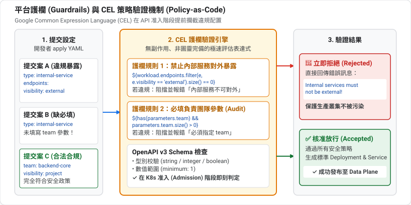
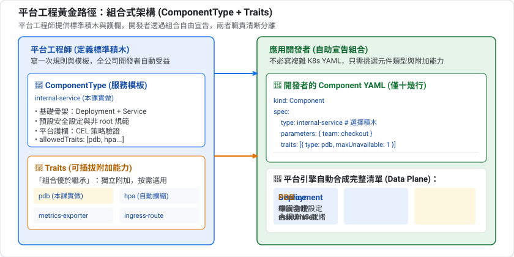
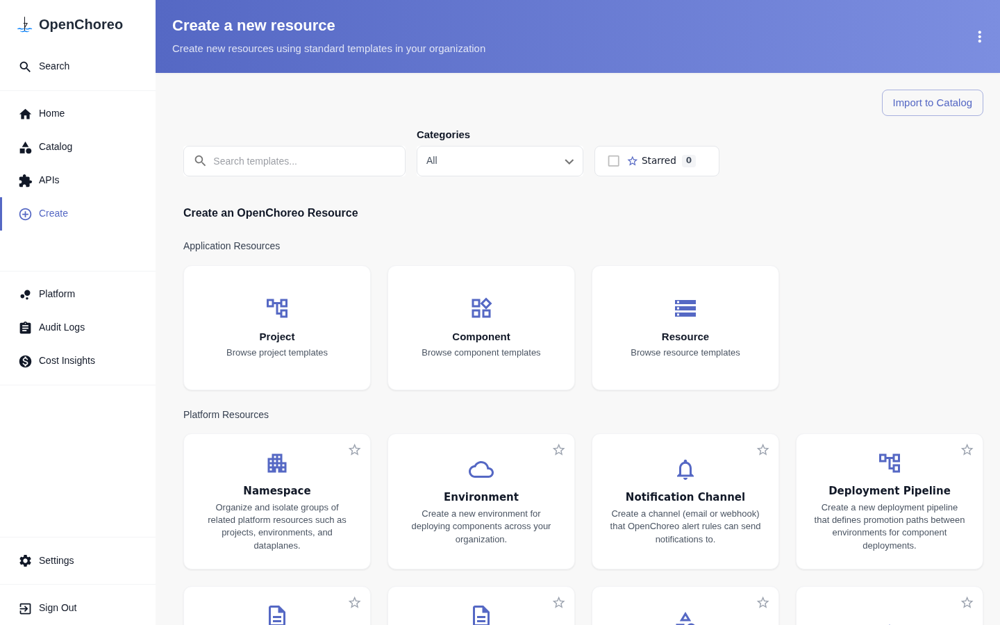

summary: 以平台工程師的身分自訂 ComponentType 與 Trait,為團隊建立有護欄的 Golden Path,並驗證參數、環境覆寫與驗證規則
id: openchoreo-08-golden-path
categories: openchoreo,kubernetes,platform-engineering
environments: Web
status: Published
feedback link: https://github.com/openchoreo/openchoreo/issues
author: 雷N

# OpenChoreo 實戰 08:平台工程師——自訂 Golden Path

## 概覽
Duration: 2

前面幾課我們都是「開發者」,直接使用平台提供的 `deployment/service`。這一課換成**平台工程師**:自己定義一個 ComponentType 和一個 Trait,讓開發者只要填幾個參數,就能得到符合團隊規範的部署。

這就是 **Golden Path(黃金路徑)**:把最佳實務包成模板,走這條路最簡單,也最安全。

### 先決條件

* 已完成第 1 到 3 課、第 5 課更佳
* 有 cluster-admin 權限(要建立叢集範圍的資源)

### 你會學到

* ComponentType 的結構:schema、resources、validations
* 如何用 CEL 運算式把參數變成 Kubernetes 資源
* Trait 的 `creates`:為元件附加能力
* `parameters` 與 `environmentConfigs` 的差別
* 驗證規則如何在違規時擋下部署

## 先備知識:平台工程與黃金路徑
Duration: 10

### 平台是一個「產品」

平台團隊的客戶是公司內部的開發者。好的平台具備:

* **自助**:開發者不需要開工單等人
* **預設正確**:不用做任何事,結果就是安全、合規的
* **可逃生**:需要特殊需求時,有受控的方式偏離

### 黃金路徑 vs 黃金牢籠

| | 黃金路徑(Golden Path) | 黃金牢籠(Golden Cage) |
|---|---|---|
| 態度 | 這條路最好走,但你可以選別條 | 只能走這一條 |
| 結果 | 開發者自願使用 | 開發者想辦法繞過 |

OpenChoreo 的做法是提供模板(ComponentType)讓大部分情況一鍵搞定,同時用 `allowedTraits` 等欄位**限定**可附加的能力,在自由與控管之間取得平衡。

### 護欄(Guardrails)

「護欄」是阻止你掉下懸崖、但不阻礙你前進的東西。對應到平台:

| 護欄 | 實現方式 |
|---|---|
| 必須提供負責團隊 | schema 的 `required` |
| 數值範圍合理 | schema 的 `minimum`、`enum` |
| 不能對外暴露 | `validations` 規則 |
| 只能用核准的附加能力 | `allowedTraits` |



這種「把規則寫成機器可檢查的程式碼」的做法,通稱 **策略即程式碼(policy as code)**。

### 三個技術基礎

**1. OpenAPI / JSON Schema(定義輸入的形狀)**

`parameters.openAPIV3Schema` 用 JSON Schema 描述「開發者可以填什麼、型別、預設值、必填與否」。Kubernetes 的 CRD 也用同一套語言,所以驗證是在資源被接受時就做的。

**2. CEL(Common Expression Language)**

Google 設計的小型表達式語言,語法像 C 或 JavaScript 的運算式,特色是**安全、不會無限迴圈、不能有副作用**。Kubernetes 本身也用它(例如 ValidatingAdmissionPolicy)。在 OpenChoreo 裡,`${...}` 包起來的就是 CEL:

| 寫法 | 意思 |
|---|---|
| `${parameters.team}` | 讀取參數 |
| `${size(workload.endpoints) > 0}` | 條件判斷,可用於 `includeWhen` 與 `validations` |
| `${has(x) ? x : oc_omit()}` | 有值才填,沒有就省略欄位 |
| `forEach` | 對每個端點各產生一份資源 |

**3. 模板化**

ComponentType 是一個「資源模板」:把輸入(參數、Workload)代進去,輸出一組 Kubernetes 資源。

### Trait:組合優於繼承

假設有 4 種元件類型、5 種附加能力(自動擴縮、健康檢查…)。如果每個組合都做成一個 ComponentType,要寫 4 × 2⁵ 種。**Trait** 讓能力獨立存在,需要時才附加到元件上,這就是「組合優於繼承」的設計原則。

### 本課會用到的兩個 Kubernetes 概念

| 資源 | 白話解釋 |
|---|---|
| **HorizontalPodAutoscaler(HPA)** | 依 CPU 等指標自動增減副本數 |
| **PodDisruptionBudget(PDB)** | 規定在「自願性中斷」(例如節點維護、升級)時,至少要保留幾個 Pod 在線,避免一次全部下線 |

### 誰負責什麼?

| 角色 | 寫什麼 | 在乎什麼 |
|---|---|---|
| 平台工程師 | ComponentType、Trait、Workflow、Environment | 安全、合規、一致性、成本 |
| 開發者 | Component、Workload | 功能、速度 |



這個分工的美妙之處:平台工程師寫一次規則,所有開發者自動受益;開發者專心在業務,不必記規範。

在入口網站的 Create 頁面中，開發者便可透過自服務門戶直接選用平台工程師定義的各類標準範本：



接下來你要扮演平台工程師。

## 讀懂內建的 ComponentType
Duration: 6

最好的教材就是現成的範本:

```bash
kubectl get clustercomponenttype
kubectl get clustertrait
kubectl get clustercomponenttype service -o yaml
```

預設有四種 ComponentType(`service`、`web-application`、`worker`、`scheduled-task`)與五種 Trait(`health-probes`、`horizontal-pod-autoscaler`、`observability-alert-rule`、`persistent-volume-claim`、`vertical-pod-autoscaler`)。

`service` 的骨架可以濃縮成:

| 區塊 | 作用 |
|---|---|
| `workloadType` | 底層 Kubernetes 工作負載種類(`deployment`、`cronjob`) |
| `allowedTraits` | 這個類型允許附加哪些 Trait |
| `allowedWorkflows` | 允許使用哪些建置流程(第 4 課) |
| `environmentConfigs` | 每個環境可以覆寫的參數 schema |
| `resources` | 要產生的資源模板(Deployment、Service、HTTPRoute…) |
| `validations` | 部署前必須通過的規則 |

### 模板裡的變數

`resources[].template` 內的 `${...}` 是 **CEL 運算式**,常用變數:

| 變數 | 內容 |
|---|---|
| `metadata.name` / `metadata.namespace` | 產生資源的名稱與 namespace |
| `metadata.componentName` / `metadata.labels` / `metadata.podSelectors` | 元件名稱、標準標籤、Pod selector |
| `parameters.*` | Component 層級的參數(跨環境一致) |
| `environmentConfigs.*` | 環境層級的參數(來自 ReleaseBinding) |
| `workload.*` | 開發者寫的 Workload(image、endpoints…) |
| `gateway.*` / `dataplane.*` | 平台提供的閘道與資料平面資訊 |

另外還有 `includeWhen`(條件產生)、`forEach`(迭代產生多個資源)、`oc_omit()`(省略欄位)、`oc_merge()`(合併 map)等輔助函式。

Positive
: 第 2 課說過的「參數 vs 環境設定」在這裡有了具體樣貌:`parameters` 寫在 Component 上,`environmentConfigs` 寫在 ReleaseBinding 上。ComponentType 負責宣告兩者的 schema。

## 設計我們的 Golden Path
Duration: 3

情境:公司有許多**內部服務**,規範是:

1. 絕對不能對外暴露(不產生外部路由)
2. 每個服務必須標註負責團隊(`team` 標籤)
3. 副本數與日誌等級可以依環境調整
4. 可以附加 PodDisruptionBudget

我們建立 `internal-service` 這個 ComponentType,以及 `pod-disruption-budget` 這個 Trait。

## 撰寫 ComponentType
Duration: 8

`internal-service.yaml`:

```yaml
apiVersion: openchoreo.dev/v1alpha1
kind: ClusterComponentType
metadata:
  name: internal-service
  annotations:
    openchoreo.dev/description: 只在叢集內提供服務的元件,不產生外部路由,並強制標註負責團隊
spec:
  workloadType: deployment
  allowedTraits:
    - kind: ClusterTrait
      name: horizontal-pod-autoscaler
    - kind: ClusterTrait
      name: pod-disruption-budget
  parameters:
    openAPIV3Schema:
      type: object
      required: [team]
      properties:
        team:
          type: string
          description: 負責這個服務的團隊,會成為 Pod 的 team 標籤
  environmentConfigs:
    openAPIV3Schema:
      type: object
      properties:
        replicas:
          type: integer
          default: 1
          minimum: 1
        logLevel:
          type: string
          default: info
          enum: [debug, info, warn, error]
  validations:
    - rule: ${size(workload.endpoints) > 0}
      message: internal-service 至少需要一個端點
    - rule: ${!workload.endpoints.exists(name, ep, "external" in ep.visibility)}
      message: internal-service 不允許 external 端點,請改用 deployment/service
  resources:
    - id: deployment
      targetPlane: dataplane
      template:
        apiVersion: apps/v1
        kind: Deployment
        metadata:
          name: ${metadata.name}
          namespace: ${metadata.namespace}
          labels: '${oc_merge(metadata.labels, {"team": parameters.team})}'
        spec:
          replicas: ${environmentConfigs.replicas}
          selector:
            matchLabels: ${metadata.podSelectors}
          template:
            metadata:
              labels: '${oc_merge(metadata.podSelectors, {"team": parameters.team})}'
            spec:
              containers:
                - name: main
                  image: ${workload.container.image}
                  command: '${has(workload.container.command) ? workload.container.command : oc_omit()}'
                  args: '${has(workload.container.args) ? workload.container.args : oc_omit()}'
                  env: '${[{"name": "LOG_LEVEL", "value": environmentConfigs.logLevel}]}'
    - id: service
      targetPlane: dataplane
      template:
        apiVersion: v1
        kind: Service
        metadata:
          name: ${metadata.componentName}
          namespace: ${metadata.namespace}
          labels: ${metadata.labels}
        spec:
          type: ClusterIP
          ports: ${workload.toServicePorts()}
          selector: ${metadata.podSelectors}
```

### 重點解說

| 片段 | 意義 |
|---|---|
| `parameters.required: [team]` | 開發者**必須**提供 `team`,否則無法建立 |
| `environmentConfigs` | `replicas` 與 `logLevel` 可在每個環境各自設定,並有預設值與限制 |
| `validations` | 兩條規則,違規時整個部署被擋下並顯示訊息 |
| `resources` 只有 Deployment 與 Service | **沒有 HTTPRoute**,所以天生不會對外 |
| `oc_merge(metadata.labels, {"team": ...})` | 把標準標籤與 `team` 合併 |

Negative
: **YAML 引號陷阱。** 運算式裡只要出現 `": "`(例如 `{"team": parameters.team}`),整個值就必須用單引號包起來,否則 YAML 解析會失敗:`mapping values are not allowed in this context`。內建範本也是這樣寫。

## 撰寫 Trait
Duration: 5

Trait 用 `creates` 附加資源。`pdb.yaml`:

```yaml
apiVersion: openchoreo.dev/v1alpha1
kind: ClusterTrait
metadata:
  name: pod-disruption-budget
  annotations:
    openchoreo.dev/description: 為元件建立 PodDisruptionBudget,避免維護時同時下線過多 Pod
spec:
  parameters:
    openAPIV3Schema:
      type: object
      properties:
        minAvailable:
          type: integer
          default: 1
          minimum: 0
  creates:
    - targetPlane: dataplane
      template:
        apiVersion: policy/v1
        kind: PodDisruptionBudget
        metadata:
          name: ${metadata.name}-${trait.instanceName}
          namespace: ${metadata.namespace}
          labels: ${metadata.labels}
        spec:
          minAvailable: ${parameters.minAvailable}
          selector:
            matchLabels: ${metadata.podSelectors}
```

Trait 可以用 `trait.instanceName` 區分同一個元件上的多個實例,所以名稱是 `${metadata.name}-${trait.instanceName}`。

套用兩者:

```bash
kubectl apply -f internal-service.yaml -f pdb.yaml
```

## 以開發者身分使用
Duration: 6

開發者只需要寫:

```yaml
apiVersion: openchoreo.dev/v1alpha1
kind: Component
metadata:
  name: ledger
  namespace: default
spec:
  owner:
    projectName: default
  autoDeploy: true
  componentType:
    kind: ClusterComponentType
    name: deployment/internal-service
  parameters:
    team: payments
  traits:
    - kind: ClusterTrait
      name: pod-disruption-budget
      instanceName: pdb
      parameters:
        minAvailable: 1
---
apiVersion: openchoreo.dev/v1alpha1
kind: Workload
metadata:
  name: ledger-workload
  namespace: default
spec:
  owner:
    componentName: ledger
    projectName: default
  endpoints:
    http:
      type: HTTP
      port: 9090
      visibility: [project]
  container:
    image: "ghcr.io/openchoreo/samples/greeter-service:latest"
    command: ["./go-greeter"]
    args: ["--port", "9090"]
```

```bash
kubectl apply -f component.yaml
kubectl get component ledger -n default \
  -o jsonpath='{range .status.conditions[*]}{.type}={.status} {.message}{"\n"}{end}'
```

預期 `Ready=True`。看看平台替你產生了什麼:

```bash
kubectl get deploy,svc,pdb,httproute -A -l openchoreo.dev/component=ledger
```

預期有 Deployment、Service、PodDisruptionBudget,**沒有 HTTPRoute**。

驗證標籤與環境變數:

```bash
NS=$(kubectl get ns -o name | grep dp-default-default-development | cut -d/ -f2)
kubectl get deploy -n $NS -l openchoreo.dev/component=ledger \
  -o jsonpath='{.items[0].metadata.labels.team} {.items[0].spec.template.spec.containers[0].env}{"\n"}'
```

預期 `payments [{"name":"LOG_LEVEL","value":"info"}]`。

Positive
: 開發者完全沒寫 Deployment、Service 或 PDB。他只回答了「誰負責(team)」和「要不要 PDB」,其餘全由平台決定。

## 環境覆寫
Duration: 4

`replicas` 與 `logLevel` 是 `environmentConfigs`,所以改的是 ReleaseBinding,不是 Component:

```bash
kubectl patch releasebinding ledger-development -n default --type merge \
  -p '{"spec":{"componentTypeEnvironmentConfigs":{"replicas":2,"logLevel":"debug"}}}'
sleep 8
kubectl get deploy -n $NS -l openchoreo.dev/component=ledger \
  -o jsonpath='{.items[0].spec.replicas} {.items[0].spec.template.spec.containers[0].env}{"\n"}'
```

預期 `2 [{"name":"LOG_LEVEL","value":"debug"}]`。

## 護欄:驗證規則
Duration: 6

### 試圖對外暴露

把端點可見度改成 `external`:

```bash
kubectl patch workload ledger-workload -n default --type json \
  -p '[{"op":"replace","path":"/spec/endpoints/http/visibility","value":["external"]}]'
sleep 12
kubectl get releasebinding ledger-development -n default \
  -o jsonpath='{range .status.conditions[*]}{.type}={.status} {.reason}: {.message}{"\n"}{end}'
```

你會看到:

```
ReleaseSynced=False RenderingFailed: Failed to render resources: component type validation failed:
rule[1] "${!workload.endpoints.exists(...)}" evaluated to false: internal-service 不允許 external 端點,請改用 deployment/service
```

Positive
: 違規的變更**不會**被部署,已經在跑的資源維持原狀。錯誤訊息就是你在 `validations[].message` 寫的文字,所以訊息要寫成能告訴開發者「該怎麼辦」。

Negative
: 注意 `kubectl apply` 本身**不會**失敗,Component 的 `Ready` 也仍是 `True`。驗證失敗是反映在 **ReleaseBinding** 的 `ReleaseSynced` / `Ready` 條件上。排錯時請看 ReleaseBinding,不要只看 Component。

改回去:

```bash
kubectl patch workload ledger-workload -n default --type json \
  -p '[{"op":"replace","path":"/spec/endpoints/http/visibility","value":["project"]}]'
```

### 缺少必填參數

這種錯誤比較早被攔下,在建立 ComponentRelease 時由 admission webhook 拒絕:

```bash
kubectl patch component ledger -n default --type json -p '[{"op":"remove","path":"/spec/parameters"}]'
kubectl get component ledger -n default -o jsonpath='{.status.conditions[*].message}{"\n"}'
```

預期訊息結尾是 `parameters do not match ComponentType schema: .team is required`。

## 使用內建 Trait
Duration: 4

`internal-service` 的 `allowedTraits` 也列了內建的 `horizontal-pod-autoscaler`。把參數補回去,並附加 HPA:

```bash
kubectl patch component ledger -n default --type merge -p '{
  "spec":{"parameters":{"team":"payments"},
  "traits":[
    {"kind":"ClusterTrait","name":"pod-disruption-budget","instanceName":"pdb","parameters":{"minAvailable":1}},
    {"kind":"ClusterTrait","name":"horizontal-pod-autoscaler","instanceName":"hpa","parameters":{"replicas":{"min":1,"max":3}}}
  ]}}'
sleep 12
kubectl get hpa,pdb -A | grep ledger
```

預期同時看到 HPA(1 到 3 個副本、CPU 80%)與 PDB。

Negative
: 刻意不放進 `allowedTraits` 的 Trait 不能使用,這是平台工程師限制開發者可用能力的方式。本課沒有實測「使用不在白名單的 Trait」會得到什麼錯誤。HPA 顯示 `cpu: <unknown>/80%` 只是剛建立、metrics 尚未就緒,稍後會有數值。

## 清理
Duration: 1

```bash
kubectl delete component ledger -n default
kubectl delete workload ledger-workload -n default --ignore-not-found
kubectl delete clustercomponenttype internal-service
kubectl delete clustertrait pod-disruption-budget
```

## 自我檢核
Duration: 4

試著不看上文回答下面的問題;答不出來的,回頭看對應的章節。

1. `parameters` 與 `environmentConfigs` 有何不同?

2. 驗證規則違規時,錯誤出現在哪裡?

3. 為什麼要有 Trait,而不是為每種組合做一個 ComponentType?

4. CEL 運算式裡出現 `": "` 時 YAML 要注意什麼?

### 參考答案

1. parameters 寫在 Component 上、跨環境一致;environmentConfigs 在 ReleaseBinding 上設定、每個環境可不同。

2. 出現在 ReleaseBinding 的條件(`ReleaseSynced=False`、`RenderingFailed`),Component 本身仍可能是 Ready,且已部署的資源不變。

3. 組合優於繼承:能力獨立存在、按需附加,避免組合數量爆炸。

4. 整個值要用單引號包起來,否則會出現 `mapping values are not allowed`。

## 恭喜與下一步
Duration: 1

你已經:

* ✅ 讀懂內建 ComponentType 與 Trait 的結構
* ✅ 寫出自己的 `internal-service` ComponentType 與 `pod-disruption-budget` Trait
* ✅ 驗證了必填參數、環境覆寫與驗證規則三道護欄
* ✅ 理解平台工程師與開發者的分工

### 重點整理

| 概念 | 一句話 |
|---|---|
| ComponentType | 把「一個元件長什麼樣」寫成模板 |
| Trait | 可重複附加的能力 |
| parameters / environmentConfigs | 元件層級與環境層級的輸入 |
| validations | 違規就不部署的護欄 |
| allowedTraits | 限制開發者可用的能力 |

### 延伸閱讀

* [OpenChoreo 文件](https://openchoreo.dev/docs/)
* [CEL 語言規格](https://github.com/google/cel-spec)

### 下一課

**09:微服務實戰** — 部署官方的多服務範例,練習依賴與排錯。
