summary: 認識 OpenChoreo 的 MCP 伺服器,用 OAuth 取得 token,讓 AI 代理人(或你自己的腳本)讀取資源、查詢日誌指標,並以受控方式操作平台
id: openchoreo-10-ai-mcp
categories: openchoreo,kubernetes,ai,mcp
environments: Web
status: Published
feedback link: https://github.com/openchoreo/openchoreo/issues
author: 雷N

# OpenChoreo 實戰 10:AI 與 MCP 整合

## 概覽
Duration: 2

OpenChoreo 內建 **MCP(Model Context Protocol)** 伺服器,讓 AI 助理能用標準協定查詢與操作平台:列出專案、觸發建置、查詢日誌與指標、晉升版本。AI 看到的是和你相同的資源模型,並且受**同一套權限**限制。

### 先決條件

* 已完成第 1 到 3 課
* 第 7 課的 Observability Plane(使用觀測相關工具時需要)
* 本機有 `curl` 與 Python 3
* 建議:Claude Code、Cursor、Gemini CLI 等支援 MCP 的 AI 助理(本課的助理端設定**未實測**)

### 你會學到

* 兩個 MCP 伺服器各提供什麼
* 用 Client Credentials 取得存取 token
* 不靠任何 AI 客戶端,用 MCP 協定直接呼叫工具
* 讀取、查詢與寫入三類操作
* 權限與安全:AI 能做什麼、不能做什麼

Positive
: 本課的 MCP 呼叫全部用一支 Python 腳本直接對伺服器說 MCP 協定,不依賴任何 AI 客戶端。好處是你能看清楚協定本身,也能確定伺服器端的行為。

## 先備知識:AI 代理人與 MCP
Duration: 10

### 大型語言模型怎麼「做事」?

大型語言模型(LLM)本身只會產生文字。要讓它能真的查資料、操作系統,需要**工具呼叫(tool use)**:

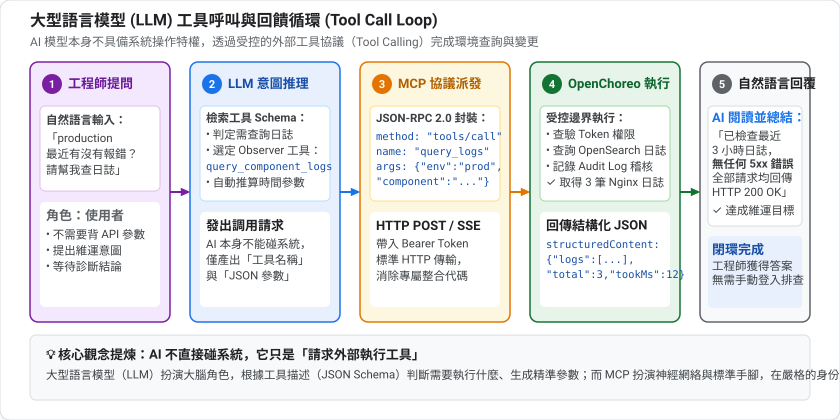

AI 自己不碰你的系統,它只是「請求呼叫某個工具」,由外部程式執行並把結果還給它。模型負責大腦思考與參數組裝，外部程式負責手腳執行與邊界保護。

### 問題:每個工具都要各寫一套整合

如果有 N 個 AI 應用、M 個系統,就需要 N × M 個整合。**MCP(Model Context Protocol)** 是 Anthropic 提出的開放協定,目標是統一這件事:AI 應用實作一次 MCP 客戶端,系統實作一次 MCP 伺服器,就能互通。類比:USB 讓所有裝置共用同一種接口。

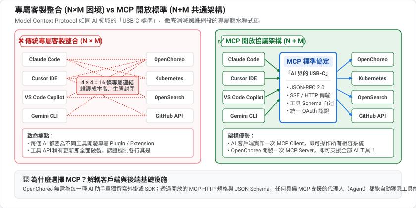

### MCP 的角色與能力

| 角色 | 說明 |
|---|---|
| **MCP 客戶端** | AI 應用(Claude Code、Cursor…)內建的連線元件 |
| **MCP 伺服器** | 提供能力的一方,本課就是 OpenChoreo |

伺服器可以提供三類東西:

| 類型 | 說明 | 本課 |
|---|---|---|
| **Tools(工具)** | AI 可以呼叫的動作,有名稱與參數 schema | ✅ 主角 |
| **Resources(資源)** | 可讀取的資料 | 未使用 |
| **Prompts(提示)** | 預先寫好的提示模板 | 未使用 |

### 協定長什麼樣?

MCP 的訊息格式是 **JSON-RPC 2.0**:

```json
{"jsonrpc":"2.0","id":1,"method":"tools/call",
 "params":{"name":"list_projects","arguments":{"namespace_name":"default"}}}
```

傳輸方式有兩種常見的:本機程序用 **stdio**,遠端服務用 **HTTP**(OpenChoreo 用 HTTP)。因為就是 HTTP 加 JSON,所以我們才能用 `curl` 或幾十行 Python 直接和它對話。

### 工具的 schema:AI 怎麼知道怎麼用?

每個工具附帶一份 JSON Schema(`inputSchema`),說明有哪些參數、型別、哪些必填。AI 讀這份說明就知道怎麼組出正確的呼叫。如果缺參數,伺服器回傳錯誤訊息,AI 通常會自己修正後重試。

### 認證:OAuth 的兩種流程

AI 要呼叫 API,必須證明身分。OpenChoreo 用 OAuth 2.0 的兩種授權方式:

| | Authorization Code + PKCE | Client Credentials |
|---|---|---|
| 誰在操作 | **人**在瀏覽器登入並授權 | **程式**用自己的帳密換 token |
| 適用 | 桌面型 AI 助理 | 腳本、自動化、無人值守 |
| 代表身分 | 該使用者 | 該應用本身 |
| 本課 | 只列出設定 | 實際操作 |

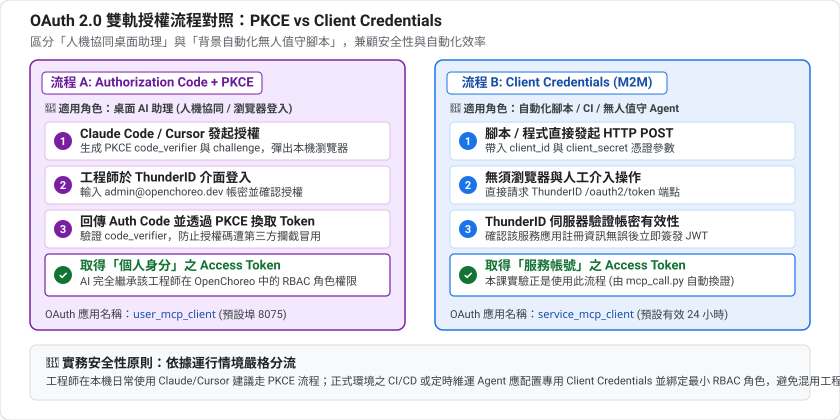

**PKCE** 是保護公開客戶端(無法安全保存密碼的應用)的機制,避免授權碼被攔截後被冒用。

取得的 **access token** 是一串有時效的憑證,放在 HTTP 標頭 `Authorization: Bearer <token>` 送出。

### AI 操作基礎設施的風險

讓 AI 能刪專案,必須認真面對風險:

| 風險 | 說明 | 對策 |
|---|---|---|
| **權限過大** | AI 用了高權限帳號,一次誤判影響範圍很大 | 最小權限、專用帳號 |
| **誤操作** | AI 理解錯誤,執行了不該做的事 | 寫入前讓人確認、先唯讀 |
| **提示注入(Prompt Injection)** | 日誌、網頁等**不可信內容**裡夾帶指令,誘騙 AI 照做 | 把工具回傳的內容視為資料而非指令、限制寫入權限 |
| **洩漏** | 憑證被貼進對話或日誌 | 定期更換、不要硬寫在設定檔 |

特別注意提示注入:AI 查詢**應用程式日誌**時,日誌內容可能由外部使用者控制(例如使用者輸入的字串被記錄下來)。這些文字進入 AI 的上下文後,可能被當成指令。所以「AI 能讀日誌」和「AI 能改系統」這兩種能力最好分開授權。

### OpenChoreo 的立場

MCP 只是控制平面 API 的另一個入口,**沿用同一套 RBAC、稽核與資源模型**,沒有另一套後門。這是它安全模型的基礎。

準備好了嗎?看看兩個 MCP 伺服器。

## 兩個 MCP 伺服器
Duration: 4

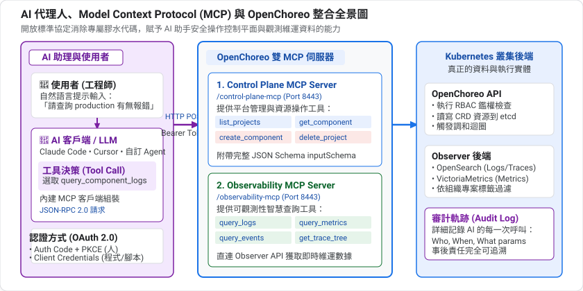

| 伺服器 | 本機位址 | 職責 |
|---|---|---|
| **Control Plane MCP** | `http://api.openchoreo.localhost:8080/mcp` | 管理資源、部署、建置、平台設定 |
| **Observability MCP** | `http://observer.openchoreo.localhost:11080/mcp` | 日誌、指標、追蹤、告警、成本、DORA |


### Control Plane 的工具分類

預設啟用七個工具集:`namespace`、`project`、`component`、`resource`、`deployment`、`build`、`pe`(平台工程)。

| 類別 | 範例工具 |
|---|---|
| 命名空間與專案 | `list_namespaces`、`create_project`、`delete_project` |
| 元件 | `list_components`、`create_component`、`patch_component` |
| Workload | `get_workload`、`update_workload` |
| 部署 | `list_release_bindings`、`update_release_binding`(晉升就是這個) |
| 建置 | `trigger_workflow_run`、`get_workflow_run_logs` |
| 平台工程 | `create_environment`、`create_component_type`、`*_authz_role` |

實測這個環境的 Control Plane MCP 回報 **130 個工具**。

### Observability 的工具

實測回報 **17 個工具**:

| 類別 | 工具 |
|---|---|
| 日誌 | `query_component_logs`、`query_workflow_logs`、`query_platform_logs` |
| 指標 | `query_http_metrics`、`query_resource_metrics` |
| 追蹤 | `query_traces`、`query_trace_spans`、`get_span_details` |
| 告警/事故 | `query_alerts`、`query_incidents` |
| 成本 | `query_costs`、`query_recommendations` |
| 交付 | `query_dora_metrics`、`query_dora_deployments` |
| 稽核/事件 | `query_audit_logs`、`query_component_events`、`query_workflow_events` |

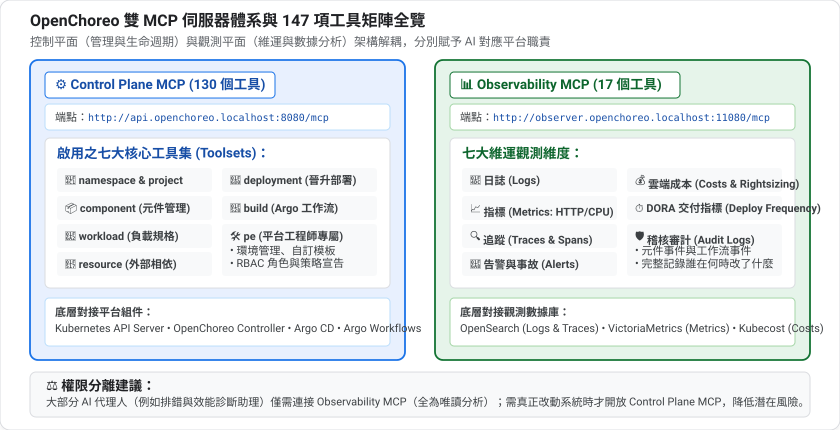

## 取得存取 token
Duration: 4

OpenChoreo 預先建立了兩個 OAuth 應用:

| 應用 | 授權方式 | 用途 |
|---|---|---|
| `user_mcp_client` | Authorization Code + PKCE | 能開瀏覽器登入的 AI 助理 |
| `service_mcp_client` | Client Credentials | 腳本、自動化、不能開瀏覽器的代理人 |

用 Client Credentials 向 ThunderID 要 token:

```bash
curl -s -X POST "http://thunder.openchoreo.localhost:8080/oauth2/token" \
  -H 'Content-Type: application/x-www-form-urlencoded' \
  -u 'service_mcp_client:service_mcp_client_secret' \
  -d 'grant_type=client_credentials'
```

預期回傳 JSON,包含 `access_token`、`token_type: Bearer`、`expires_in`。

Positive
: 官方文件寫 token 有效期約 1 小時,實測這個環境回傳的是 `expires_in: 86400`(24 小時)。以回應內容為準。

Negative
: `service_mcp_client_secret` 是公開的**預設值**,只適用於本機實驗。正式環境務必建立自訂的 OAuth 應用,並綁定最小權限的角色。

## 用腳本說 MCP 協定
Duration: 8

MCP over HTTP 就是 JSON-RPC。實驗檔案在 `codelabs/labs/10-mcp/mcp_call.py`,它會自動取 token、送 JSON-RPC、解析回應(伺服器以 SSE 格式回傳)。

### 列出工具

```bash
cd codelabs/labs/10-mcp
python3 -I mcp_call.py cp __list__ | head
python3 -I mcp_call.py obs __list__
```

### 它在底層做了什麼

```bash
TOKEN=...   # 上一節的 access_token

curl -s -X POST http://api.openchoreo.localhost:8080/mcp \
  -H "Authorization: Bearer $TOKEN" \
  -H "Content-Type: application/json" \
  -H "Accept: application/json, text/event-stream" \
  -d '{"jsonrpc":"2.0","id":1,"method":"tools/list"}'
```

| 步驟 | JSON-RPC `method` |
|---|---|
| 握手 | `initialize`(回報 `serverInfo`: `openchoreo-api`) |
| 探索工具 | `tools/list` |
| 呼叫工具 | `tools/call`,參數 `{"name": ..., "arguments": {...}}` |

Positive
: 實測這個伺服器是**無狀態**的:`initialize` 沒有回傳 `Mcp-Session-Id`,不做握手也可以直接 `tools/list` 與 `tools/call`。

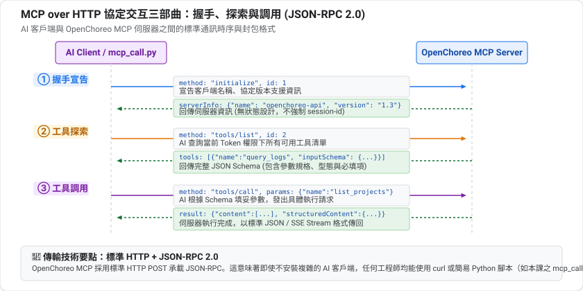

## 讀取
Duration: 5

```bash
python3 -I mcp_call.py cp list_namespaces '{}'
python3 -I mcp_call.py cp list_projects '{"namespace_name":"default"}'
```

回傳的 `structuredContent` 是結構化 JSON,例如 `list_projects` 會給你每個專案的 `deploymentPipelineRef`、`latestRelease`、`status`。

每個工具都有 JSON Schema。想知道參數,從 `tools/list` 的 `inputSchema` 看,AI 助理就是靠這份 schema 知道該怎麼呼叫的。

## 查詢可觀測性資料
Duration: 6

第 7 課我們直接查 OpenSearch,因為 Observer 需要 token。現在有 token 了,可以走「正門」。

查日誌(時間用 RFC3339,`namespace`、`start_time`、`end_time` 為必填):

```bash
S=$(date -u -d '-3 hours' +%Y-%m-%dT%H:%M:%SZ)
E=$(date -u +%Y-%m-%dT%H:%M:%SZ)
python3 -I mcp_call.py obs query_component_logs "{
  \"namespace\":\"default\",\"project\":\"default\",
  \"component\":\"react-starter\",\"environment\":\"development\",
  \"start_time\":\"$S\",\"end_time\":\"$E\",\"limit\":3}"
```

回傳的每筆日誌都附 `metadata`:`componentName`、`projectName`、`environmentName`、`podName`…。我們實測查到的,正是之前用 `curl` 打 `react-starter` 留下的 nginx 存取日誌。

查資源指標:

```bash
python3 -I mcp_call.py obs query_resource_metrics "{
  \"namespace\":\"default\",\"project\":\"default\",
  \"component\":\"react-starter\",\"environment\":\"development\",
  \"start_time\":\"$S\",\"end_time\":\"$E\",\"step\":\"30m\"}"
```

預期回傳 `cpuUsage`、`cpuRequests`、`cpuLimits`、`memoryUsage`… 的時間序列。

Negative
: 指標工具要求:提供 `component` 就必須同時提供 `project`,否則回 `project is required when component is provided`。AI 助理遇到這種錯誤通常會自己補上參數重試,但自己寫腳本時要注意。

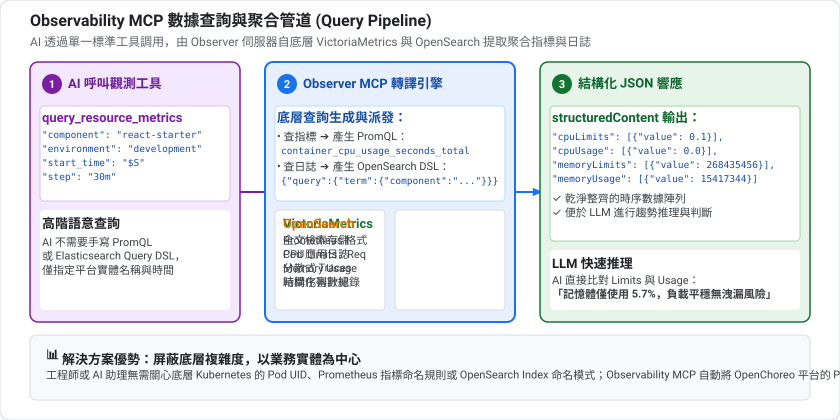

## 寫入:建立與刪除
Duration: 5

AI 也能改變平台狀態。用建立再刪除一個專案來看看:

```bash
python3 -I mcp_call.py cp create_project \
  '{"namespace_name":"default","name":"mcp-demo","display_name":"MCP Demo","description":"created via MCP"}'
kubectl get project -n default

python3 -I mcp_call.py cp delete_project \
  '{"namespace_name":"default","project_name":"mcp-demo"}'
kubectl get project -n default
```

預期第一次 `kubectl get project` 多出 `mcp-demo`,刪除後消失。

Positive
: 專案是用 `kubectl` 就能看到的真實 Kubernetes 資源。MCP 並沒有另一套資料庫,它只是控制平面 API 的另一個入口,所以 GitOps、稽核日誌、RBAC 全部照常運作。

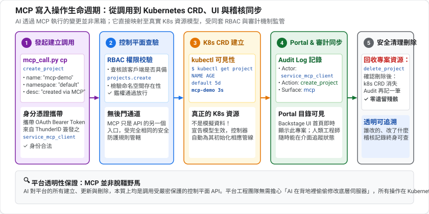

在入口網站的 Audit Logs 頁面中，亦能即時看到這兩筆由 MCP 調用所留下的審計日誌（Actor 為 `service_mcp_client`、Surface 為 `mcp`）：

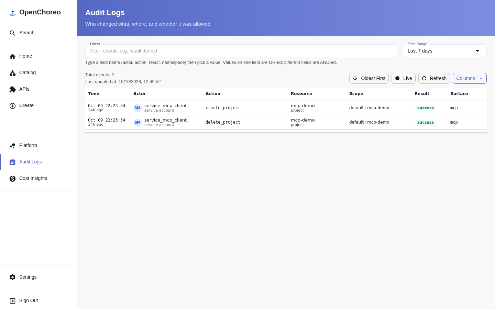

## 權限與安全
Duration: 5

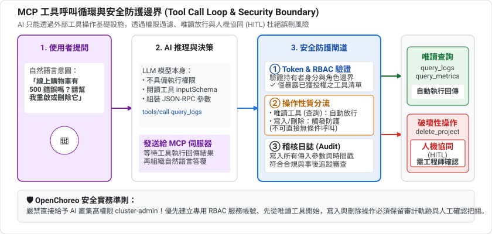

AI 助理有能力刪除專案,這是好事也是風險。OpenChoreo 的做法:


### 1. 同一套 RBAC

MCP 呼叫以 token 代表的身分授權,和你用 `occ` 或入口網站完全一樣。`service_mcp_client` 能做什麼,取決於綁在它身上的角色。

### 2. 依權限過濾工具

預設 `filterByAuthz=true`:你**沒有權限**的工具不會出現在 `tools/list`,呼叫也會被拒絕。

### 3. 縮小工具集

* 伺服器端用 `openchoreoApi.config.mcp.toolsets` 決定啟用哪些工具集(例如開發者版本不含 `pe`)
* 連線時可用查詢參數 `?toolsets=namespace,project,component` 讓 AI 只看到部分工具

Negative
: `toolsets` 查詢參數只影響 `tools/list` 看到什麼,**不會**阻擋 `tools/call`。真正的防線是 RBAC 與伺服器端設定,不要把這個參數當成安全機制。

### 4. 稽核

第 7 課啟用的稽核日誌(`query_audit_logs`)會記錄變更。

### 實務建議

| 做法 | 理由 |
|---|---|
| 給 AI 專用的 OAuth 應用,不要共用你的帳號 | 稽核時分得出是誰 |
| 先給唯讀角色 | 排錯與分析就夠用了 |
| 需要寫入時,限定在特定 namespace/專案 | 縮小爆炸半徑 |
| 正式環境的變更仍走 GitOps/審核流程 | AI 提案、人審核 |

## 連接 AI 助理
Duration: 5

Negative
: 以下設定整理自官方文件 [Configuring MCP Servers](https://openchoreo.dev/docs/ai/mcp-servers/),**作者沒有在 AI 客戶端實測**(會修改你的客戶端設定)。MCP 伺服器端的行為已用上一節的腳本驗證。

### 方式 A:瀏覽器登入(建議)

使用 `user_mcp_client`(PKCE),以 `admin@openchoreo.dev` / `Admin@123` 登入:

```bash
claude mcp add --transport http \
  --client-id user_mcp_client --callback-port 8075 \
  openchoreo-cp http://api.openchoreo.localhost:8080/mcp

claude mcp add --transport http \
  --client-id user_mcp_client --callback-port 8075 \
  openchoreo-obs http://observer.openchoreo.localhost:11080/mcp
```

然後在 Claude Code 內執行 `/mcp`,選擇伺服器並在瀏覽器完成驗證。

### 方式 B:Bearer token

```bash
claude mcp add --transport http \
  openchoreo-cp http://api.openchoreo.localhost:8080/mcp \
  --header "Authorization: Bearer <ACCESS_TOKEN>"
```

token 到期後要重新取得並更新設定。Cursor、Gemini CLI、Codex CLI、VS Code 的設定格式請見官方文件。

### 試試這些提示

* 「列出 default namespace 的所有 Project 和 Component」
* 「`react-starter` 在 development 最近 3 小時有沒有錯誤日誌?」
* 「幫我把 `xxx` 從 development 晉升到 staging」(寫入操作,請先確認 AI 的計畫)

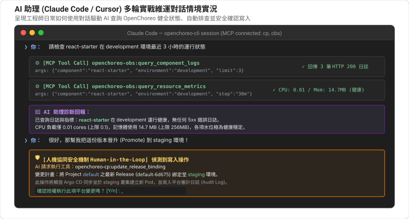

官方 repo 的 `samples/mcp` 目錄提供更完整的情境練習:服務部署、日誌分析、建置失敗診斷、資源最佳化。

## 內建 AI 代理人
Duration: 6

除了讓外部 AI 客戶端透過 MCP 連線之外，OpenChoreo 官方架構中還原生設計了三個專屬的內建 AI 代理人（Built-in Agents）：**SRE Agent**、**FinOps Agent** 與 **Portal Assistant**。

這些代理人並非獨立的外掛工具，而是作為平台的「一等平台公民（First-Class Platform Users）」，完全建立在我們前面學過的 **MCP 伺服器** 與可觀測性底座之上，並受同一套 RBAC 與安全邊界監管。

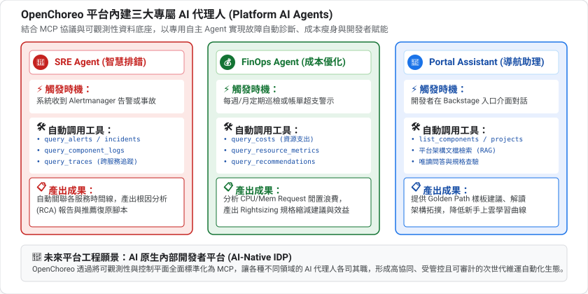

### 1. SRE Agent：事件驅動的智慧根因分析 (RCA)

[SRE Agent](https://openchoreo.dev/docs/ai/sre-agent/) 專為事故管理與智慧除錯設計，它的核心定位是**根因分析 (Root Cause Analysis, RCA)**：

* **事件驅動喚醒**：它並非無休止地全天候輪詢，而是在監控告警規則中標記 `triggerAiRca: true`。當 Alertmanager 發出關鍵告警（Critical Alert）時，自動觸發分析任務，有效控制 LLM 調用成本。
* **MCP 資料協同**：SRE Agent 透過 Observability MCP 自動調用 `query_alerts`、`query_component_logs` 與 `query_traces`，撈取事故發生前後 10 分鐘的日誌異常、錯誤堆疊與跨服務呼叫鏈。
* **RCA 報告與修復建議**：產出的分析報告預設持久化儲存於 SQLite（生產環境可切換 PostgreSQL），並在 Backstage UI 的告警頁面直接呈現可能根因、影響範圍與推薦的復原指令。

#### 官方啟用配置摘要

SRE Agent 需要真實的 LLM API Key（目前官方原生支援 OpenAI 系列模型），並透過 OpenBao Vault 與 ExternalSecrets 注入：

```bash
# 1. 於 OpenBao 寫入 LLM API Key
kubectl exec -n openbao openbao-0 -- \
  env BAO_ADDR=http://127.0.0.1:8200 BAO_TOKEN=root \
  bao kv put secret/rca-llm-api-key value="<YOUR_LLM_API_KEY>"

# 2. 升級 Observability Plane 啟用 RCA
helm upgrade --install openchoreo-observability-plane \
  oci://cr.openchoreo.dev/openchoreo/helm-charts/openchoreo-observability-plane \
  --namespace openchoreo-observability-plane \
  --reuse-values \
  --set rca.enabled=true \
  --set rca.llm.modelName=gpt-5.4

# 3. 於控制平面註冊 RCA Agent 端點
kubectl patch clusterobservabilityplane default --type=merge \
  -p '{"spec":{"rcaAgentURL":"http://rca-agent.openchoreo.localhost:11080"}}'
```

### 2. FinOps Agent：排程巡檢與成本最佳化 (Rightsizing)

[FinOps Agent](https://openchoreo.dev/docs/ai/finops-agent/) 專注於雲端成本治理與資源規格建議：

* **數據來源**：依賴 OpenChoreo 的 FinOps 模組（如社群維護的 OpenCost 模組）採集 Kubernetes 容器資源花費。
* **自動分析閒置**：定期分析各元件所宣告的 `cpu/memory requests` 與歷史實際使用峰值，找出過度配置（Over-provisioned）的 Workload。
* **具體縮容建議**：產出 Rightsizing 規格調整建議（例如建議將 CPU Request 從 2 Core 降為 0.5 Core），並精確估算每月可省下的雲端金額。

#### 官方啟用配置摘要

```bash
# 啟用 FinOps Agent 並開啟建議功能
helm upgrade --install openchoreo-observability-plane \
  oci://cr.openchoreo.dev/openchoreo/helm-charts/openchoreo-observability-plane \
  --namespace openchoreo-observability-plane \
  --reuse-values \
  --set finOpsAgent.enabled=true \
  --set finOpsAgent.llmName=gpt-5.4 \
  --set finOpsAgent.remediationEnabled=true

# 註冊 FinOps 端點
kubectl patch clusterobservabilityplane default --type=merge \
  -p '{"spec":{"finOpsAgentURL":"http://finops-agent.openchoreo.localhost:11080"}}'
```

### 3. Portal Assistant：Backstage 內嵌的開發者對話助理

[Portal Assistant](https://openchoreo.dev/docs/ai/portal-assistant/) 是直接深植在 Backstage 入口網站介面中的互動對話助理，大幅消除工程師在平台、終端與外部 AI 視窗之間的上下文切換：

* **兩大原生互動入口**：
  * **Build 頁面自動浮現**：當元件的最新建置失敗時，Portal Assistant 會自動彈出；點擊開啟對話時，上下文已自動鎖定該次失敗的 Build Run 日誌，無須工程師手動複製貼上。
  * **Logs 頁面即時 Investigate**：每一行應用程式日誌在滑鼠懸停（hover）時，都會出現一個 **「Investigate」** 按鈕。點擊後自動開啟側邊抽屜，將該行錯誤及對應的分散式追蹤傳遞給助理展開對話分析。
* **端對端身分透傳**：由 Backstage 攜帶登入使用者的個人 JWT 轉發給 MCP Server，嚴格遵循該使用者的 RBAC 權限，AI 絕對無法查閱使用者無權存取的命名空間。

#### 官方啟用配置摘要

```bash
# 啟用 Control Plane Portal Assistant 與 Backstage 特性旗標
helm upgrade --install openchoreo-control-plane \
  oci://cr.openchoreo.dev/openchoreo/helm-charts/openchoreo-control-plane \
  --namespace openchoreo-control-plane \
  --reuse-values \
  --set portalAssistant.enabled=true \
  --set portalAssistant.llm.modelName=gpt-5.4 \
  --set backstage.features.assistant.enabled=true
```

Positive
: 這三大內建代理人的強大之處在於：它們不是隨意讀寫叢集的黑箱機器人，而是遵循同一套 MCP 協定標準的平台使用者。當你掌握了本課的 MCP 呼叫方式，就等於掌握了這套 AI-Native 內部開發者平台的核心技術基礎。

Negative
: 啟用上述內建代理人需要配置真實的外部 LLM API Key（目前官方原生綁定 OpenAI API）、OpenCost 成本模組，以及足夠的本機記憶體支援額外的 Agent Pod。本課實驗環境未預先部署這三個功能，正式生產環境可依上述 Helm 步驟開啟。

## 清理
Duration: 1

本課的寫入範例已經自行刪除專案。如果你在 AI 助理裡做了其他操作,請用 `kubectl get` 檢查並清理。若加了 MCP 伺服器到客戶端,可以移除:

```bash
claude mcp remove openchoreo-cp
claude mcp remove openchoreo-obs
```

## 自我檢核
Duration: 4

試著不看上文回答下面的問題;答不出來的,回頭看對應的章節。

1. LLM 本身能直接查你的系統嗎?工具呼叫是怎麼運作的?

2. Client Credentials 與 Authorization Code + PKCE 分別適合什麼情境?

3. `toolsets` 查詢參數是安全機制嗎?

4. 為什麼「AI 能讀日誌」和「AI 能改系統」最好分開授權?

### 參考答案

1. 不能。AI 只是「請求呼叫某工具」,由外部程式執行並把結果回傳給它。

2. 前者適合腳本與自動化(程式用自己的帳密換 token);後者適合桌面 AI 助理(人在瀏覽器登入授權)。

3. 不是。它只影響 `tools/list` 看到什麼,不會阻擋 `tools/call`;真正的防線是 RBAC 與伺服器端設定。

4. 日誌可能含外部使用者控制的內容(提示注入),進入 AI 上下文後可能被當成指令;分開授權可限縮被誘導後的傷害。

## 恭喜,全系列完成
Duration: 1

你已經:

* ✅ 認識兩個 MCP 伺服器與它們的工具(130 與 17 個)
* ✅ 用 Client Credentials 取得 token,直接說 MCP 協定
* ✅ 完成讀取、查詢可觀測性資料、建立/刪除資源
* ✅ 理解 RBAC、工具過濾與稽核如何限制 AI

### 系列回顧

| 課 | 主題 |
|---|---|
| 01 | 本機安裝與初體驗 |
| 02 | 架構與核心概念 |
| 03 | 部署第一個 Component |
| 04 | 從原始碼建置 |
| 05 | 多環境與 Promotion |
| 06 | GitOps |
| 07 | 可觀測性 |
| 08 | 自訂 Golden Path |
| 09 | 微服務實戰 |
| 10 | AI 與 MCP |

### 延伸閱讀

* [Configuring MCP Servers](https://openchoreo.dev/docs/ai/mcp-servers/)
* [MCP Servers Reference](https://openchoreo.dev/docs/reference/mcp-servers/)
* [Model Context Protocol](https://modelcontextprotocol.io/)
* [OpenChoreo 範例:samples/mcp](https://github.com/openchoreo/openchoreo/tree/release-v1.3/samples/mcp)
